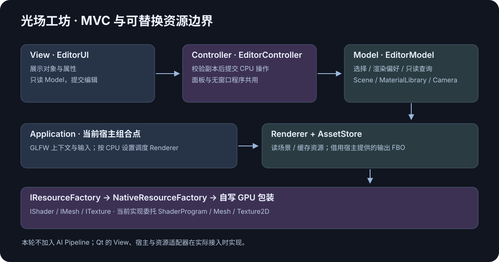
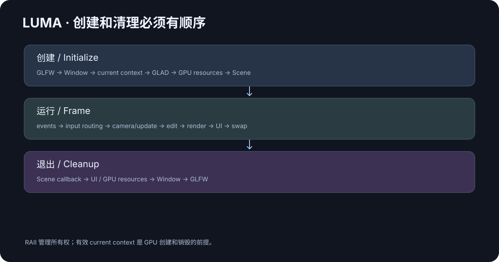
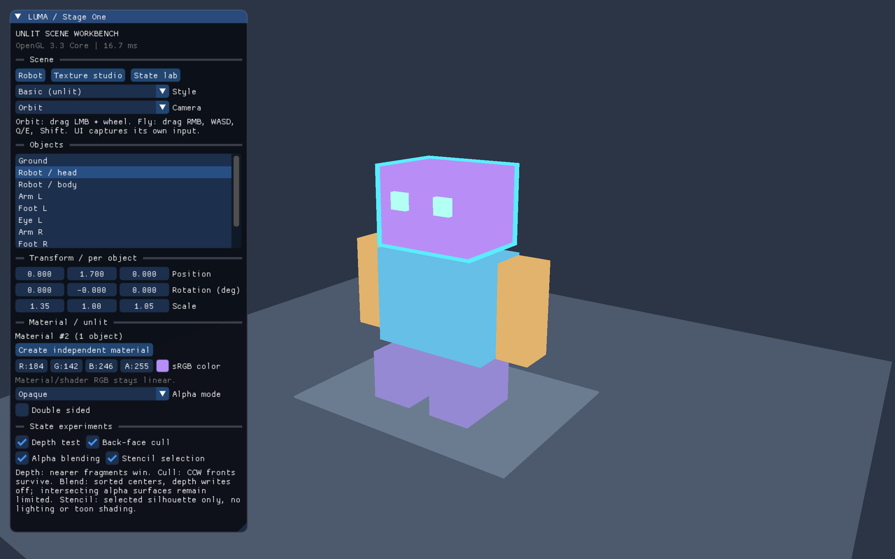

+++
date = '2026-10-19T20:00:00+08:00'
draft = false
title = 'OpenGL 项目实战（一）：从练习代码到可复用工作台'
description = '完成现代 OpenGL 第一阶段后，怎样把窗口、着色器、纹理、矩阵和相机连接成一款持续成长的软件？本文用光场工坊的真实 C++17 工程讲解 Application、SceneLayer 和资源层的职责、运行顺序、错误清理以及扩展边界。附本地构建、运行与测试命令，帮助你复用现有知识增加自己的场景。'
toc = true
tags = ['OpenGL', 'C++', 'Software Design']
keywords = ['OpenGL 项目实战', 'OpenGL 模块封装', 'C++ 渲染器架构', 'GLFW 生命周期', 'SceneLayer 场景', 'OpenGL 第一阶段项目']
[[params.faqItems]]
question = '学完 OpenGL 第一阶段可以做什么项目？'
answer = '可以做可编辑的基础 3D 工作台，使用程序几何、纹理、MVP、相机与状态测试。后续逐步加入光照、模型、阴影和后期效果。'
[[params.faqItems]]
question = 'Qt 和 GLFW 入口如何共存？'
answer = '原 GLFW 入口继续用于学习，Qt6 软件界面已经接入。两者共享 CPU 场景、控制器和自有 OpenGL 资源封装。'
[[params.faqItems]]
question = 'RAII 为什么还需要规定资源释放顺序？'
answer = 'GPU 包装对象析构会调用 OpenGL，因此仍需要有效的当前上下文。资源对象必须在窗口和上下文销毁前释放。'
+++



学完窗口、纹理和相机之后，做 OpenGL 项目实战最有价值的一步，是把这些知识连成一个能持续增加功能的软件。光场工坊选择“可编辑的 3D 场景工作台”：第一阶段放物体、换纹理、调变换、控制视角；后续学习的光照、模型、阴影和 PBR 都进入同一个项目。

这里推荐先固定两件事：**每一层负责什么，以及资源在什么时候存在。** 当这两个问题有了明确答案，新建场景就不必再复制 GLFW 初始化、shader 编译和缓冲上传。

本文对应工程的第一阶段基础能力。可交互的 [HTML 产品原型](../../index.html) 表达软件后续的视觉方向；[C++ 工程](../../native/README.md) 才是本系列复现和学习的对象。原型的二次元、霓虹和写实效果包含后续知识，不算当前原生版本已经掌握的算法。

## 先让一个版本形成完整使用流程

第一版的任务是：启动工作台，选择一个物体，修改颜色、位置或尺寸，切换线框检查结构，再用相机观察结果。状态实验还可以分别比较深度、模板、混合和剔除，看到课本规则对画面的实际影响。

这条流程只需要第一阶段的核心知识。它同时给后续功能留出了自然位置：基础立方体可以换成导入的模型，Unlit 材质可以换成带光照的材质，直接绘制可以扩展为离屏 Pass。

| 当前工作台动作 | 已学知识 | 后续可以增加的能力 |
| --- | --- | --- |
| 创建几个物体 | VAO、VBO、EBO | 模型导入、实例化 |
| 修改位置和尺寸 | GLM、MVP | 层级变换、动画 |
| 换颜色或纹理 | uniform、Texture2D | 材质贴图、PBR |
| 旋转和漫游 | View、Projection、输入 | 多视口、相机预设 |
| 比较遮挡与透明 | 深度、模板、混合、剔除 | 阴影、离屏后期 |

使用范围也要确定。这个版本采用单窗口、主线程渲染和基础场景容器，适合学习、材质观察和小型场景搭建。大型世界流式加载、多窗口资源共享和完整跨图形 API 引擎需要更多约束，不能直接套用当前所有实现。

## OpenGL 模块封装从调用端开始

先看使用者真正需要什么。新增场景应该能实现 `onCreate()` 放置内容，实现 `onUpdate()` 更新运动，再交给 `Application::run()`。场景长期保存实体 ID 和自己的数值状态；窗口与 GPU handle 由公共层管理。

这个入口借鉴 Qt 的生命周期组织思路。Qt 的 `initializeGL / resizeGL / paintGL` 各有明确调用时机，且这些回调执行时上下文已成为 current。光场工坊采用自己的 `Application / SceneLayer`，继续使用 GLFW。Qt 的机制说明可见 [QOpenGLWidget 官方文档](https://doc.qt.io/qt-6/qopenglwidget.html)。

本项目的外层结构是：

```text
Application
  ├─ GlfwRuntime / GlfwWindow   宿主与当前上下文
  ├─ InputSnapshot              输入快照与 UI 路由
  ├─ SceneLayer                具体场景的创建和更新
  ├─ AssetStore / Scene        资源、物体与材质数据
  ├─ EditorModel / Controller   只读编辑视图与统一操作入口
  ├─ NativeResourceFactory      选择自写 GPU 资源实现
  ├─ Renderer                   从场景提交绘制
  └─ EditorUI                   读取模型，通过控制器提交编辑
```

这里的 `Application` 是组合入口。它知道如何按顺序组织模块，却不生成立方体、不解码图片，也不在一个大函数里处理所有 shader 参数。把它放在 `app` 目录，低层窗口模块就不会反向依赖整个渲染器。

另一条边界同样关键：`gfx` 里的 Mesh 不知道 Scene 和 EditorUI。它拿到顶点与索引，上传数据，按约定绘制。具体物体用哪个模型矩阵、什么材质、属于哪个场景，由上层决定。

完整接口可以从 [Application.hpp](../../native/include/luma/app/Application.hpp) 和 [SceneLayer.hpp](../../native/include/luma/app/SceneLayer.hpp) 开始阅读，再与 [公共接口说明](../../docs/api-contract.md) 对照。后者解释语义，头文件给出实际签名。

## 生命周期决定资源封装是否可靠



CPU 对象和 GPU 对象的创建条件不同。一个保存位置与投影参数的 Camera 可以先构造；调用 `glCreateProgram`、`glGenBuffers` 或上传纹理，则需要有效的当前上下文，且函数入口已经加载。

[GLFW 的上下文指南](https://www.glfw.org/docs/3.4/context_guide.html) 明确要求调用 OpenGL 前拥有 current context。因此启动流程需要依次完成窗口创建、makeCurrent、GLAD 加载，再创建 GPU 资源。即使某个系统偶然没有立即报错，也不应该依赖错误顺序。

退出时先释放依赖上下文的资源，再销毁窗口。RAII 管理“谁负责释放”，应用结构管理“释放时上下文是否仍然有效”。它们共同成立，才构成可靠的资源生命周期。

### 初始化失败也有生命周期

假设顶点 shader 编译成功，片元 shader 失败。这时还没有形成完整 ShaderProgram，但顶点 shader 已经是需要清理的资源。资源工厂必须处理这个中间状态，输出带文件名和阶段的日志，再把错误传回应用入口。

场景创建也可能中途失败，例如几个物体已经加入，下一张图片不存在。已经构造好的资源仍由容器和 RAII 清理；`onCreate()` 没有完成时，不应假定场景已经进入正常运行状态。

这比在所有错误分支里手工添加一串 `glDelete*` 更容易维持正确性。代价是要明确所有权，并限制 GPU 对象跨上下文、跨线程的随意流动。当前项目选择主线程渲染来降低这部分复杂度。

### 相机比例与视口都使用像素尺寸

窗口逻辑宽高与 framebuffer 像素宽高在高分辨率显示器上可能不同。用于 `glViewport` 的是像素尺寸，投影 aspect 也必须对应实际渲染区域。[GLFW framebuffer size 说明](https://www.glfw.org/docs/3.4/window_guide.html#window_fbsize) 专门区分了这两种尺寸。

窗口最小化时宽或高可能变成零。此时仍应继续处理事件，暂停绘制和尺寸相关计算。直接做 `width / height` 会把原本普通的窗口状态变成投影矩阵错误。

这也是把尺寸处理放在公共层的理由。每个场景都自行设置 viewport，很容易出现某个场景忘了更新，或者在一个例子中重复缩放两次。

## 一帧中，输入、编辑和绘制各做一次自己的工作

一帧的主要顺序是：处理窗口事件，构建输入快照，确定 UI 是否消费输入，更新相机与场景，通过控制器编辑 CPU 参数，绘制场景，绘制 UI，交换缓冲。

这样的顺序让属性面板的修改可以进入当前画面。它还防止输入行为交叉：拖动颜色滑杆时不应同时转动相机，输入名称时也不应触发 WASD。

UI 接入使用 Dear ImGui 的 GLFW + OpenGL3 后端。它的官方接入指南要求根据 `WantCaptureMouse / WantCaptureKeyboard` 决定应用是否继续消费对应输入，见 [Getting Started](https://github.com/ocornut/imgui/wiki/Getting-Started)。项目把这部分依赖放在 editor 层，场景和 Camera 不包含 ImGui 控件调用。

输入快照还承担一个容易遗漏的细节：失焦时释放按键和拖拽。假设按住 W 后切到别的应用，原窗口可能收不到通常的释放过程；回来后继续前进就会表现得像相机出了问题，实际缺失的是输入清理。

更新使用秒作为时间单位。键盘速度乘 delta，鼠标位移已经是本帧的距离，不再重复乘 delta。长时间暂停后回来时限制模拟步长，避免物体突然跳过一大段运动。

## OpenGL 项目目录应该反映依赖方向

源码按职责放在 `include/luma` 与 `src` 下，具体实现和接口对应。建议按以下顺序阅读，而不是从第三方目录开始：

| 阅读位置 | 需要回答的问题 |
| --- | --- |
| `app/Application` | 谁控制整个程序和退出顺序？ |
| `core/GlfwWindow` | current context 在哪里建立？ |
| `gfx/ShaderProgram`、`Mesh`、`Texture2D` | GPU 对象由谁持有？ |
| `scene/Scene`、`MaterialLibrary`、`AssetStore` | CPU 数据和 GPU 资源怎样分别复用？ |
| `editor/EditorModel`、`EditorController` | 面板与无窗口程序怎样使用同一操作？ |
| `render/Renderer` | 何时设置状态并发出绘制？ |
| `editor/EditorUI` | UI 怎样提交操作，并避开输入冲突？ |

第三方依赖固定来源和版本。工程保留 GLAD 2、GLM 1.0.1、Dear ImGui 1.91.9b 与固定提交的 stb_image。GLFW 优先查找本地安装，缺失时使用固定 3.4 回退，不在每次构建时追随最新版。

GLAD 的生成头、加载入口和教程写法必须一致。本工程使用 GLAD 2 的 `glad/gl.h` 系列。遇到网络文章里的 `glad/glad.h` 和 `gladLoadGLLoader`，先检查它属于哪个生成版本，再决定是否能直接复制。[GLAD 官方仓库](https://github.com/Dav1dde/glad) 是确认版本与生成方式的依据。

## 编译与运行这一版

以下命令在工作区根目录执行。第一次构建需要 C++17 编译器和 CMake；GLFW 没有安装时，CMake 回退下载还需要网络。

```bash
cmake -S opengl_visual_workbench/native -B opengl_visual_workbench/native/build -DCMAKE_BUILD_TYPE=Debug
cmake --build opengl_visual_workbench/native/build -j 4
ctest --test-dir opengl_visual_workbench/native/build --output-on-failure
./opengl_visual_workbench/native/build/bin/luma_workbench --help
./opengl_visual_workbench/native/build/bin/luma_workbench
```

图形程序与纯 CPU 测试的环境要求不同。CPU 数学、几何和场景行为可以不创建窗口；真实 GL 测试需要操作系统图形会话。命令的实际结果、平台和已验证范围集中保存在 [原生验证记录](../../native/tests/verification.md)，阅读时以记录为准。

对工程做了修改后，至少重建目标并运行相关测试。只看到窗口出现，不能证明纹理、状态切换和退出路径都正确；只看到 CPU 测试通过，也不能证明驱动成功编译了 GLSL。

## 什么时候应该增加一个抽象

当两个真实场景重复初始化代码时，提取运行层很有价值；当同一份几何被多个物体引用时，AssetStore 和资源 ID 解决了实际问题；当同一场景需要不同绘制风格时，管线策略才有明确消费者。

相比之下，第一版还不需要通用消息总线、脚本反射和完整插件系统。每增加一个抽象，读者就要再理解一组生命周期和接口；如果它暂时没有使用场景，这笔成本会直接压在学习过程上。

后续画风也按这个原则增长。Basic 和 Wireframe 服务当前任务，学习光照后增加 Phong / Toon，学习 FBO 后增加后期与拾取。为了将来可能支持的 API，现在不必先重写一个通用图形设备层。

本篇可以带走的检查方法只有三个问题：**谁拥有资源、谁决定调用顺序、下一个场景还需要复制哪些代码。** 如果新增场景仍然复制一大段窗口和缓冲代码，就回到这些边界上继续收拢。

继续阅读 [第二篇：GPU 资源封装](../02-gpu-resources/index.zh.md)，看 Shader、Mesh 与 Texture 怎样变成可复用对象；再读 [第三篇：场景与相机](../03-scene-and-camera/index.zh.md)，把它们组合成可编辑内容。整体演进对应 [实现里程碑](../../docs/milestones.md)。

## 原生画面与本次实际运行



这张图来自 C++ 程序的 framebuffer 读回，包含 Dear ImGui 面板，尺寸为 2560 × 1600。它展示程序几何、颜色、MVP、深度遮挡和模板选择轮廓；没有灯光明暗，头部的青色边框是选中反馈。和产品原型比较时，先比较工作流程是否成立：对象能否独立编辑、资源是否复用、相机是否能观察场景，然后再按课程增加视觉算法。

本机真实运行报告为 `OpenGL 4.1 Metal - 89.4`，深度位数 32、模板位数 8，默认输出需要手动 sRGB 编码。工程只使用基础 3.3 能力；驱动返回较高版本不代表代码用了较高版本功能。不能把“请求了 3.3”写成实际运行版本，也不能仅根据窗口请求的色彩提示推测附件编码。

生命周期集成测试分别让 `onCreate / onUpdate / onDestroy` 抛出异常，然后检查程序返回值和回调次数。其输出里的 `deliberate ... failure` 是预期注入的错误；最终 `PASS lifecycle` 才说明错误被按约定处理。这个测试有意义的原因在于，它检查公开行为，而非照着实现判断某个私有变量是否等于一。

实际验证还有一个环境边界：沙箱内启动曾在 AppKit 初始化时停住，尚未进入 OpenGL 断言。同一个可执行文件在可用图形会话下才能执行像素测试。因此记录把“没有到达测试”和“测试断言失败”分开，避免为了让日志看起来好看而误判算法。

## 添加第四个场景时，具体复用哪些步骤

以“桌面摆件展示台”为例，可以沿着这条路径实现自己的内容。先复制 [独立场景示例](../../native/examples/reusable_scene.cpp) 的入口文件，保留 `Application` 和 `SceneLayer`，修改场景类名。创建时向 AssetStore 请求一个立方体和一个平面，再创建各自材质；这两种几何会经过同一套 CPU 生成和 GPU 缓存。随后调用 `Scene::create` 得到实体 ID，设置位置和缩放，最后设置相机看向展示台。

如果想让摆件转动，只在 `onUpdate` 更新那一个实体的四元数。如果想让用户用面板旋转，就不要每帧覆盖它的旋转。本项目默认工作台保持静止，专用的 camera 学习例子才自动旋转，这样同一份 Transform 不会被“用户编辑”和“演示动画”同时争抢。

新增场景不需要知道 VAO 的数字、不需要重新注册 GLFW 回调、不需要拷贝纹理解码函数。遇到纹理加载失败时，沿资源层日志定位路径；物体位置错误时，沿实体 ID 检查 Transform；画面全空时，再检查相机、shader 和状态。分层的实际收益，是把问题缩小到能独立验证的一段链路。

独立场景可以先连接已有 `luma_app` 目标。当前 CMake 已把 `luma_reuse_example` 这样构建出来，运行它就能确认复用接口是真实的编译依赖，而非文章里看起来优雅的伪代码。若以后把模块带到另一个目录，需要一起保留头文件、库目标与 shader / 图片资产；当前资产路径在配置时绑定到源码目录，还没有二进制安装包的资产查找器。

## MVC 要让第二个调用方真正用起来

光场工坊现在把编辑分成三份责任：EditorModel 提供场景、材质、相机的只读查询，保存选择与渲染偏好；EditorController 接受编辑，先验证再提交；EditorUI 负责控件展示，把用户输入交给控制器。

这条边界的证据是 [controller_example.cpp](../../native/examples/controller_example.cpp)。它不创建窗口，直接构造 CPU 场景与材质仓库，再用与面板相同的控制器选择对象、修改变换、克隆和编辑材质。运行入口是 `luma_controller_example`，链接 CPU 模块；如果这个例子也需要 GLFW 或 shader，说明编辑逻辑仍然没有拆干净。

原来的 SceneLayer 仍适合创建与更新业务场景。它负责“有哪些物体，如何运动”；控制器负责“用户或外部程序正在执行哪项编辑”。两者可以共用 CPU 数据，但属性的控制来源仍需明确：动画每帧重设旋转时，面板编辑也会被后续动画覆盖。MVC 分工不会自动解决动画和编辑的优先级。

这里选择直接函数调用，暂时没有事件总线、通用命令队列或 AI 节点图。选择、变换和材质已经有真实消费者，先把这些操作做到可测试、可复用，后续撤销或后台任务才有可靠的接入位置。控制器的实现见 [EditorController.hpp](../../native/include/luma/editor/EditorController.hpp)，共享数据入口见 [EditorModel.hpp](../../native/include/luma/editor/EditorModel.hpp)。

## Qt 宿主已经接入：同一 MVC 如何换 View

现在的 Qt 版本由 `WorkbenchWindow` 和 `QtViewport` 实现。View 调用同一个 EditorController，CPU 数据与编辑规则继续复用；Qt 的回调管理 current context。Qt 版本没有套 GLFW 循环，也没有假定输出 FBO 编号为零；每次 paintGL 都把实际 `defaultFramebufferObject()`、DPI 后像素尺寸和输出编码能力交给 Renderer。这个边界让 Qt 只替换宿主，不迫使场景重写。

资源包装另有一条替换路径：AssetStore 和 Renderer 通过 IResourceFactory 创建 IShader / IMesh / ITexture，当前注入 NativeResourceFactory，内部仍用自己的 ShaderProgram / Mesh / Texture2D。如果以后使用 Qt 的 Shader / Buffer 包装，只需在组合点替换工厂即可保持调用端契约。当前 Qt 界面已经运行，但 QtResourceFactory 仍未实现。

另一个容易低估的变化是多窗口。当前 `GlfwRuntime` 只有一个所有者，GPU 资源假定在创建它们的上下文中使用；把一个 `MeshId` 发到另一个窗口，不会自动完成资源共享。要支持多窗口，应先定义 share group 与上下文切换规则，再考虑哪些容器能共享。现在明确这个边界，比加入一个没有真实消费者的全局资源单例更容易扩展。

最后是分发与保存。运行时实体 ID 适合当前会话中的对象选择，适合长期保存的则是资产路径、稳定标识与材质参数。后续工程存档不能直接把 GPU handle 或内存引用写入文件；这些东西只在本次运行有效。第一阶段把资源与实例分开，正是为了让后续序列化有可以落脚的数据层。

## 常见问题

**这些封装会妨碍理解 OpenGL 吗？** 会不会妨碍，取决于能否顺着调用找到真实 API。本工程保留独立资源实现和 shader 文件，文章追踪从入口到 draw 的链路。调用方便与底层可读可以同时做到。

**以后改用 Qt，需要重写渲染器吗？** 当前渲染器读取宿主提供的目标和资源契约；Model / Controller、场景与算法可以继续使用。仍要编写 Qt 宿主、输入和资源适配，验证上下文、附件及释放顺序，当前 Qt 宿主已运行；尚未实现的是 QtResourceFactory、第二阶段渲染与打包。

**为什么不直接把最终 Demo 的所有特效移植过来？** 这一系列围绕已学知识建立可复现的进度。高级特效需要各自的资源、Pass 和验证；把它们全部塞进第一篇，会让读者能启动程序却解释不清画面如何产生。
