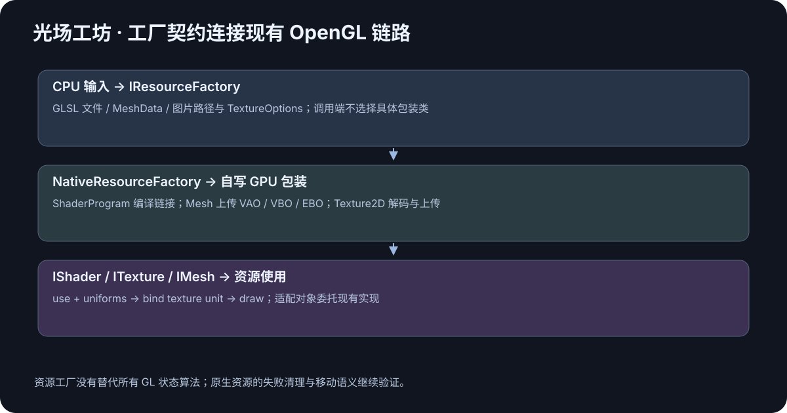
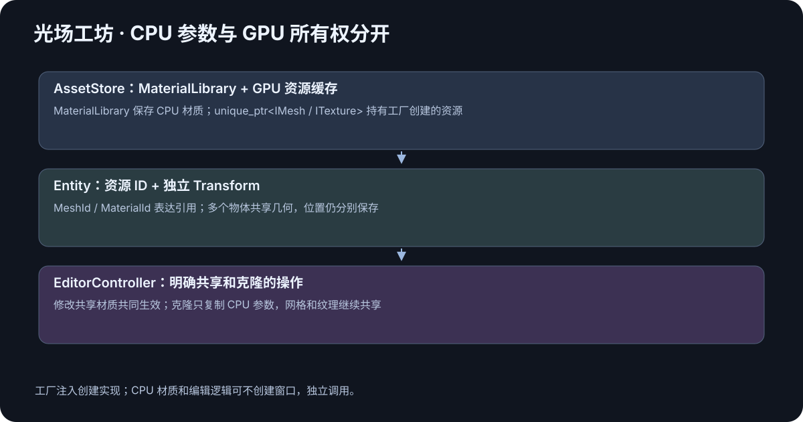
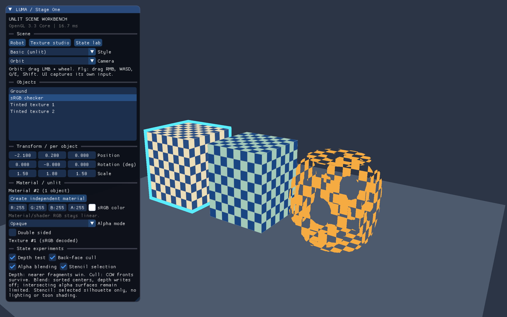

+++
date = '2026-10-19T20:05:00+08:00'
draft = false
title = 'OpenGL 项目实战（二）：封装 Shader、Mesh 和 Texture'
description = '用同一套 C++17 资源类连接 GLSL 文件、顶点与索引、图片解码和真实 OpenGL 绘制。本文说明 ShaderProgram、Mesh、Texture2D 的 RAII 所有权、移动语义、uniform 缓存、纹理单元与色彩空间，并给出失败清理、资源复用、几何检查和驱动验证方法，帮助你把三角形例子改造成能持续使用的模块。'
toc = true
tags = ['OpenGL', 'C++', 'RAII']
keywords = ['OpenGL 资源封装', 'ShaderProgram 封装', 'VAO VBO EBO Mesh', 'Texture2D 纹理', 'C++ RAII OpenGL', 'OpenGL 纹理单元']
[[params.faqItems]]
question = 'Shader、Mesh 和 Material 应该合成一个类吗？'
answer = '本项目分别管理程序、几何和材质参数，再由 Renderer 组合。相同网格因此可以服务不同物体和材质。'
[[params.faqItems]]
question = '为什么 OpenGL 资源类禁止复制？'
answer = '复制整数 handle 不会复制 GPU 资源，会使多个析构函数误以为自己拥有相同对象。项目使用 move-only 包装和资源 ID 共享。'
[[params.faqItems]]
question = '绑定纹理与设置 sampler uniform 有什么区别？'
answer = '绑定纹理把对象放到某个纹理单元，sampler uniform 选择着色器从哪个单元采样。两个步骤都需要正确设置。'
+++



OpenGL 资源封装真正要解决的问题，是让一份 GLSL、一个网格和一张图片能被可靠地创建、引用、使用和释放。把 `glGenBuffers` 放进类里只是开始；错误发生后留下了什么、对象移动后谁还拥有资源、场景切换能否复用，决定了这些类以后是否好用。

[第一篇](../01-workbench-architecture/index.zh.md) 固定了上下文与应用的生命周期。本篇进入 `ShaderProgram / Mesh / Texture2D`，再通过 AssetStore 把资源交给场景。当前调用端使用稳定的资源契约，NativeResourceFactory 在内部委托这些自写类。完整实现位于 [gfx 源码目录](../../native/src/gfx)，对应声明在 [gfx 头文件目录](../../native/include/luma/gfx)。

## 先划分“资源”和“使用资源的物体”

一个立方体的顶点数据，不应该因为场景里出现十个立方体就上传十份。它们可以使用同一个 Mesh，各自保存位置、旋转和缩放。材质也可以共享，但共享意味着修改参数会共同生效，应该由调用者明确选择。

因此 Mesh 保存几何，ShaderProgram 保存程序，Texture2D 保存采样资源，MaterialDesc 保存 CPU 材质参数。Renderer 在绘制某个实例时把它们组合起来，给 shader 设置对应矩阵与材质，再调用 Mesh::draw。



| 类型 | 它拥有的内容 | 不应该顺手装进去的内容 |
| --- | --- | --- |
| ShaderProgram | program、uniform location 缓存 | 某个物体的位置、场景灯光列表 |
| Mesh | VAO、VBO、EBO、索引数量 | 相机、物体名称、文件对话框 |
| Texture2D | 纹理对象和采样配置 | 选中对象、材质面板状态 |
| MaterialDesc | 基础颜色、纹理引用、透明规则 | GLFW 窗口与 GPU 缓冲 |
| MaterialLibrary | CPU 材质参数与编号 | 创建 GPU 对象 |
| AssetStore | 工厂生成的网格、纹理缓存与材质仓库入口 | 控件绘制和相机移动 |

这种拆分也有代价：提交绘制时需要查询资源。小型工作台的首版选择清楚的 ID 和容器，不提前加入复杂的锁、后台上传和资源卸载。以后出现真实瓶颈，再根据测量调整。

## ShaderProgram：先保证失败能被解释

创建 program 的完整过程是读取两个文件、分别创建和编译 shader、查询编译状态、创建 program、attach、link、查询链接状态、释放不再需要的 shader 对象。最终保留 program；任一步失败都携带文件路径和阶段信息向外报告。

这里不能只检查链接结果。如果顶点 shader 成功而片元 shader 失败，顶点 shader 仍需要释放。直接抛异常而忘记它，会把成功路径看起来很整洁的封装变成失败路径泄漏。[ShaderProgram.cpp](../../native/src/gfx/ShaderProgram.cpp) 展示完整创建和清理链路。

uniform location 缓存在每个 program 自己的映射里，因为位置属于具体程序。相同名字在另一个 program 中不保证有相同位置。重新链接程序时也不能沿用旧位置；当前版本没有热重载，所以缓存随 program 生命周期结束。

### 必需参数不能悄悄失效

`uModel` 拼错和“某个参数在这个画风里不需要”是两种情况。对必需 uniform，查询不到应报告错误；真正可选的参数才采用明确的可选处理。把所有 `-1` 都忽略，会让原本能在 CPU 侧定位的拼写问题变成画面不对。

本项目 `set()` 确保对应 program 已绑定，使用时更直接。它会带来一些重复绑定开销；在第一版里，可靠性和阅读成本比省掉少量状态设置更重要。以后优化也应保留这一语义，不能要求旧调用者突然记住一个隐含前提。

顶点与片元 shader 仍是单独 GLSL 文件。读者可以直接观察 `projection * view * model * position` 和纹理采样，而不必在一段 C++ 字符串拼接中寻找入口。关于 shader 和 program 的规则，可核对 [Khronos Shader Compilation](https://wikis.khronos.org/opengl/Shader_Compilation)。

## Mesh：CPU 几何与 GPU 上传分开

`MeshData` 保存顶点和索引，`PrimitiveFactory` 产生立方体、平面和三角形，`Mesh::upload()` 才创建 VAO、VBO 与 EBO。这个分界能让几何测试不依赖窗口，也让之后的 Assimp 结果进入同一种上传路径。

顶点布局使用 `sizeof(Vertex)` 和 `offsetof`，避免手算字节偏移。位置、法线、UV 和颜色有固定 location；索引使用 uint32。属性的 location、分量数量、类型、stride 和 offset 必须与 GLSL 输入约定一致。

VAO 记录顶点输入状态。尤其是 EBO 绑定属于 VAO 状态，绑定或解绑顺序随意改动，可能让上传正确的数据在绘制时消失。OpenGL 规则可查 [Khronos Vertex Specification](https://www.khronos.org/opengl/wiki/Vertex_Specification)。

### 能上传，不代表几何就正确

CPU 侧先验证网格非空、索引范围合法、三角形索引数量合理和最终 draw 数量能被 GLsizei 表示。顶点数据中的非有限值也应尽早发现，避免把 NaN 当成“GPU 渲染故障”。

绕序还需要独立检查。对三个顶点 a、b、c，叉积 `(b-a) × (c-a)` 给出几何方向。它与设计法线的点积应该为正；平面向上却使用向下绕序时，开启背面剔除就会让地面消失。

现有 HTML 原型就经历过平面和球体绕序错误，几何回归测试是实际问题带来的检查。本轮原生代码也验证基础图元的绕序与法线一致。测试目的不是规定某组顶点必须保持原样，而是保证换了生成方式后朝向仍然正确。

Mesh::draw 不决定 MVP。一个 Mesh 被两个实体使用时，Renderer 分别上传两个模型矩阵再绘制；如果把 model 塞进 Mesh，资源共享就会和实例行为纠缠在一起。这一点会在 [第三篇](../03-scene-and-camera/index.zh.md) 用可编辑物体展示。

## Texture2D：从文件到 sampler 的链路不能断

纹理路径分为两段：CPU 解码得到 ImageData，GPU 上传创建 Texture2D。stb_image 负责图片格式，OpenGL 负责纹理对象和采样行为。解码失败时输出路径与失败原因，成功上传后释放不再需要的 CPU 像素。

首版统一解码为 RGBA8，简化上传布局。Y 翻转在本次图片数据上局部完成，不用一个全局开关影响所有加载请求。这样后续增加不同来源的图片或工作线程时，加载选项不会互相覆盖。[stb_image 官方源码](https://github.com/nothings/stb/blob/f0569113c93ad095470c54bf34a17b36646bbbb5/stb_image.h) 给出了加载接口与返回数据的约定。

上传时还需要设置内部格式、wrap、min/mag filter 与 mipmap。min filter 使用 mipmap 采样时就要生成 mipmap；mag filter 只有 nearest / linear，不能把带 mipmap 的过滤枚举直接套进去。

### 纹理单元与 sampler 是两步

纹理对象是存储与采样配置；纹理单元是绘制时的绑定位置；sampler uniform 选择读取哪一个单元。绑定到单元 0，并不会自动把 shader 中所有 sampler 都设置为 0。

Renderer 因此要同时绑定材质纹理并设置 sampler。Texture2D::bind 负责单元绑定，不去猜 shader 里参数的名字。资源类不知道具体材质，是它能被不同程序复用的原因。

实际代码入口是 [Texture2D.hpp](../../native/include/luma/gfx/Texture2D.hpp) 与 [Texture2D.cpp](../../native/src/gfx/Texture2D.cpp)。阅读顺序可以是 TextureOptions::validate、ImageData::decode、Texture2D::fromFile，最后看 bind。

### 颜色空间必须和缓存一起设计

颜色贴图标记为 sRGB，让采样进入线性空间；法线、粗糙度等数据贴图需要保留数值语义。首版虽然只有基础颜色贴图，加载配置仍把色彩空间显式写出来。

同一个路径按 sRGB 与 Linear 加载，含义并不相同。因此缓存 key 除了规范化路径，还包含 flipY、wrap、filter、mipmap 和色彩空间。只按文件名缓存，会让后一次请求意外拿到前一次的采样结果。

最终显示只编码一次：目标附件支持 sRGB 时使用硬件编码，否则最后输出阶段手动处理。未来 FBO 中间结果保持线性，不应因为它也是一张“纹理”就在中间偷偷编码。

## RAII 与移动语义说明谁能删除资源

GLuint 是整数，但资源身份与所有权不是普通整数语义。复制 handle 并不会复制 GPU 内的数据，如果两个包装对象都在析构中删除它，就会出现重复所有者。

本工程的 GPU 包装对象禁止复制，支持 `noexcept` 移动。移动构造转移 handle，源对象归零；移动赋值先释放目标原有资源，再接管新资源；空对象析构不做删除。容器因此可以拥有资源，场景通过 ID 共享引用。

检验移动也不能只看“代码可以编译”。真实 GL 测试可以检查移动后对象的名称、源对象的空状态，以及销毁后的 GL 对象存在性。复制被禁止则属于编译期约束，两种证据分别说明不同问题。

RAII 仍有边界。析构会调用 GL，就需要有效的 current context；不能把资源放进任意全局静态变量后，指望应用结束时操作系统替你排好顺序。上下文规则与 [第一篇的生命周期](../01-workbench-architecture/index.zh.md) 要一起阅读。

## 用三组结果验证资源封装

第一组是正向绘制：彩色三角形、索引矩形与带纹理的物体都使用同一套资源模块。画面能证明数据、shader 和提交链路在实际驱动上接通。

第二组是有明确原因的失败：无效 GLSL、缺失图片、越界索引、错误采样配置和必需 uniform 缺失。记录应包含文件、阶段或参数名，不能只有一个“初始化失败”。

第三组是共享与生命周期：重复获取 primitive 命中同一个缓存项，不同纹理选项不误用缓存；移动和销毁只由一个所有者执行；退出时资源在 context 之前清理。

CPU 检查通过下列命令运行：

```bash
cmake --build opengl_visual_workbench/native/build -j 4
ctest --test-dir opengl_visual_workbench/native/build --output-on-failure
```

真实 GL 验证的可执行入口、运行环境与结果见 [原生验证记录](../../native/tests/verification.md)。其中的负例预期会输出诊断；判定标准是它被测试明确捕获，而不是要求测试过程完全没有文字日志。

## 把这些资源带进下一个场景

现在可以用一条链路描述绘制：场景引用 MeshId 和 MaterialId，Renderer 查询网格与材质，选 program，上传相机和模型矩阵，绑定纹理单元，再发出 draw。每一段都能找到负责的类。

后续增加模型导入时，导入器产生 MeshData 和材质参数；增加光照时，扩展材质与 shader；增加后期时，引入 RenderTarget 与 Pass。资源类的所有权与错误规则可以继续使用，调用者不必把窗口与缓冲逻辑重新复制一遍。

完整共享语义与 API 约定见 [公共接口说明](../../docs/api-contract.md)。继续阅读 [第三篇：场景、变换和相机](../03-scene-and-camera/index.zh.md)，把这些模块组合成真正可操作的工作台。

## 把一次纹理绘制逐项追到 GPU



从 Texture studio 的一个方块开始：`Presets.cpp` 请求图片路径和 TextureOptions，AssetStore 规范化路径并组成缓存键；首次请求经 NativeResourceFactory 进入 ImageData 解码，得到 RGBA8 像素；Texture2D 再申请 GL 对象、设置上传对齐和采样参数，最后按选项生成 mipmap。缓存返回 TextureId，MaterialDesc 保存该 ID，实体仅持有 MaterialId。

进入 Renderer 后，材质中的 TextureId 被查成 ITexture 接口；当前原生适配对象委托 Texture2D，绑定到约定纹理单元。ShaderProgram 的 sampler uniform 接收单元编号，其他 uniform 接收对象矩阵、观察投影矩阵、颜色和透明规则。Mesh::draw 绑定 VAO，以索引数量发出 draw。片元 shader 将采样结果与材质颜色相乘，Mask 根据阈值丢弃片元；Blend 交给对应的绘制队列与混合状态处理。

这条链路上的每一步都有可见的故障表现。路径错了应该在解码阶段报错；纹理单元设错可能采样到另一张图片；顶点属性偏移错了可能让 UV 跳到无关数据；mipmap 规则不一致可能使纹理不完整；最后重复做 sRGB 编码会使颜色明显变浅。把它们全部归为“贴图没显示”并不断改 shader，排查范围会越来越大。

## 三组失败案例怎样定位

**第一组：画出物体但纹理方向反了。** 先看图片坐标和几何 UV 的约定，再检查本次加载的 flipY。项目在解码结果上按选项处理行顺序，避免修改 stb 的全局翻转开关。使用同一张图的两个材质，如果一个需要翻转、另一个不需要，它们必须成为不同缓存项；路径相同并不足以证明最终 GPU 结果相同。

**第二组：一切正常，移动赋值后才出问题。** 假设 `a` 和 `b` 原本各有一个纹理，执行 `a = std::move(b)` 时，先删除 `a` 的旧对象，再接管 `b` 的 handle，最后把 `b` 清空。只实现移动构造而忘记移动赋值，就可能泄漏被替换的对象；只复制数字而不清空源，会让后续析构重复删除。真实 GL 测试通过对象存活查询检查这两个方向，不能靠“窗口暂时没崩”判断所有权正确。

**第三组：颜色单独看对，透明叠加却太暗。** sRGB 是显示编码，常规混合需要在线性颜色上进行。当前宿主的默认附件没有可用的硬件 sRGB 编码，所以程序先在内部线性浮点颜色附件完成混合，再由最后的显示 shader 编码一次。半透明白叠加黑底的测试读回约 188，而不是把编码值直接混合得到的约 128。这个内部附件只处理输出正确性，基础工作台没有因此获得 Bloom 或任意后期滤镜接口。

## 如何检查缓存真正复用了资源

先在一个应用中连续请求相同 primitive，比较返回的 MeshId；然后为两个实体使用这一个 ID，但给它们设置不同位置。如果它们都显示出来且变换独立，说明资源共享没有把实例参数也绑在一起。再请求同一路径和相同选项的图片，检查 TextureId 命中；改变色彩空间或翻转选项后，结果应分开。

材质有不同规则：`cloneMaterial` 复制的是 CPU 参数与纹理引用，不是把像素再上传一遍。因此两个材质可以共用同一个 TextureId，同时使用不同颜色、透明模式或双面设置。UI 中“创建独立材质”的效果应是当前对象变成新 MaterialId，而 MeshId 和 TextureId 仍然保持共享。

本次驱动测试已实际运行，输出涵盖资源移动、shader / 图片负例、缓存、材质克隆、状态恢复和深度 / 混合 / 模板像素断言，最后报告没有 GL 错误。不同平台的编译日志措辞可能不同，测试应依赖错误类型、路径与阶段等稳定语义，避免硬编码某一家驱动的整段报错文本。

## 调用端依赖契约，自写包装继续保留

为了以后接入 Qt 的资源类，不能让 AssetStore 容器和 Renderer 成员写死具体 ShaderProgram、Mesh、Texture2D。当前资源边界由 [IResourceFactory.hpp](../../native/include/luma/gfx/IResourceFactory.hpp) 定义：IShader 提供使用程序和类型明确的 uniform 设置，IMesh 提供 draw，ITexture 提供指定单元的绑定；工厂接收文件、MeshData 和纹理选项，返回唯一拥有的资源对象。

[NativeResourceFactory](../../native/include/luma/gfx/NativeResourceFactory.hpp) 的适配对象持有原来的 move-only 类，把 use、set、draw、bind 委托给自写实现。原来的 OpenGL 链路仍可继续向下阅读；增加稳定契约只改变资源的创建与调用边界，不删掉已经学过的 glGen、glBufferData 或 shader 编译代码。

工厂显式传给 AssetStore、Renderer 和 DisplayTransfer。这样不会出现隐藏单例决定后端，也不会只替换场景 shader，却漏掉最后显示编码使用的 program。需要注意的是，RenderState 与 FBO 传输依然是 OpenGL 算法；这层契约服务于包装实现替换，尚未覆盖另一套图形 API。

Qt 接入时可以先继续用这些原生包装，再按需要实现 Qt 工厂。适配器会在内部处理 [QOpenGLShaderProgram](https://doc.qt.io/qt-6/qopenglshaderprogram.html) 和 [QOpenGLBuffer](https://doc.qt.io/qt-6/qopenglbuffer.html) 等对象，保持本项目的矩阵、纹理选项和错误语义。它需要真实实现和运行验收，当前源码没有用空类宣称完成。

### 用替身验证创建边界，用驱动验证 OpenGL

资源接口还有一个眼下就能用的消费者：测试工厂。它记录创建次数与销毁次数，AssetStore 第一次请求基础几何或图片时创建，重复请求应复用；创建抛异常或返回空资源时不能污染缓存，下一次请求还应正常重试。资源仓库退出后，已成功创建的资源应恰好释放一次。

这些行为可以不创建窗口验证，但它们不能证明 shader 编译或纹理上传成功。因此原始包装的真实 GL 移动语义与像素测试仍然保留。两组测试约束不同责任：一组验证依赖注入与缓存，一组验证 OpenGL 实现。具体命令和结果继续保存在 [验证记录](../../native/tests/verification.md)。

## 下一阶段资源接口怎样增长

加入法线贴图时，可以继续使用 Texture2D，但要按线性数据采样，不能套用颜色贴图的 sRGB 解码。加入模型导入时，把 Assimp 的数据转换成 MeshData，而不是让基础 Mesh 包装对象依赖 Assimp 的场景树。加入离屏渲染时，再引入管理 FBO 附件的专用资源类，不让 Texture2D 顺手承担窗口大小和 Pass 调度。

这些扩展共享的是所有权与上传流程，算法仍需要各自实现。已经有 Texture2D 并不等于已经实现天空盒；已有 ShaderProgram 也不等于 PBR 材质成立。保持这条区别，才能用同一套封装复用基础设施，同时清楚看到每个新知识点增加了什么。

## 常见问题

**为什么不让 Mesh 直接调用 shader？** 这样会把几何和具体渲染方法绑定。把组合工作放在 Renderer，同一份网格就能被实体填充、线框和后续阴影 Pass 使用。

**能把所有资源都放进 shared_ptr 吗？** 可以，但引用计数不自动解决上下文销毁时机。本项目由 AssetStore 集中拥有 GPU 资源，ID 表达引用关系，更容易检查退出顺序。

**一个截图足够证明资源层正确吗？** 不够。截图证明某一条正向路径，负例、移动所有权和缓存行为需要各自的检查。反过来，CPU 测试也替代不了实际驱动编译与绘制。
