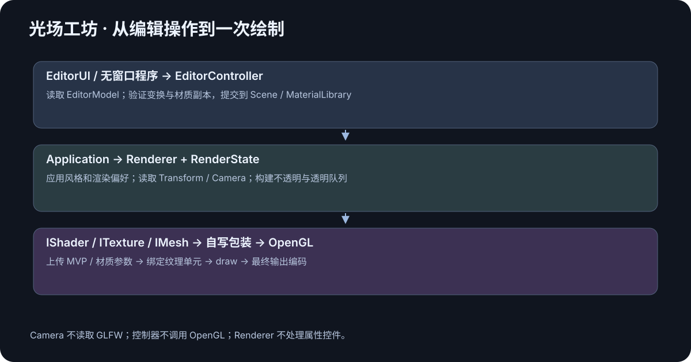
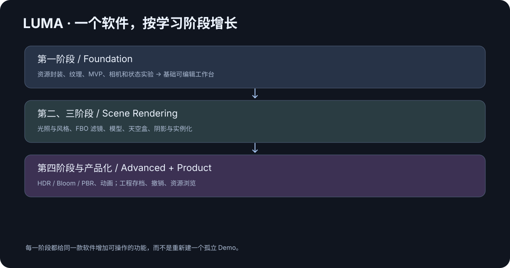
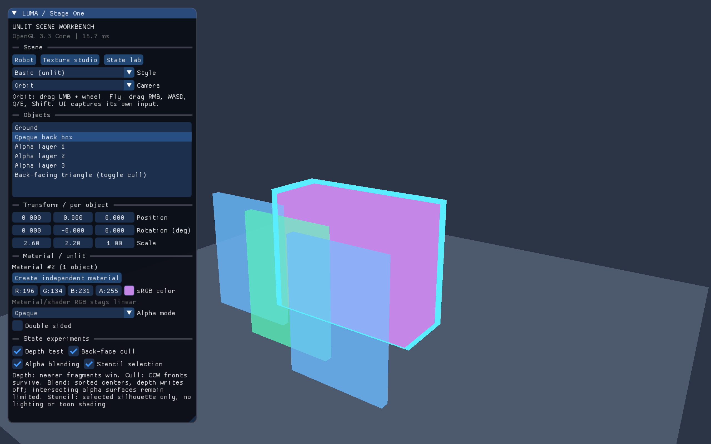

+++
date = '2026-10-19T20:10:00+08:00'
draft = false
title = 'OpenGL 项目实战（三）：让场景类只写物体和交互'
description = '怎样在封装资源后简单地增加一个 3D 场景？本文围绕真实 SceneLayer 示例，连接实体 ID、共享网格、独立材质、TRS 变换、Camera 与输入控制，追踪从场景更新到 GLSL 的完整调用链。结合 Basic、Wireframe 和深度模板混合实验，给出新增场景、交互验收与继续扩展光照模型的具体方法。'
toc = true
tags = ['OpenGL', 'C++', 'Camera']
keywords = ['OpenGL 场景封装', 'SceneLayer 示例', 'GLM MVP 变换', 'OpenGL 相机系统', 'OpenGL 材质共享', 'OpenGL 深度模板混合']
[[params.faqItems]]
question = '多个物体共用一个 Mesh 会共用位置吗？'
answer = '不会。本工程的 Entity 分别拥有 Transform，仅通过 MeshId 共享几何。材质是否共享也由 MaterialId 分别决定。'
[[params.faqItems]]
question = 'Camera 为什么不直接读取 GLFW？'
answer = 'Camera 保存观察和投影数据，CameraControls 消费输入快照。这样相机数学不绑定窗口系统，也能在不创建窗口的测试中验证。'
[[params.faqItems]]
question = '为什么首版没有直接引入 ECS？'
answer = '当前对象规模与组件需求适合简单场景容器。先把资源引用和实例数据分清，再根据实际规模与组合需求决定是否引入 ECS。'
+++



OpenGL 场景封装做得好不好，可以用一个直接的任务检验：增加一个新场景时，需要重新写多少窗口、缓冲和 shader 编译代码？在光场工坊里，新增内容通过 SceneLayer 创建实体和材质、设置相机、更新运动；公共层把这些数据变成实际 draw。

本篇沿着一条完整路径阅读：`onCreate → Scene / AssetStore → onUpdate → Transform / Camera → Renderer → GLSL`。源码入口是 [可编译的复用示例](../../native/examples/reusable_scene.cpp)，它与主工作台链接同一套公共模块，文章不会单独维护一份看起来相似却无法编译的 API。

## Entity、Mesh 和 Material 分别回答什么

Mesh 回答“有哪些顶点和索引”，Material 回答“怎样表达表面参数”，Entity 回答“场景里具体哪一个物体”。同一份立方体几何可以成为多个实体，每个实体有自己的 Transform。

因此一个实体包含名称、Transform、MeshId 和 MaterialId。多个物体引用同一个 MeshId 很常见；引用同一个 MaterialId 则表示它们主动共享材质。编辑颜色是否共同生效，取决于材质引用关系，而不取决于几何是否一样。

工作台提供独立材质操作：克隆选中物体的材质，再把新 MaterialId 设置回该实体。Mesh 仍共享，变换仍独立，材质从此也独立。完整资源所有权规则在 [第二篇](../02-gpu-resources/index.zh.md) 已经说明。

| 想达到的行为 | 应该共享什么 | 应该独立保存什么 |
| --- | --- | --- |
| 同样形状的两个物体 | MeshId | Transform |
| 一组同色物体一起换颜色 | MeshId、MaterialId | Transform |
| 同样形状但分别调颜色 | MeshId | MaterialId、Transform |
| 切换观察方式 | 场景与资源 | Camera / 控制器状态 |

首版 Scene 使用简单容器和强类型 ID。它已经能支持这些行为，暂时不需要为了“以后会复杂”引入完整 ECS。ID 的独立类型还可以防止把 TextureId 意外传给需要 EntityId 的函数。

### 清空场景后，旧引用必须明确失效

场景切换会清空实体。编号在同一 Scene 生命周期内单调分配，不复用已发出的 EntityId，所以旧选择状态不会突然指向一个新物体。

选择由 EditorModel 保存，EditorUI 从模型读取 EntityId，不长期保存容器中 Transform 的引用或 name 的 string_view。控制器在提交前重新确认对象存在；场景清空后调用 reconcileSelection 清理失效选择。即时查询后使用即可；场景容器发生结构修改时，这些借用数据不能被假定仍然有效。

资源缓存随应用存活，场景切换仍可重复使用基础 Mesh 与 Texture。这个首版策略避免动态卸载引入更多生命周期；代价是已加载资源不会立即回收。等项目确实需要大量资产时，再加入卸载和代际 handle。

## 一个 SceneLayer 怎样开始工作

`onCreate(SceneContext&)` 获得 AssetStore、Scene、Camera 和 CameraControls 的引用。它创建一次资源引用和实体组合，不在每一帧重新上传立方体或重新编译 shader。

`onUpdate(SceneContext&, const FrameInfo&)` 读取本帧时间和输入，更新 CPU 场景数据。Renderer 随后读取这些数据完成绘制。场景可以保存实体 ID、动画参数或业务状态，但不持有 GLFWwindow，也不在析构里删除 GPU 对象。

完整示例在文末的“源码实录”中展示，并作为 `luma_reuse_example` 目标编译。也可以先直接阅读 [reusable_scene.cpp](../../native/examples/reusable_scene.cpp)，再打开 [SceneLayer.hpp](../../native/include/luma/app/SceneLayer.hpp) 对照每个参数的实际类型。

你可以把这个例子换成自己的场景：创建几块积木、一个机器人、一个展台，或者太阳系的基础球体轨道。变的是对象组合和运动规则，资源加载与运行顺序继续使用已有模块。

## OpenGL 场景中的变换，始终沿同一条链路传递

Transform 保存位置、四元数旋转与正缩放，模型矩阵采用 `T * R * S`。对列向量来说，作用顺序是先缩放、再旋转、最后平移。Camera 产生 View 与 Projection，顶点最终经过 `P * V * M`。

这个约定需要在 setter、矩阵生成和 shader 中保持一致。把矩阵封装起来，不会消除乘法顺序；只是把它集中到一个有明确语义的位置。相关学习笔记可以回看 [坐标变化与矩阵](../../../OpenGL%20%5B%20%E5%9D%90%E6%A0%87%E5%8F%98%E5%8C%96%20%26%20%E7%9F%A9%E9%98%B5%20%5D.md)。

用一个可以手算的点来验证，比只检查函数返回了 16 个数更有价值。让点 `(1,0,0)` 先按 `(2,3,4)` 缩放，再绕 Z 轴旋转 90°，最后平移 `(3,2,1)`，结果应该是 `(3,4,1)`。把顺序写反会得到不同位置，测试就能捕获真实行为变化。

原生 CPU 测试使用这个结果检验 TRS。测试还拒绝零缩放、负缩放、零长度四元数和非有限参数；首版限制正缩放，是为了避免奇异矩阵和镜像绕序问题进入基础绘制路径。

矩阵由 [Transform.cpp](../../native/src/scene/Transform.cpp) 计算，Renderer 为当前实例上传。图元不保存模型矩阵，所以同一个 Mesh 可以在不同位置绘制，既共享 GPU 数据，也保持独立行为。

## Camera 保存“怎么看”，控制器负责“怎么动”

Camera 提供 `lookAt`、透视参数、aspect、view 和 projection。它不读取 GLFW，也不知道鼠标正在拖动哪个控件。这使数学行为能够在没有窗口的 CPU 测试中验证。

CameraControls 接收经过路由的 InputSnapshot，根据 Orbit 或 Fly 模式修改 Camera。Orbit 适合围绕模型观察，Fly 适合 WASD 漫游。两者共用 Camera 数据，不需要让 Renderer 知道当前是哪一种输入方式。

切换模式时保留已有位置与观察方向，避免视图突然跳回默认状态。Orbit 距离由当前 eye 与 target 得到，目标保存在 Camera 中，纯 Camera 矩阵接口继续保持稳定。

### 键盘位移与鼠标位移的时间语义不同

键盘表达“本帧仍在按住”，位移通常是速度乘 delta。鼠标表达“自上次采样移动了多少”，重复乘 delta 会使相同拖动在不同帧率下产生不同结果。

滚轮同样按输入增量处理，缩放距离设置上下界，防止穿过观察目标或者远到不可操作。Camera::lookAt 拒绝 eye 与 target 重合，也拒绝无效 up 向量；透视参数要求 near、far、FOV 和 aspect 在合理范围。

这些规则都是为了避免产生 NaN 矩阵，而不是把错误推给 shader。具体实现见 [Camera.cpp](../../native/src/scene/Camera.cpp) 和 [CameraControls.cpp](../../native/src/scene/CameraControls.cpp)；GLM 负责底层向量、四元数和矩阵运算，相关 API 可查 [GLM 官方手册](https://github.com/g-truc/glm/blob/1.0.1/manual.md)。

### 输入路由需要真实交互验证

直接在测试中填 Camera 参数，不能证明鼠标拖动真的可用。最终检查还要通过窗口输入路径，分别验证旋转、缩放、漫游、UI 捕获和失焦释放。

在之前的 HTML 原型中，视口被过宽的事件选择器误当成场景按钮，点击或拖动会重置场景。这个问题说明“鼠标事件有触发”和“用户操作得到正确结果”之间仍有距离。原生版使用自己的输入路由，但同样需要观察真实状态变化。

UI 捕获标志来自 [Dear ImGui 官方接入指南](https://github.com/ocornut/imgui/wiki/Getting-Started)，窗口输入与焦点行为可核对 [GLFW Input guide](https://www.glfw.org/docs/3.4/input_guide.html)。项目验证记录分别保留 CPU 行为与实际运行证据，不混用两个结论。

## Renderer 读取场景，而不接管场景业务

Renderer 遍历 RenderItem，读取 Transform 和 Camera，查询对应 Mesh 与 Material，设置状态后绘制。同一份场景可以使用 Basic 或 Wireframe，切换绘制方式不会重新创建物体。

Basic 采用当前阶段的无光照颜色 / 纹理表达。Wireframe 使用桌面 OpenGL 的 polygon mode 检查三角形结构。它们没有伪装成 PBR 或光照材质；后续 Phong、Toon 和 Neon 会在各自知识完成后接入。

UI 从 EditorModel 查询 CPU 参数，把编辑副本交给 EditorController 校验并提交，下一次绘制使用新值。滑杆回调不持有可写 Renderer，不重新创建 Mesh；无窗口程序已经能调用同一个控制器，后续撤销、工程存档和后台业务可继续使用这些操作。

输出目标由宿主传入，Renderer 不交换窗口缓冲，也不假定所有宿主的默认 FBO 都是 0。GLFW 和 Qt 两种宿主都遵守这条边界；Qt 的 QOpenGLWidget 使用自己的 framebuffer，见 [Qt 官方文档](https://doc.qt.io/qt-6/qopenglwidget.html)。

## 同一项编辑，面板和程序共用一个函数

场景类只写内容，解决了重复初始化；要把项目发展成软件，还需要让编辑规则可被界面以外的程序使用。EditorModel 借用 Scene、MaterialLibrary、Camera 和 CameraControls，向 View 提供只读查询。EditorController 保存对这些对象的操作入口，View 不直接修改容器或渲染器。

变换编辑先构造副本，分别验证位置、四元数与缩放，再一次提交。如果位置合法而缩放为零，整个操作失败，旧位置也要保持原值。若在 UI 中依次直接调用三个 setter，最后一个抛异常时，前两个可能已经生效；把校验规则集中到控制器，才能为未来外部输入提供相同语义。

材质操作也遵守这个规则。普通编辑修改同一个 MaterialId，共享者共同变化；独立材质操作先克隆，再给当前实体设置新引用，之后编辑只影响当前物体。选择被删除或场景清空时，控制器需要清理旧选择，不能把旧 ID 当成新对象。

[无窗口复用例子](../../native/examples/controller_example.cpp) 展示这些操作的另一条入口。它不模拟 AI，也不需要模型服务，直接通过 C++ 调用当前业务函数。先运行它，再阅读 [EditorController.cpp](../../native/src/editor/EditorController.cpp)，就能看到面板之外如何使用现有代码。Qt 的按钮与属性栏现在调用这些函数，具体输入框和布局由 Qt View 实现。

## 深度、模板、混合和剔除为什么单独做实验

在一个复杂场景中同时开启所有状态，画面正确时很难知道哪条规则起了作用，出错时也很难定位。State Lab 把它们做成可比较的开关与对象组合，使用同一套 RenderState。

深度测试解决可见片元的遮挡，但要同时理解深度写入。透明混合通常在不透明之后，保留深度测试、关闭深度写入，并按观察距离由远到近排列；中心排序对相交透明物体仍有限制。

模板用于标记选中物体和绘制轮廓。它与后续二次元描边不同：当前实验学习的是 stencil 条件与状态组合，不包含风格化光照。剔除则把几何绕序与正反面联系起来，正好验证 [第二篇](../02-gpu-resources/index.zh.md) 的图元数据。

每个 Pass 开始时显式设置状态，避免上一个实验遗留深度写入关闭、线框或模板掩码。清屏前也要恢复相关写入掩码和 scissor，否则“执行了 clear”未必真的清掉全部目标区域。

## 运行、检查和增加自己的场景

先按 [原生工程 README](../../native/README.md) 构建工作台，再运行复用示例：

```bash
cmake --build opengl_visual_workbench/native/build -j 4
./opengl_visual_workbench/native/build/bin/luma_reuse_example
./opengl_visual_workbench/native/build/bin/luma_controller_example
ctest --test-dir opengl_visual_workbench/native/build --output-on-failure
```

主工作台的 `--help` 列出独立示例入口和截图选项。实际执行记录在 [verification.md](../../native/tests/verification.md)，包括已验证的系统、CPU / GL 检查与尚未覆盖的范围。

新增场景时，先使用现有 Primitive 和 Unlit 材质，保证内容正确；再加入变换更新和输入交互；最后验证共享材质、场景清空、窗口缩放和退出。这个顺序可以把错误定位到“资源、实例、输入还是状态”中的某一层。

## 同一个项目以后怎样成长



第二阶段首先增加 Light 和带光照的材质，再通过不同管线实现 Phong 与 Toon。FBO 进入后，滤镜、画面导出和视口拾取才有统一的离屏目标。

第三阶段让 ModelImporter 把外部模型转换成现有 MeshData，继续复用资源上传。阴影增加独立 Pass，实例化增加批量提交；场景里的“物体引用几何和材质”仍然成立。

第四阶段再加入 HDR、Bloom、PBR、粒子和动画。Compute 等功能按实际设备能力启用，基础 3.3 路径继续可用。详细边界与阶段成果见 [架构设计](../../docs/architecture.md) 和 [里程碑](../../docs/milestones.md)。

## 用三次操作检验“独立”和“共享”

在 Robot 场景中先选择头部，调整 Position、Rotation 和 Scale。身体与脚的位置应保持自己的值，因为每个实体分别拥有 Transform。接着选中 Arm L，观察面板显示的材质编号和引用数量；左右手臂使用同一 MaterialId，改颜色会共同生效。最后点击 `Create independent material`，再次改色，只有当前手臂改变。这个过程分别检验独立变换、共享材质和克隆材质，比把三个对象都设置成不同颜色更能说明接口语义。

这里不会复制网格。手臂和身体仍然是同一立方体几何的不同实例，缩放由模型矩阵完成。克隆材质也只复制 CPU 参数，纹理仍可共享。如果以后需要“复制对象”，应复制实例参数和资源引用，再决定是否独立材质；不应默认重新上传每一份 VBO。

另一个检查是持续修改旋转值。工作台预设没有自动动画，因此面板的值应保留；独立复用例子每帧更新旋转，用户编辑就会被下一次更新覆盖。这两种行为都能解释，但应明确由谁控制 Transform。以后加入动画系统和撤销命令时，同样需要先决定当前属性的控制来源。

## 相机最容易漏掉的两类边界

第一类是合法的自定义 up。普通场景习惯把 Y 轴朝上，但俯视编辑器可能使用 `eye=(0,5,0)`、`target=(0,0,0)`、`up=(0,0,-1)`。这个观察矩阵合法。如果控制器每帧重新调用 lookAt 时遗漏 up 参数，就会把它恢复成默认 Y 轴，导致 up 与观察方向共线。相机数学通过了输入校验，控制器仍可能在没有输入时破坏它，因此回归测试需要覆盖整条更新接口。

第二类是模式切换与距离限制。Fly 可以移动到离 target 很远的位置，切回 Orbit 后，若控制器每帧无条件把距离夹到固定范围，即使用户没有滚轮输入，画面也会突然跳动。合理的边界是滚轮实际改变距离时应用交互限制；空输入不应悄悄重设用户已有的观察姿态。

这两个问题说明，相机封装不能只验证“向前移动了正确距离”。要同时验证无输入时保持状态、自定义轴仍有效、UI 消费输入后保持状态，以及不同控制方式共享同一个 Camera 时是否引入隐含重置。相关行为放在独立 CPU 用例中，重构输入算法时可以快速发现回退。

## State lab 应该怎样看，而不是只勾选开关



先保持所有基础状态开启，从斜视角观察不透明盒子的前后关系；关闭 Depth test，观察提交顺序如何覆盖画面。再恢复深度，查看透明薄盒。关闭 Alpha blending，半透明表面会像普通颜色一样覆盖后方；重新开启后，再用相机移动理解排序为什么依赖观察位置。

随后查看背向三角形，比较 Back-face cull 开关。该实验只改变正反面保留规则，不改变顶点，也不会把法线朝向自动修好。若生成器绕序与法线不一致，剔除和未来光照会以不同方式暴露错误，所以 CPU 几何检查与实际绘制仍然都需要保留。

最后打开模板选中轮廓，选中不同对象并观察遮挡关系。完全挡在前景物体后的选择对象不应穿透显示成实心块；线框模式也应继续保持线框边界。这个测试同时约束深度、模板、polygon mode 和各 Pass 的恢复顺序，比仅验证“有一圈描边”更具体。

自动 GL 测试会主动污染前一段状态，包括写入掩码和 scissor，再调用正常 Renderer，读回约定像素检查结果。手动交互则检查切场景、编辑和相机的组合行为。它们覆盖的故障不同：自动读回适合精确比较状态规则，实际窗口适合发现输入冲突和视图跳动。

## 从基础展示台演进成自己的实用软件

想偏向二次元创作，可以先保留机器人和颜色分区，第二阶段加入分段光照与画风参数；想偏向真实三维展示，可以先做产品展台，随后增加多光源、材质贴图、模型与 PBR。两条方向都使用同一份场景、资源和编辑流程，不必为每种画风重写一个应用。

现阶段先把新对象放进已有场景，验证名称、独立变换、资源引用和相机视角。下一阶段才为 MaterialDesc 增加真正被 shader 消费的光照字段。若现在先把“金属度”滑杆放进原生界面却不参与着色，用户就无法根据操作结果理解知识点；产品原型可以表达目标，学习工程的每个控件则应对应已经实现的行为。

## 后续业务接入的实际边界

目前没有 AI Pipeline，也没有推理依赖。以后接入业务服务时，可以把返回的数值映射为现有变换、材质或相机操作；新增灯光、模型导入等能力时，再增加真正被业务和 Renderer 消费的命令。控制器不负责下载、网络重试或调度 GPU 线程，这些由宿主应用根据业务组织。

模型与控制器是单线程 CPU 对象，当前不保证并发安全。后台结果应回到编辑所属线程再提交；上传、绘制与资源销毁还要满足 OpenGL current context 约定。接口准备好能减少重写，但不代表未来任何 AI 任务都能零适配接入。

## 可编译示例源码实录

本节在生成阅读版时同步工程中实际参与编译的示例。下方内容以该源码文件为准，修改示例后重新生成博客即可保持一致。

```cpp
#include <glm/gtc/quaternion.hpp>
#include <luma/app/Application.hpp>

// This file is a complete client. It contains no window, shader, or GL calls.
class CubeStudio final : public luma::SceneLayer {
  public:
    void onCreate(luma::SceneContext& ctx) override {
        const auto cube = ctx.assets.primitive(luma::Primitive::Cube);
        const auto lavender =
            ctx.assets.createMaterial(luma::MaterialDesc::unlit({0.55f, 0.35f, 0.80f, 1.0f}));
        cube_ = ctx.scene.create("Reusable cube", cube, lavender);
        ctx.camera.lookAt({4.f, 3.f, 6.f}, {0.f, 0.f, 0.f});
        ctx.controls.setMode(luma::CameraMode::Orbit);
    }

    void onUpdate(luma::SceneContext& ctx, const luma::FrameInfo& frame) override {
        ctx.scene.transform(cube_).setRotation(glm::angleAxis(
            static_cast<float>(frame.elapsedSeconds) * 0.4f, glm::vec3{0.f, 1.f, 0.f}));
    }

  private:
    luma::EntityId cube_{};
};

int main() {
    luma::Application app{"Cube Studio", 1280, 800};
    return app.run(std::make_unique<CubeStudio>());
}
```

## 无窗口控制器源码实录

以下内容在构建阅读版时同步 `controller_example.cpp`，与 CPU 示例目标编译的是同一份源码。这个入口只操作参数，不创建窗口或 GPU 对象。其中 `MeshId{1}` 只是 CPU 引用示意；真正渲染时必须通过 AssetStore 获取有效资源 ID，如上一份 SceneLayer 示例。

```cpp
#include <iostream>
#include <luma/editor/EditorController.hpp>
#include <stdexcept>
using namespace luma;
int main() {
    Scene scene;
    MaterialLibrary materials;
    Camera camera;
    CameraControls controls;
    auto shared = materials.createMaterial(MaterialDesc::unlit({1, 0, 0, 1}));
    auto first = scene.create("First", {1}, shared);
    auto second = scene.create("Second", {1}, shared);
    EditorModel model(scene, materials, camera, controls);
    EditorController controller(model);
    controller.select(first);
    controller.setTransform({1, 2, 0}, {1, 0, 0, 0}, {2, 2, 2});
    auto material = model.materials().material(model.selectedMaterial());
    material.baseColor = {0, 1, 0, 1};
    controller.setMaterial(material);
    if (materials.material(shared).baseColor.g != 1)
        throw std::runtime_error("shared edit was not visible");
    auto independent = controller.cloneSelectedMaterial();
    material.baseColor = {0, 0, 1, 1};
    controller.setMaterial(material);
    if (materials.material(shared).baseColor.g != 1 ||
        materials.material(independent).baseColor.b != 1 ||
        scene.transform(second).position() != glm::vec3(0))
        throw std::runtime_error("independent edit changed another object");
    std::cout
        << "CPU controller: selection, transform, shared color and independent clone passed\n";
}
```

## 常见问题

**简单 Scene 将来一定要换成 ECS 吗？** 不一定。只有在组件组合、对象规模和更新行为提出明确需求时，再比较 ECS 带来的收益和迁移成本。当前实体、资源与实例分离已经能支撑基础工作台。

**为什么不能把 EntityId 直接写进工程存档？** 它是当前运行时的引用，不是跨启动稳定的资产标识。持久化应保存稳定资产路径或 UUID，再在载入时建立运行时 ID。

**学习项目应该追求最少调用代码吗？** 调用简单很有价值，但边界也要可解释。目标是减少重复步骤，同时能沿着场景、资源和 Renderer 找到真实 OpenGL 链路。
