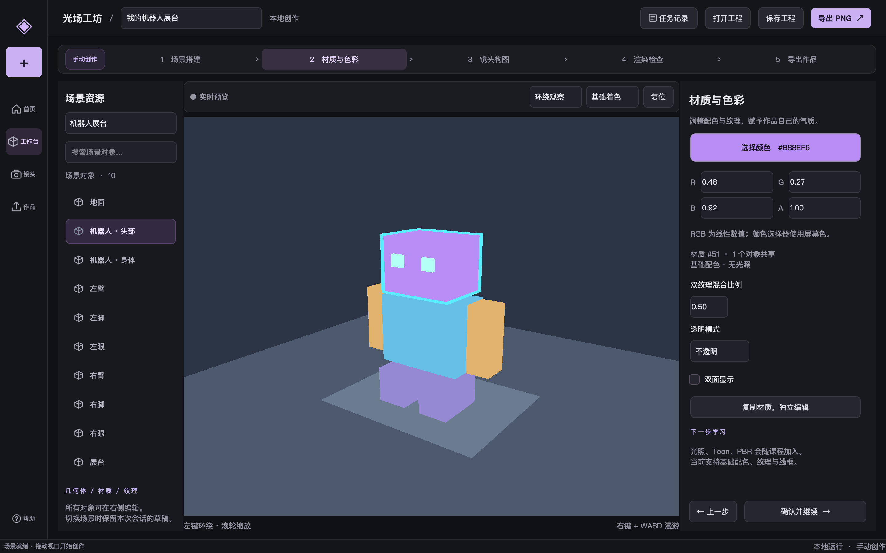
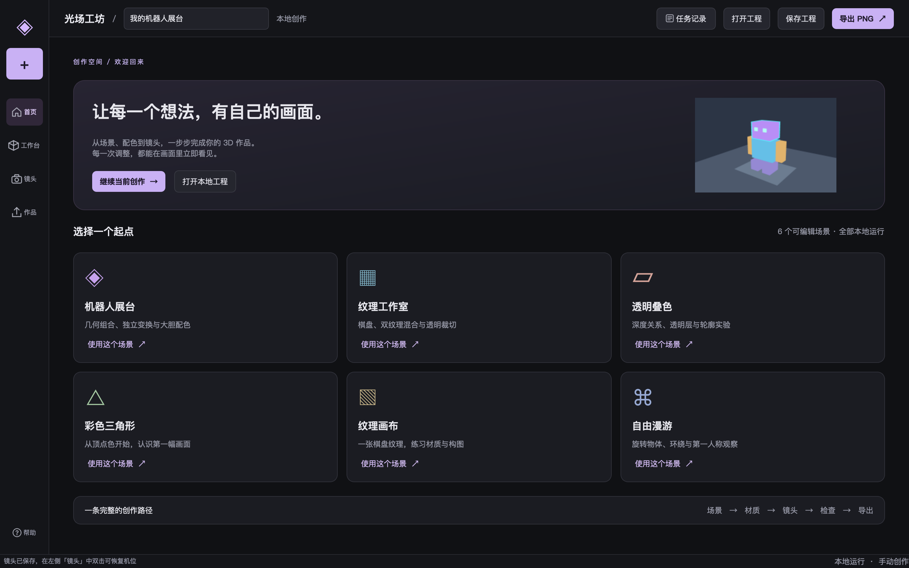
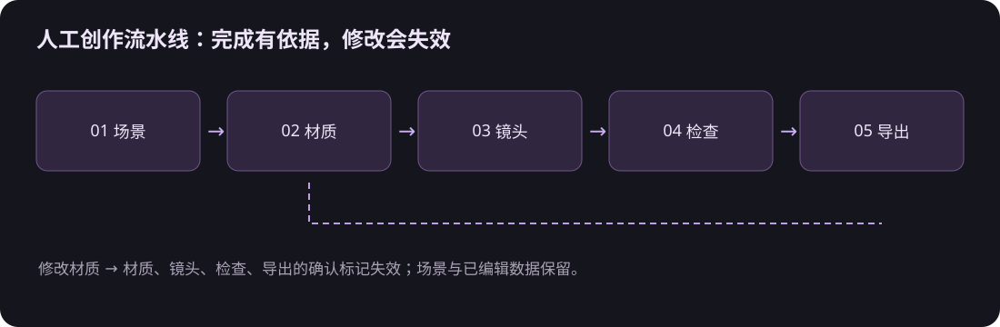
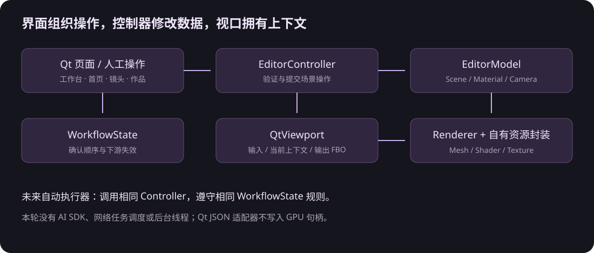
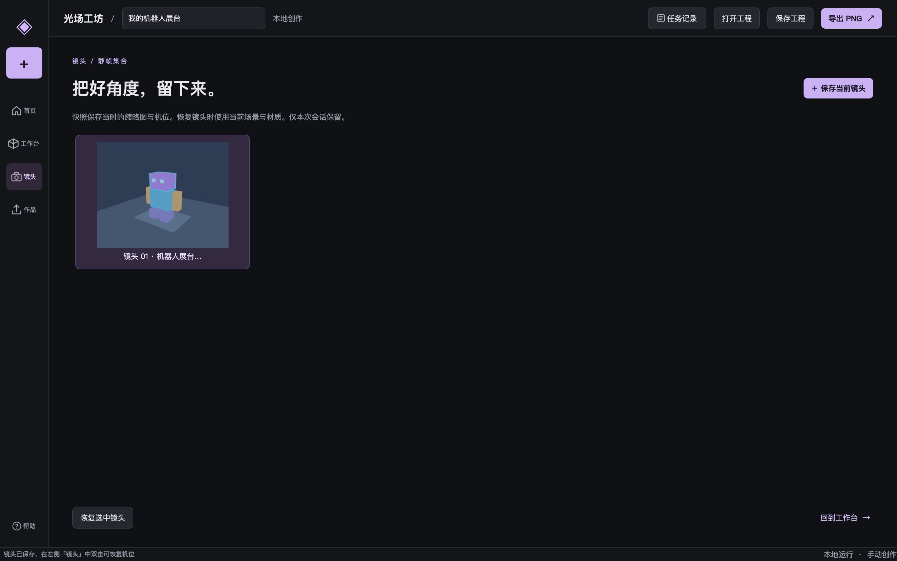

+++
date = '2026-10-20T14:00:00+08:00'
draft = false
title = 'OpenGL 项目实战（四）：用 Qt 做一条人工创作流水线'
description = 'OpenGL 学完第一阶段，怎样把参数面板变成可持续完善的软件？本文用光场工坊的真实 Qt6 改版，说明五步人工创作流水线、MVC 操作入口、相机快照、工程存档和 PNG 导出如何衔接。重点解释修改后的状态失效、材质共享的恢复，以及未来接入自动执行器时哪些代码可以复用、哪些仍需补齐。'
toc = true
tags = ['OpenGL', 'Qt', 'MVC', 'C++']
keywords = ['Qt OpenGL 工作台', '人工创作流水线', 'OpenGL 项目实战', 'Qt MVC 架构', 'OpenGL 工程保存', 'AI pipeline 扩展接口']
[[params.faqItems]]
question = '没有 AI 也能有 pipeline 吗？'
answer = '可以。当前流水线由人选择场景、编辑材质、调整镜头、检查和导出，阶段之间有顺序与失效规则。AI 只是未来可能增加的执行者。'
[[params.faqItems]]
question = 'Qt 是否替代了自己的 OpenGL 封装？'
answer = '没有。Qt 负责窗口、控件、输入与上下文，视口继续调用自己的 Renderer 和 NativeResourceFactory。'
[[params.faqItems]]
question = '工程文件保存了哪些内容？'
answer = '版本化 JSON 保存预设、TRS、材质参数与共享分组、相机姿态、基础风格及渲染状态。镜头快照与本次操作记录不随文件持久化。'
[[params.faqItems]]
question = '以后接入 AI 是否只需要加一个按钮？'
answer = '不是。现有 Controller 和流程规则可以复用，仍需增加异步任务、取消、版本冲突、持久化任务与线程边界。'
+++



> 版本说明：本文主体记录第一阶段的五步流程。2026-10-24 第二阶段已扩展为七步、七个首页模板，并加入下文的媒体交互审计与入口去重。早期截图中的加号、继续创作等重复入口已删除。最新光照与后处理实现见[第五篇](../05-stage-two-lighting/index.zh.md)。

Qt OpenGL 工作台需要一条能走完的创作路径。把位置、颜色和开关都放进面板，可以展示技术，却很难告诉使用者下一步做什么。这次光场工坊将界面组织成“场景 → 材质 → 镜头 → 检查 → 导出”，每一步都对应已有能力。

**我的建议是先做好人工操作的数据与失效规则，再考虑自动化执行。** 人工和 AI 可以调用同一个控制器，但一次修改是否影响下游，必须由软件自己确定。仅仅把五个按钮排成箭头，无法保证这个约束。

本文接续 [模块架构](../01-workbench-architecture/index.zh.md)、[GPU 资源封装](../02-gpu-resources/index.zh.md) 和 [场景与相机](../03-scene-and-camera/index.zh.md)，代码与运行方法在 [原生工程](../../native/README.md)。截图来自 Qt6 与 Apple M2 Pro 的实际 OpenGL 4.1 Core 窗口。

## Qt OpenGL 工作台先解决“下一步做什么”

本轮参考了 [Pixo 工作区](https://pixo.video/zh/539-04a9405c/dashboard) 的实际页面：侧边导航、项目卡片、素材分组、故事版切换和任务抽屉。我们借用其组织操作的方式，把视频业务换成当前 3D 编辑业务。

首页有六个场景模板和继续创作入口；工作台左侧选对象，中间看结果，右侧只显示当前阶段的参数；镜头页保存角度；作品页记录本次导出。这个分工让使用者始终知道自己在改什么、结果在哪里。



| 阶段 | 当前真实操作 | 用到的第一阶段知识 |
| --- | --- | --- |
| 场景 | 选择对象、编辑位置旋转缩放 | 顶点数据、GLM、模型矩阵 |
| 材质 | 颜色、透明方式、纹理混合 | GLSL uniform、纹理与采样 |
| 镜头 | 环绕、漫游、预设机位、快照 | View、Projection、相机输入 |
| 检查 | 深度、背面剔除、透明混合、选中轮廓 | 深度、模板、混合、剔除 |
| 导出 | 当前视口 PNG、可编辑工程 | framebuffer 读回与 CPU 序列化 |

第一阶段的渲染效果仍然是基础配色、纹理与线框。Toon、光照、PBR 和 Bloom 需要后续课程。软件界面已经有创作流程，不等于这些算法已经实现。

布局用 `QSplitter` 允许调整三栏比例，属性区可以滚动，确认与返回按钮固定在底部。实际验收包含 1440×900 和 1100×720 的窗口，不用缩小字体才能找到按钮。

## 人工创作流水线的关键是修改后的失效

确认“检查完成”之后，再移动相机，之前的构图检查就过期了。类似地，改材质会影响透明叠加与最终画面，因此材质及后续确认都需要重新进行。场景数据仍然保留，失效的是确认状态。



[WorkflowState](../../native/include/luma/editor/WorkflowState.hpp) 只包含阶段状态，不依赖 Qt 或 OpenGL。它允许自由导航，但 `complete()` 要求前序阶段已确认。修改时从对应阶段开始清除完成标记。

```cpp
WorkflowState workflow;
workflow.complete(WorkflowStage::Scene);
workflow.complete(WorkflowStage::Material);

// 配色有了变化：清除材质及之后的确认。
workflow.invalidateFrom(WorkflowStage::Material);

// 返回哪个面板，是独立的导航操作。
workflow.setCurrent(WorkflowStage::Camera);
```

这里没有强制限制用户只能顺序操作。点击“材质”可以直接试颜色，点击顶部“导出”也能保存当前预览；不过未经检查的临时导出不会让整条流程被标记为已完成。这样既保留探索自由，也保持完成标记的含义。

相机还有一条容易漏掉的路径：鼠标和 WASD 经 `QtInput → CameraControls` 更新机位，不会经过属性按钮的回调。我们比较每次输入处理前后的 `eye / target / up`，实际改变后调用 `onCameraChanged`，由界面使镜头及后续确认失效。

这一行为有真实的失败记录：新增测试先确认四个阶段，再发送 W 键。旧实现中相机移动了，“检查完成”仍然保留；接入相机变化通知后，测试要求检查标记被清除。

## Qt MVC 保持同一个操作入口

界面改版沿用上一版的 CPU 数据与控制器。`WorkbenchWindow` 负责组合页面；`WorkbenchStages.cpp` 构建阶段参数面板；`WorkbenchPages.cpp` 构建首页、镜头和导出页；`WorkbenchActions.cpp` 处理文件、快照及记录；主题和图标单独放在 `WorkbenchTheme.cpp`。



用户改位置时，界面采集 XYZ，调用 `EditorController::setTransform()`，由控制器先验证副本再提交。颜色、相机、基础风格和渲染状态也通过同一控制器。控件不编译 shader，不操作 VAO，也不决定 GPU 资源释放时机。

渲染路径依然是 `QtViewport → Renderer → IResourceFactory`，当前注入 `NativeResourceFactory`。QOpenGLWidget 每帧传入自己的 `defaultFramebufferObject()` 和实际像素大小。Qt 官方明确要求在这个控件里使用它提供的 FBO，不能假定默认目标是 0，详见 [QOpenGLWidget 文档](https://doc.qt.io/qt-6/qopenglwidget.html)。

本项目所说的 MVC，是自己的 CPU 场景模型、编辑控制器与 Qt View 的职责分工。Qt 的 `QAbstractItemModel` 模型/视图框架是另一套具体 API，目前对象列表没有迁移到那套接口；可对照 [Qt Model/View 文档](https://doc.qt.io/qt-6/model-view-programming.html)。

换成 Qt 的 Shader、Texture 或 Buffer 包装，应该实现新的 `IResourceFactory` 适配，并保留当前上下文和释放顺序。换资源包装能复用上层场景，但渲染 pass、色彩编码和状态恢复仍需要我们的渲染器负责。

## 工程存档必须保存材质关系

同一个材质被两条手臂使用时，修改颜色会同时改变它们。点击“复制材质，独立编辑”后，只应改变一条手臂。工程文件如果仅仅按对象保存 RGBA，重开时就无法区分“颜色恰好相同”和“共享同一个材质”。

[ProjectDocument](../../native/include/luma/qt/ProjectDocument.hpp) 保存 `materialGroup`。恢复时，每个分组只克隆一次材质，随后通过 `EditorController::assignMaterial()` 给同组对象分配相同材质 ID。文件不保存会随运行变化的 GPU handle。

当前文档是预设的编辑配方，结构如下；省略了对象数组的具体内容：

```text
.luma / JSON version 1
  preset / name
  objects[]: position / rotation / scale
             color / mix / cutoff / alpha / doubleSided / group
  eye / target / up / cameraMode
  style / background / depth / cull / blend / outline
```

读取时先验证版本、预设、对象数、所有向量、正缩放、非零四元数、材质范围和有效相机，再请求加载场景。坏 JSON 和无效变换不能先清掉当前作品。写入使用 `QSaveFile`，检查完整写入后调用 `commit()`；它的临时文件机制见 [官方文档](https://doc.qt.io/qt-6/qsavefile.html)。

这里的原子性有明确边界：文件提交是原子的，非法文档在加载前拒绝；真实 GPU 加载或资源分配的中途故障并没有被包装成整个工程的通用事务。当前文件只支持内置预设，不包含外部 OBJ、任意纹理资源路径或跨版本迁移。

集成测试做了三组具体往返：保存后修改 X 再读回；给一条手臂独立材质，确认另一条仍独立、两只脚仍共享；恢复相机与渲染状态，并检查控件值跟随更新。这比“文件存在”更接近使用者需要的存档可靠性。

## 快照、导出与下一步自动化的边界

镜头快照保存实际 framebuffer 缩略图和相机姿态。恢复快照会恢复机位，渲染当前场景与材质；缩略图保留捕获那一刻的效果。因此它不是项目历史版本，也不是动画时间线。



PNG 导出只在 `savePng()` 真正成功后显示成功记录。失败的路径也进入记录，但不能双击打开不存在的文件。工程、PNG 的保存位置由用户选择，导出内容包含当前的轮廓设置。

| 内容 | 当前持久化范围 |
| --- | --- |
| 场景变换、材质关系、相机、渲染状态 | 写入用户指定的 `.luma` 文件 |
| PNG 画面 | 写入用户指定的 `.png` 文件 |
| 镜头缩略图、切换场景草稿、任务与导出记录 | 本次会话；退出后不恢复 |
| 后台任务、视频、AI 生成 | 尚未实现 |

未来加入自动执行器时，可以复用 `EditorController` 的验证操作、`WorkflowState` 的失效规则，以及 `ProjectDocument` 的场景配方。仍然需要设计任务队列、取消、版本号、结果回到主线程的方式与 GPU 上下文约束。这些问题出现时再实现，会比现在造一套没有实际调用方的 AI 框架更容易验证。

## Qt 交互审计：按钮连接之后，还要检查什么

**我建议把“选中状态、取消路径、数据精度”作为 Qt 交互的验收条件。** 2026-10-24 逐项检查时，相机复位、光泽度、位置 X 和后处理开关这四个回归用例都先失败；它们已有按钮和回调，问题藏在回调内部。

例如材质底色是 `.075`，表单只显示两位小数。旧实现修改光泽度时，会从所有表单重新拼出材质，顺手把底色写成 `.08`。把显示精度加高只能推迟这个问题，无法保证之后导入的数据仍然保持原值。

当前实现从模型复制候选，按 field/component 修改目标字段。修改高光范围只写 shininess，修改 X 只写 position.x，关闭后处理只写 enabled；其余字段保留模型中的原始值。完整路径在 [WorkbenchInspector.cpp](../../native/src/qt/WorkbenchInspector.cpp) 与 [WorkbenchPostPage.cpp](../../native/src/qt/WorkbenchPostPage.cpp)。

```cpp
// WorkbenchInspector::editMaterial 中的实际做法。
auto mat = m->materials().material(m->selectedMaterial());
if (field == 0) mat.baseColor[component] = color_[component]->value();
if (field == 1) mat.specularColor[component] = specularColor_[component]->value();
if (field == 2) mat.shininess = shininess_->value();
if (field == 3) mat.textureMix = mix_->value();
if (field == 4) mat.alphaMode = AlphaMode(alpha_->currentIndex());
if (field == 5) mat.doubleSided = doubleSided_->isChecked();
if (invoke([mat](auto& c) { c.setMaterial(mat); }))
    changed(WorkflowStage::Material);
```

另一个陷阱是 currentItem 不等于实际选中。Ctrl 取消高亮时，列表仍可保留当前项，且不会发生行变化。若仅监听 currentRowChanged，删除按钮就可能删除一个没有高亮的灯光或镜头。现在监听 itemSelectionChanged，动作同时检查 isSelected；Qt 对两种状态的说明见 [QItemSelectionModel 文档](https://doc.qt.io/qt-6/qitemselectionmodel.html)。

### 镜头和作品共用一个 Qt 媒体模块

[MediaGallery](../../native/include/luma/qt/MediaGallery.hpp) 负责记录、搜索、场景/状态筛选、计数和动作状态；[MediaPreviewDialog](../../native/include/luma/qt/MediaPreviewDialog.hpp) 负责完整图像、前后切换、详情与 Esc。二者不依赖 Renderer，也不持有 GPU 资源。


窗口通过 onRestore/onRename/onRemove 回调连接镜头业务。真正读取 framebuffer、恢复 Camera 和写出 PNG 的操作留在 [WorkbenchMediaActions.cpp](../../native/src/qt/WorkbenchMediaActions.cpp)。增加另一种本地图片集合时，可以复用图库组件，把业务回调换成自己的实现。

```cpp
// WorkbenchPages::buildShots 的实际组合入口。
shotGallery_ = new MediaGallery("shots", true, page);
shotGallery_->onRestore = [this](int) { restoreShot(); };
shotGallery_->onRename = [this](int id, const QString& name) {
    for (auto& shot : shotData_)
        if (shot.id == id) shot.name = name;
};
```

预览序列取当前筛选结果，第一张禁用上一张，最后一张禁用下一张，左右键切换，Esc 退出。隐藏信息栏后会重新按可用空间适配图片。快照保留拍摄时的完整画面；恢复动作只恢复该预设草稿中的机位，仍使用当前材质。


本轮实际查看了 [Pixo 媒体页](https://pixo.video/zh/539-04a9405c/projects/01a14299-2568-7fc1-9212-f221a8d02472?view=media) 的筛选、图片预览、信息栏和项目菜单。我们采用这些操作方式，但为 3D 编辑保留三栏视口和七步流程。场景用原生下拉筛选，卡片动作放到选择区与右键菜单；没有把 AI、积分和音视频入口做成空按钮。具体差异见[逐项审计](../../docs/implementation/2026-10-24-interaction-audit.md)。

### 取消保存也属于完整流程

现在已有路径时直接保存，项目菜单另设“另存为”。打开工程、新建和关闭都先处理未保存修改；用户取消时，作品继续留在当前窗口。场景 Draft 保存 document、path、workflow、dirty，切回来时也能继续保存到原文件。

覆盖确认要检查最终文件名。旧代码在文件对话框返回之后才加 `.png`；用户输入 `作品` 时，对话框可能只检查不存在的 `作品`，随后应用覆盖已经存在的 `作品.png`。现在在打开对话框前设置 defaultSuffix，原理和属性边界见 [QFileDialog 文档](https://doc.qt.io/qt-6/qfiledialog.html#defaultSuffix-prop)。

```cpp
QFileDialog dialog(this, "导出当前画面", projectName_->text() + ".png");
dialog.setNameFilter("PNG 图片 (*.png)");
dialog.setAcceptMode(QFileDialog::AcceptSave);
dialog.setDefaultSuffix("png");
if (dialog.exec() != QDialog::Accepted || dialog.selectedFiles().isEmpty())
    return;
```

[交互回归入口](../../native/tests/qt_interaction_tests.cpp) 使用真实 Qt/OpenGL 窗口，覆盖预览、重命名、移除取消、跨场景恢复、PNG 成功/失败、扩展名覆盖确认、保存与打开取消。测试应用仅关闭系统原生对话框，便于输入和检查；软件仍使用系统对话框。

当前只保证本地、单线程的人工作业。图库、快照和记录尚未持久化，后台任务仍未加入。以后接入 AI 或后端，应复用这些值对象和 Controller 操作，再增加任务与存储边界。

### 一个动作应当在哪里出现

**按钮能正常点击，还不足以说明它应该留在界面上。** 后续精简发现，侧栏加号与首页都只调用 `showPage(0)`；首页“继续当前创作”与工作台导航相同；导出面板内的按钮和面板底部按钮又都调用 `chooseExport()`。这些入口没有增加功能，却要求使用者判断它们是否有区别。

这次直接删除 11 个重复按钮与 4 个菜单项。页面切换统一走侧栏，打开/保存统一走顶栏，项目菜单仅保留新建当前场景工程和另存为；镜头只在构图时保存，PNG 只保留导出阶段底部一个可见按钮。


删除涉及 `WorkbenchWindow.cpp`、`WorkbenchPages.cpp`、`WorkbenchStages.cpp` 和 `WorkbenchProjectActions.cpp`。控件构建与 connect 一起移除，不通过隐藏控件保留旧实现。同时删除无人读取的 `shots_`、`exports_` 别名与 `exportCount_` 计数，原有弹窗回归改为点击保留的导出按钮。


这个规则有明确边界：快捷键与右键菜单服务不同操作方式；色板和 RGBA 数值服务直观选色与精确编辑，仍然保留。判断重复时，比较动作、结果和当前上下文，再决定删除。后续增加功能也按[开发边界](../../docs/development-boundaries.md)执行。

### 运行与复现

在工作区根目录执行：

```sh
cmake -S opengl_visual_workbench/native \
  -B opengl_visual_workbench/native/build \
  -DCMAKE_PREFIX_PATH=/opt/homebrew -DLUMA_WITH_QT=ON
cmake --build opengl_visual_workbench/native/build -j4
ctest --test-dir opengl_visual_workbench/native/build --output-on-failure
opengl_visual_workbench/native/build/bin/luma_qt_tests
opengl_visual_workbench/native/build/bin/luma_qt_interaction_tests
opengl_visual_workbench/native/build/bin/luma_qt_workbench
```

CPU 测试不创建窗口，Qt 集成测试需要真实图形会话。桌面上的其他窗口可能抢走焦点，因此键盘测试先激活测试窗口并检查视口持有焦点，再发送 WASD；这和相机算法的数值错误是两类问题。

## 常见问题

### 没有 AI，这也是 pipeline 吗？

是。阶段有输入、操作、结果和确认依赖，修改会让下游结果的确认失效。当前执行者是人，自动执行器以后沿用同一份规则。

### Qt 能完全替换自己的封装吗？

可以替换资源包装和宿主适配。场景、控制器与材质数据应继续独立；渲染算法是否迁移，需要逐项处理。当前实际运行的是自己的 OpenGL 封装。

### 第一阶段就能呈现二次元和真实 PBR 吗？

当前只能做配色、几何与纹理表达。二次元光照和 PBR 有新的算法要求，页面会随着后续学习加入相应能力，不能把视觉方向当成当前渲染成果。

### 为什么没加视频时间线？

静帧快照只验证相机与画面保存。视频时间线还需要时间采样、动画求值和编码，现在引入会越过当前学习阶段。
