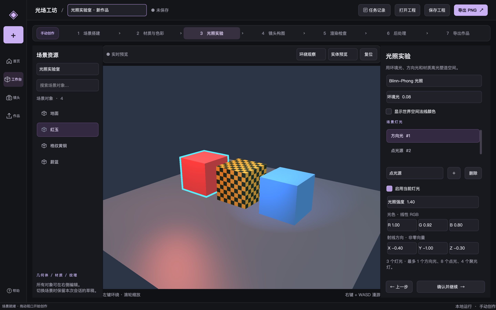
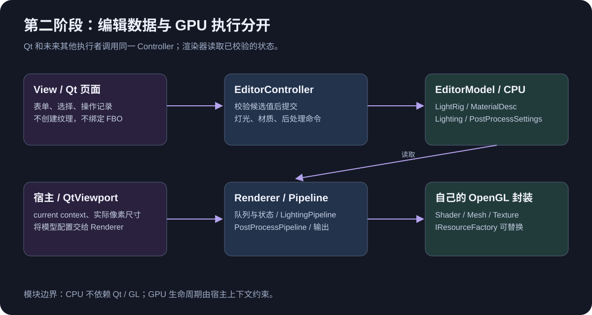
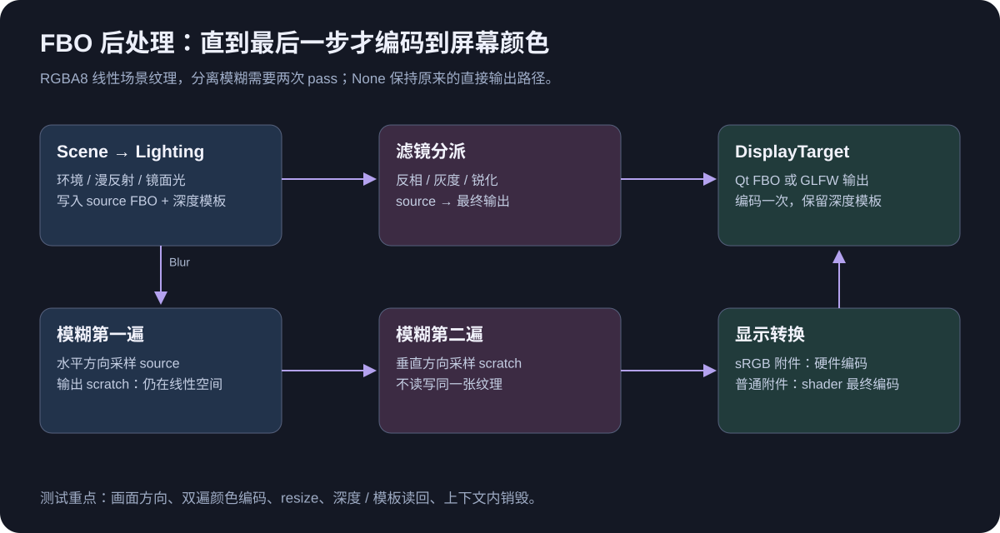
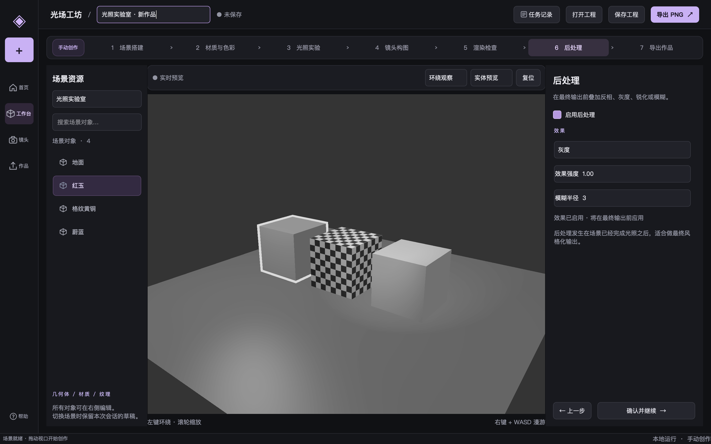
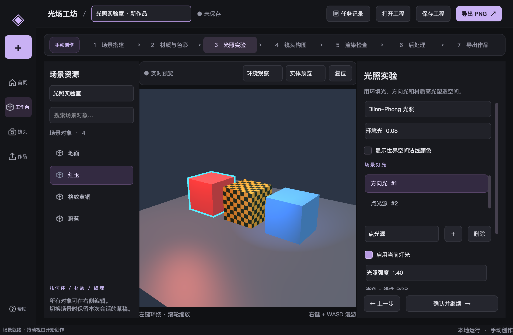

+++
date = '2026-10-24T18:00:00+08:00'
draft = false
title = 'OpenGL 项目实战（五）：把光照与 FBO 接进可复用工作台'
description = 'OpenGL 第二阶段学完后，可以把环境光、漫反射、镜面高光、材质贴图、方向光、点光和聚光灯接进同一个 Qt 创作软件。本文给出光场工坊实际实现的模块边界、Controller 到 GLSL 的调用链、FBO 后处理、工程版本迁移、完整示例与真实像素测试，说明如何继续扩展项目，而不把所有功能堆进窗口文件。'
toc = true
tags = ['OpenGL', 'Qt', 'C++', '光照', 'FBO', 'MVC']
keywords = ['OpenGL 光照封装', 'Qt OpenGL 项目实战', 'Blinn Phong 多光源', 'FBO 后处理', 'OpenGL 模块边界', 'OpenGL 高光贴图', 'OpenGL 可复用渲染器']
[[params.faqItems]]
question = '为什么使用 Blinn-Phong，而不是直接实现 PBR？'
answer = '它对应当前已学的环境、漫反射和镜面光模型，能把法线、材质和多光源组合起来。PBR 需要后续材质工作流与环境光知识，本阶段先完成真实可操作的光照链路。'
[[params.faqItems]]
question = 'Qt 和自己的 OpenGL 封装分别负责什么？'
answer = 'Qt 管窗口、控件、输入和 current context；自己的 Renderer、LightingPipeline、PostProcessPipeline 与资源包装执行绘制。以后可以在 IResourceFactory 边界替换资源包装。'
[[params.faqItems]]
question = '后处理的模糊为什么需要两个 FBO？'
answer = '先从 source 做水平采样写入 scratch，再从 scratch 做垂直采样写入输出，避免同一遍读写相同纹理。中间结果保持线性，最终才编码到屏幕。'
[[params.faqItems]]
question = '保存工程时可以直接保存 TextureId 吗？'
answer = '不能。它是当前 AssetStore 分配的运行期编号。本版把内置资源的相对路径与完整采样选项写入磁盘，空槽保存 null，由 AssetStore 恢复实际纹理。外部资产需要后续 URI 和打包机制。'
+++



OpenGL 光照封装的价值，是让下一次创作只需要配置对象、材质和灯光。光场工坊现在可以在同一款 Qt 软件中摆放物体，调整三种光源，比较高光，再通过 FBO 滤镜导出画面。本文把这些操作对应到具体类、成员函数和 shader，你可以直接运行，也可以取出模块复用。

**我建议先把 CPU 编辑状态与 GPU 执行分开，再增加渲染效果。** 这次没有让 Qt 的滑杆直接写 uniform。滑杆调用 Controller，Controller 验证并更新 Model，宿主在下一帧把数据交给 Renderer。新增效果可以沿着这条链路扩展。

前四篇分别解释了[架构与生命周期](../01-workbench-architecture/index.zh.md)、[GPU 资源](../02-gpu-resources/index.zh.md)、[场景与相机](../03-scene-and-camera/index.zh.md)和[Qt 人工创作流水线](../04-qt-manual-workflow/index.zh.md)。第五篇只讨论本次新增的第二阶段；源码与启动入口在[原生工程说明](../../native/README.md)。

## 先运行一遍，再看 OpenGL 光照封装

从工作区根目录执行下面三条命令，就能打开真实 Qt 程序。`lighting` 预设创建地面、三块不同材质的立方体，以及方向光、点光源、聚光灯。中间黄铜立方体同时使用底色贴图和线性高光贴图。

```sh
cmake -S opengl_visual_workbench/native -B opengl_visual_workbench/native/build \
  -DCMAKE_PREFIX_PATH=/opt/homebrew -DLUMA_WITH_QT=ON -DCMAKE_BUILD_TYPE=Debug
cmake --build opengl_visual_workbench/native/build -j4
opengl_visual_workbench/native/build/bin/luma_qt_workbench --preset lighting
```

先在“光照实验”中把环境光设为 0，再逐个关闭灯光。方向光只取方向；点光源随距离衰减；聚光灯还限制照射锥。打开法线颜色后，看到的是世界空间法线映射到 RGB 的调试画面，不是新的艺术风格。

接着选中“红玉”，在“材质与色彩”中调整高光 RGB 与光泽度。光泽度越大，高光区域越集中。高光位置也取决于相机，所以转动镜头时应能观察到变化，而不是只有材质滑杆数值在变。

| 本阶段知识 | 软件中的入口 | 对应代码 |
| --- | --- | --- |
| 颜色与线性计算 | 底色、灯光颜色与输出 | TextureOptions、DisplayTransfer |
| 环境 / 漫反射 / 镜面光 | 着色模型切换与环境光 | LightingSettings、lighting.frag |
| 法向量矩阵 | 非均匀缩放与法线调试 | LightingPipeline::draw |
| 材质与贴图 | 高光颜色、光泽度、黄铜格纹 | MaterialDesc、AssetStore |
| 三种光源与组合 | 灯光列表、新增、删除、参数表 | LightRig、EditorController |
| FBO 与后处理 | 后处理阶段、PNG 导出 | PostProcessTarget、PostProcessPipeline |

这里的可见效果是 Blinn-Phong 与 LDR 滤镜。阴影、PBR、HDR/Bloom、外部模型与 Toon 尚未进入原生软件。最早的 HTML 产品原型是视觉目标，不能把它当作这些原生算法已经完成的证据。

## 模块边界比多写几个工具类更重要

LightRig 保存 CPU 值，LightingPipeline 执行 GPU 绘制，两者不能互相替代。前者在没有窗口时也能使用；后者必须处于有效 current context 中。把它们分开，后台数据处理和未来执行器才不会为了调整一个灯光强度而被迫创建 OpenGL 窗口。



[LightTypes](../../native/include/luma/lighting/LightTypes.hpp) 定义三种灯光字段和校验；[LightRig](../../native/include/luma/lighting/LightRig.hpp) 管 ID、类型数量和增删改；[EditorController](../../native/include/luma/editor/EditorController.hpp) 是编辑入口。灯光数量上限是一个方向光、八个点光、四个聚光灯；LightingSettings 默认 13 项上传预算覆盖全部支持的灯光，也可调低预算，按集合顺序限制参与项。

校验发生在修改之前。例如零方向、负强度、非有限数、无效衰减和内锥大于外锥都被拒绝。Controller 更新的是候选 LightValue，失败不会覆盖原来的灯光。这个规则比在每个滑杆里重复写 if 更有价值，因为无窗口调用者也获得相同约束。

```cpp
luma::PointLight point;
point.position = {-2, 2.5f, 2};
point.color = {1, .2f, .1f};
point.intensity = 2.2f;
auto id = controller.addPointLight(point);
point.intensity = 1.4f;
controller.updateLight(id, point);
controller.removeLight(id);
```

这是操作片段，假定调用者已经持有 Controller；下文给出完整可编译 main。LightId 只标识本次编辑状态。GPU program、纹理对象和 FBO handle 不进入 CPU 光源对象，也不写进工程文件。

Qt 页面按职责拆为窗口壳、工作台布局、检查器、流程、灯光页面、灯光动作和后处理页。窗口文件负责组合，不再承担所有参数处理。具体依赖与后续扩展位置记录在[开发边界](../../docs/development-boundaries.md)，不是靠一张“设计模式”清单来约束。

| 文件类型 | 硬上限 | 目的 |
| --- | ---: | --- |
| C++ 实现 | 360 行 | 一个文件只承载一组紧密职责 |
| C++ 头文件 | 260 行 | 接口简洁，避免把实现塞进声明 |
| Qt 页面和动作 | 320 行 | 页面构建、同步和编辑行为可分开阅读 |
| GLSL | 180 行 | 单个 pass 的算法可独立定位 |
| 测试 | 420 行 | 将 CPU、像素与宿主交互分开 |

检查脚本统计注释和空行，不靠压缩代码过关；第三方库、文章和生成 HTML 不计入。运行 `python3 opengl_visual_workbench/tools/check-native-boundaries.py`，或者运行 CTest，超限会直接失败。职责已经混在一起时，即使只有两百行，也应该拆分。

## 从法向量到材质高光：每个量都要处在同一空间

本版在世界空间计算光照。顶点 shader 输出世界位置与法线，片元 shader 用同一空间的灯光、相机位置求方向。若位置在世界空间而法线仍在局部空间，物体旋转后光照就会偏离几何表面。

[LightingPipeline::draw](../../native/src/render/LightingPipeline.cpp) 上传 `transpose(inverse(mat3(model)))`。法线表达表面的垂直方向，不能直接套用包含非均匀缩放的模型矩阵。shader 插值后再次 normalize，避免插值改变长度。物体缩放由 Transform 拒绝零值，避免求逆奇异矩阵。

```cpp
shader_->set("uModel", model);
shader_->set("uNormalMatrix", glm::transpose(glm::inverse(glm::mat3(model))));
shader_->set("uViewPosition", camera.eye());
shader_->set("uSpecularColor", material.specularColor);
shader_->set("uShininess", material.shininess);
```

对于一盏灯，漫反射系数取 `max(dot(N,L),0)`；Blinn-Phong 使用半程向量 `H=normalize(L+V)`，高光项取 `pow(max(dot(N,H),0),shininess)`。当前实现还要求漫反射朝向有效，防止背向光源的面出现孤立高光。

环境项使用环境颜色乘环境强度与底色，直接光使用灯色、强度、漫反射与镜面项组合。它是便于学习的局部光照模型，不模拟多次反弹，也不保证 PBR 的能量守恒。用它理解材料响应很合适，用它声称物理准确则不合适。

[MaterialDesc](../../native/include/luma/scene/MaterialDesc.hpp) 继续保存底色、透明模式、双面、双纹理混合，新增 `specularColor`、`shininess`、`specularTexture`。材质属于物体，灯光属于场景，不能把“灯有多亮”写成每个材质的重复字段。

底色贴图与高光贴图的语义也不同：前者是表面颜色，后者控制各像素的镜面响应。LearnOpenGL 的[光照贴图章节](https://learnopengl.com/Lighting/Lighting-maps)也分别处理这两个槽位。本工程给黄铜立方体使用了自己生成的高光格纹，按 Linear 上传；屏幕颜色贴图则使用 SRGB，让硬件采样时解码。

这给了一个容易复现的实验：保持底色图不变，关闭或换掉高光图，观察高光分布。改底色是改漫反射材质，改高光图是改镜面响应，两者不应仅仅表现为同一张图变亮。

## 三种光源共用一条上传链路

方向光的 `direction` 定义射线传播方向，因此片元指向光源的向量用 `-direction`。点光源先用位置差得到 L，再计算距离衰减。聚光灯在点光源基础上增加锥角插值，内锥全亮，外锥以外没有直接光，中间平滑过渡。

点光衰减分母是 `constant + linear*d + quadratic*d*d`。本版要求常量项为正，一次与二次项非负，保证有限位置下分母不会为零。用户可以调出很快或很慢的衰减，但不能提交造成除零的组合。

聚光锥角在 CPU 侧使用度，上传时转换为 cosine。shader 用 `dot(L,-spotDirection)` 比较；这里的 L 指向灯，spotDirection 指向灯射出的方向，二者符号相反。角度和 cosine 的单调关系也相反，不能直接照搬 UI 的大小顺序到 shader 分母里。

[LightingPipeline](../../native/include/luma/render/LightingPipeline.hpp) 每次绘制先禁用方向光，再上传当前集合与计数。这个“完整覆盖”来自一次真实失败：删除方向光后集合变空，但旧 uniform 还在，画面仍然有光。增加测试、先观察失败，再在每次上传时清空启用标记，才把问题消掉。

点光和聚光数组分别使用固定长度 8 和 4，count 限制循环。材质、法线矩阵与灯光上传都封装在 Pipeline 中，场景作者不写 uniform 名字。当前每个对象重复上传灯光是为了保持实现直接；大量对象时可以在后续课程改为每帧共享 UBO，而不是现在先做没有测量依据的优化。

完整链路是：`Qt 控件 → EditorController::updateLight → EditorModel::lights → QtViewport::paintGL → Renderer::setLighting → LightingPipeline::draw → lighting.vert / lighting.frag → Mesh::draw`。每一箭头都对应已有调用，没有隐藏的 AI 节点或假任务进度。

## FBO 后处理最容易错的是输出边界

[PostProcessTarget](../../native/include/luma/render/PostProcessTarget.hpp) 负责 FBO、RGBA8 颜色纹理、匹配宿主的 packed 深度/模板附件与 resize。它是 move-only GPU 对象，必须在所属上下文中创建、使用、销毁。`complete()` 检查自己的 FBO，不依赖外部当前绑定了哪个目标。

FBO 本身不会改变渲染算法，它只是让绘制结果先落在可采样的纹理里。随后全屏三角形读取这张图执行滤镜。关于纹理附件、完整性和离屏输出的基础定义，可以对照 [LearnOpenGL FBO 原文](https://learnopengl.com/Advanced-OpenGL/Framebuffers)。



None 或关闭效果时，Renderer 保持原来的输出路径。启用效果时，场景先写 source，再由 [PostProcessPipeline::apply](../../native/src/render/PostProcessPipeline.cpp) 执行对应 pass。反相使用 `1-color`，灰度使用线性亮度权重，锐化使用中心 5、四邻域各 -1 的核；强度参数在原图与效果之间混合。

模糊使用可分离三角权重核，半径 1 到 15。先水平采样 source 写入 scratch，再垂直采样 scratch 写入最终输出。它是局部 LDR 模糊，不是景深、运动模糊，也没有拿 RGBA8 结果冒充 HDR Bloom。

**中间结果仍是线性颜色，最终输出才编码一次。** 真实像素测试先后发现了上下翻转和重复编码：第一版 fullscreen UV 额外翻了 Y，另一版在水平模糊后就做了 sRGB，垂直模糊又编码一次。用上下不同颜色的输入、平坦区域的基准值，就能比肉眼更明确地抓住这两个问题。

Qt 的输出 FBO 不能假定为 0。宿主每帧传入 `defaultFramebufferObject()` 与设备实际像素尺寸，Renderer 只借用它。这与 [QOpenGLWidget 官方说明](https://doc.qt.io/qt-6/qopenglwidget.html)的上下文和默认 framebuffer 约定一致。QtWidget 负责 makeCurrent，GPU 资源仍由我们自己的模块管理。

本版还把源场景的深度/模板复制到宿主输出，D24/S8 与 D32F/S8 格式必须匹配。最终全屏 pass 关闭深度写入并恢复状态。否则图像看起来正确，之后接着绘制的宿主却可能拿到错误深度，这是“能截图”和“能复用”的区别。



## 可保存的七阶段工作流，暂时不引入 AI

现在的人工流程是场景、材质、光照、镜头、检查、后处理、导出。可以自由跳转尝试，但确认按顺序进行；修改光照会使光照及之后的确认失效，修改后处理只影响后处理和导出。工作流保存的是确认规则，不是渲染图结构。

未来 AI 或后端可以成为另一个 Controller 调用者；当前没有引入它们。线程切换、任务取消、版本冲突和持久化任务都仍需要设计，不能因为已有七个阶段就说自动化调度器完成了。现在真正能复用的是同步 CPU 命令和阶段失效规则。灯光控件还遵守一个细节：每次仅提交正在编辑的字段和分量，不能把整张表单重新写回模型。否则强度变化会把未动过的 0.032 衰减参数按显示精度改成 0.03；真实 Qt 回归已覆盖这个问题。

`.luma` v2 新增灯光、环境、着色模型、后处理和高光材质字段。读取 v1 时用 Unlit、None 等默认值补齐，再保留由预设重建的纹理槽位。完整文档校验在替换运行场景之前完成。QtViewport 继续在候选 Scene 上创建预设并应用文档，等所有纹理解析和编辑成功后才发布；错误灯光、无效变换、缺失或损坏的资源都不会覆盖正在编辑的内容。

这里还修正了一个跨会话陷阱：TextureId 是当前 AssetStore 的临时编号，不能保存后期待下一次仍然指向同一张图。当前只支持内置资源，所以 [ProjectTexture](../../native/include/luma/qt/ProjectTexture.hpp) 保存 `textures/checker.png` 这样的相对路径，以及颜色空间、翻转、环绕、过滤和 mipmaps 选项；空槽保存 `null`。AssetStore 保留纹理来源并负责恢复。这样把黄铜材质共享给原本没有贴图的地面，也能在重新打开后保留漫反射和高光贴图。读取 JSON 时先验证描述和“第二张颜色贴图必须有第一张”的关系，再替换场景。外部图片导入的打包和缺失处理留到后续阶段。



## 无窗口配方与最后的验证

下面是[完整示例源码](../../native/examples/lighting_example.cpp)。main 只操作 CPU 状态，不创建窗口；`synchronizeStudio` 是给已有 Qt 或 GLFW Renderer 的连接函数。创建 GPU 资源与 render 时仍然需要 current context，示例没有跳过这个生命周期要求。

```cpp
// SOURCE: native/examples/lighting_example.cpp
#include <luma/editor/EditorController.hpp>
#include <luma/render/Renderer.hpp>
#include <iostream>
#include <stdexcept>

namespace {
// Reusable CPU recipe: no window, QWidget, shader compilation or GL calls.
void configureStudio(luma::EditorController& controller) {
    luma::LightingSettings settings;
    settings.model = luma::ShadingModel::BlinnPhong;
    settings.ambientStrength = .08f;
    controller.setLightingSettings(settings);
    controller.clearLights();
    controller.addDirectionalLight({{-.4f, -1, -.3f}, {1, .9f, .8f}, 1.2f, true});
    controller.addPointLight({{-2, 2, 2}, {1, .2f, .1f}, 2, 1, .09f, .032f, true});
    controller.addSpotLight({{2, 3, 3}, {-.2f, -1, -1}, {.2f, .5f, 1}, 3,
                              1, .09f, .032f, 10, 24, true});
    luma::PostProcessSettings post;
    post.enabled = true;
    post.effect = luma::PostProcessEffect::Grayscale;
    post.intensity = .35f;
    controller.setPostProcessSettings(post);
}
} // namespace

// A Qt or GLFW host calls this after it has initialized its Renderer.
// Setting CPU values needs no context; render() still requires a current context.
void synchronizeStudio(luma::Renderer& renderer, const luma::EditorModel& model) {
    renderer.setLighting(model.lighting(), model.lights());
    renderer.setPostProcess(model.postProcess());
}

int main() {
    luma::Scene scene;
    luma::MaterialLibrary materials;
    luma::Camera camera;
    luma::CameraControls controls;
    luma::EditorModel model(scene, materials, camera, controls);
    luma::EditorController controller(model);
    auto material = luma::MaterialDesc::unlit({.2f, .4f, .8f, 1});
    material.specularColor = {.9f, .9f, 1};
    material.shininess = 96;
    auto materialId = materials.createMaterial(material);
    auto entity = scene.create("无窗口光照配方", {1}, materialId);
    controller.select(entity);
    configureStudio(controller);
    if (model.lights().entries().size() != 3 || model.lighting().ambientStrength != .08f)
        throw std::runtime_error("lighting recipe did not reach the CPU model");
    std::cout << "PASS lighting example: 3 lights, shininess 96, grayscale intensity 0.35; no window\n";
}
```

构建后运行 `opengl_visual_workbench/native/build/bin/luma_lighting_example`，会检查三盏灯已进入模型，并输出 `PASS lighting example`。这比一个只写在文章里、没有编译目标的片段更能说明接口是否可复用。

验证分三层。CPU 测试检查非法值、类型数量、Controller 提交和工作流失效；真实 OpenGL 测试编译 shader、读回方向/点/聚光、滤镜、FBO resize 与深度模板；Qt 测试真的新增、修改、删除灯光，切换滤镜，保存并恢复工程，发送 WASD 输入并导出 PNG。

```sh
ctest --test-dir opengl_visual_workbench/native/build --output-on-failure
opengl_visual_workbench/native/build/bin/luma_lighting_gl_tests --hidden
opengl_visual_workbench/native/build/bin/luma_gl_tests --hidden
opengl_visual_workbench/native/build/bin/luma_lifecycle_tests
opengl_visual_workbench/native/build/bin/luma_qt_tests
python3 opengl_visual_workbench/tools/check-native-boundaries.py
```

这些命令的 GUI 部分需要真实桌面，不能用 Qt offscreen 插件替代 QOpenGLWidget。本文截图来自 Apple M2 Pro 的 OpenGL 4.1 Metal；这证明本机路径可运行，不代表已经覆盖所有显卡。实际通过项、驱动诊断和限制放在[第二阶段验收记录](../../docs/implementation/2026-10-24-stage-two-verification.md)。

继续学习时，我建议先增加模型加载，把预设立方体换成 MeshData 与材质导入结果。保持 Controller、宿主输出与资源所有权不变，再逐步加入天空盒、阴影和 PBR。每次新增一个真实模块，比先搭完整引擎再寻找用途更容易验证。

## 着色器源码实录

以下代码由文章构建脚本从工程源码同步。位置/法线的空间约定、材质采样与后处理分支可以和上文逐项对照。

### 世界空间顶点着色器

```glsl
// SOURCE: native/assets/shaders/lighting.vert
#version 330 core
layout(location=0) in vec3 aPosition;
layout(location=1) in vec3 aNormal;
layout(location=2) in vec2 aUv;
layout(location=3) in vec4 aColor;
uniform mat4 uModel;
uniform mat4 uView;
uniform mat4 uProjection;
uniform mat3 uNormalMatrix;
out vec3 vWorldPosition;
out vec3 vNormal;
out vec2 vUv;
out vec4 vColor;
void main(){
    vec4 world=uModel*vec4(aPosition,1.0);
    vWorldPosition=world.xyz;
    vNormal=normalize(uNormalMatrix*aNormal);
    vUv=aUv;
    vColor=aColor;
    gl_Position=uProjection*uView*world;
}
```

### 多光源片元着色器

```glsl
// SOURCE: native/assets/shaders/lighting.frag
#version 330 core
struct DirectionalLight { vec3 direction; vec3 color; float intensity; int enabled; };
struct PointLight { vec3 position; vec3 color; float intensity; vec3 attenuation; int enabled; };
struct SpotLight { vec3 position; vec3 direction; vec3 color; float intensity; vec3 attenuation; vec3 cone; int enabled; };
in vec3 vWorldPosition;
in vec3 vNormal;
in vec2 vUv;
in vec4 vColor;
out vec4 fragColor;
uniform DirectionalLight uDirectional;
uniform PointLight uPoints[8];
uniform SpotLight uSpots[4];
uniform int uPointCount;
uniform int uSpotCount;
uniform vec3 uViewPosition;
uniform vec4 uBaseColor;
uniform vec3 uSpecularColor;
uniform float uShininess;
uniform vec3 uAmbientColor;
uniform float uAmbientStrength;
uniform sampler2D uTexture;
uniform sampler2D uTexture2;
uniform sampler2D uSpecularTexture;
uniform int uUseTexture;
uniform int uUseTexture2;
uniform int uUseSpecularTexture;
uniform float uTextureMix;
uniform int uAlphaMode;
uniform float uAlphaCutoff;
uniform int uManualEncoding;
uniform int uVisualizeNormals;
vec3 linearToSrgb(vec3 c){return mix(12.92*c,1.055*pow(max(c,vec3(0.0)),vec3(1.0/2.4))-0.055,step(vec3(0.0031308),c));}
vec3 directLight(vec3 lightDir,vec3 lightColor,float intensity,vec3 albedo,vec3 specular,vec3 n,vec3 viewDir){
    float diffuse=max(dot(n,lightDir),0.0);
    vec3 halfDir=normalize(lightDir+viewDir);
    float highlight=diffuse>0.0?pow(max(dot(n,halfDir),0.0),uShininess):0.0;
    return lightColor*intensity*(albedo*diffuse+specular*highlight);
}
void main(){
    vec4 base=uBaseColor*vColor;
    if(uUseTexture!=0){
        vec4 texel=texture(uTexture,vUv);
        if(uUseTexture2!=0) texel=mix(texel,texture(uTexture2,vUv),uTextureMix);
        base*=texel;
    }
    vec3 specular=uSpecularColor;
    if(uUseSpecularTexture!=0) specular*=texture(uSpecularTexture,vUv).rgb;
    vec3 n=normalize(vNormal);
    if(uAlphaMode==1 && base.a<uAlphaCutoff) discard;
    if(uAlphaMode==0) base.a=1.0;
    if(uVisualizeNormals!=0){
        vec3 normalColor=n*0.5+0.5;
        fragColor=vec4(uManualEncoding!=0?linearToSrgb(normalColor):normalColor,1.0);
        return;
    }
    vec3 viewDir=normalize(uViewPosition-vWorldPosition);
    vec3 result=uAmbientColor*uAmbientStrength*base.rgb;
    if(uDirectional.enabled!=0)
        result+=directLight(normalize(-uDirectional.direction),uDirectional.color,uDirectional.intensity,base.rgb,specular,n,viewDir);
    for(int i=0;i<uPointCount;i++){
        if(uPoints[i].enabled==0) continue;
        vec3 delta=uPoints[i].position-vWorldPosition;
        float distanceToLight=length(delta);
        vec3 lightDir=delta/max(distanceToLight,0.0001);
        float attenuation=1.0/(uPoints[i].attenuation.x+uPoints[i].attenuation.y*distanceToLight+uPoints[i].attenuation.z*distanceToLight*distanceToLight);
        result+=directLight(lightDir,uPoints[i].color,uPoints[i].intensity*attenuation,base.rgb,specular,n,viewDir);
    }
    for(int i=0;i<uSpotCount;i++){
        if(uSpots[i].enabled==0) continue;
        vec3 delta=uSpots[i].position-vWorldPosition;
        float distanceToLight=length(delta);
        vec3 lightDir=delta/max(distanceToLight,0.0001);
        float attenuation=1.0/(uSpots[i].attenuation.x+uSpots[i].attenuation.y*distanceToLight+uSpots[i].attenuation.z*distanceToLight*distanceToLight);
        float edge=dot(lightDir,normalize(-uSpots[i].direction));
        float cone=clamp((edge-uSpots[i].cone.y)/(uSpots[i].cone.x-uSpots[i].cone.y),0.0,1.0);
        result+=directLight(lightDir,uSpots[i].color,uSpots[i].intensity*attenuation*cone,base.rgb,specular,n,viewDir);
    }
    vec3 outputColor=uManualEncoding!=0?linearToSrgb(result):result;
    fragColor=vec4(outputColor,base.a);
}
```

### 全屏后处理片元着色器

```glsl
// SOURCE: native/assets/shaders/postprocess.frag
#version 330 core
in vec2 vUv;
out vec4 fragColor;
uniform sampler2D uSource;
uniform int uEffect;
uniform float uIntensity;
uniform int uRadius;
uniform int uHorizontal;
uniform int uManualEncoding;
uniform vec3 uTexelSize;
vec3 linearToSrgb(vec3 c){
    return mix(12.92*c,1.055*pow(max(c,vec3(0.0)),vec3(1.0/2.4))-0.055,
               step(vec3(0.0031308),c));
}
void main(){
    vec4 center=texture(uSource,vUv);
    vec3 result=center.rgb;
    if(uEffect==1) result=mix(result,vec3(1.0)-result,uIntensity);
    else if(uEffect==2){
        float gray=dot(result,vec3(0.2126,0.7152,0.0722));
        result=mix(result,vec3(gray),uIntensity);
    } else if(uEffect==3){
        vec3 neighbors=texture(uSource,vUv+vec2(uTexelSize.x,0)).rgb+
                       texture(uSource,vUv-vec2(uTexelSize.x,0)).rgb+
                       texture(uSource,vUv+vec2(0,uTexelSize.y)).rgb+
                       texture(uSource,vUv-vec2(0,uTexelSize.y)).rgb;
        result=mix(result,5.0*result-neighbors,uIntensity);
    } else if(uEffect==4){
        vec2 axis=uHorizontal!=0?vec2(uTexelSize.x,0):vec2(0,uTexelSize.y);
        float total=1.0;
        vec3 sum=result;
        for(int i=1;i<=15;i++){
            if(i>uRadius) break;
            float weight=1.0-float(i)/float(max(uRadius+1,2));
            sum+=texture(uSource,vUv+axis*float(i)).rgb*weight;
            sum+=texture(uSource,vUv-axis*float(i)).rgb*weight;
            total+=2.0*weight;
        }
        result=mix(result,sum/total,uIntensity);
    }
    if(uManualEncoding!=0) result=linearToSrgb(result);
    fragColor=vec4(result,center.a);
}
```

## 常见问题

### 为什么不把灯光都写在 Qt 窗口里？

那会把业务状态、GL 资源与控件生命周期绑在一起。当前无窗口示例直接复用 LightRig 和 Controller，Qt、GLFW 共享 Renderer；如果数据只存在 QWidget 成员里，这两条复用路径都要复制逻辑。

### 现在换成 Qt 自带 OpenGL 包装是否只改一个文件？

可以新增实现 IResourceFactory 的 Qt 适配器，把 shader、mesh、texture 包装换掉，调用侧保持契约。FBO、RenderState、光照算法仍是自己的 OpenGL 实现；跨图形 API 的替换需要更多边界，不应承诺只换工厂就完成。

### 为什么不用屏幕截图作为唯一测试？

截图能发现布局、观感和整体错误，但很难量化重复编码、深度模板残留和被删除的灯光是否仍参与计算。像素读回与交互测试给出明确断言，截图再补充人眼检查，两者覆盖的是不同问题。

### 后续学习要推翻当前项目吗？

不需要为了模型、阴影和 PBR 重写 Qt 壳或 CPU 编辑入口，但材质类型与渲染 pass 会继续演进。当前目标是把第一、二阶段做成可操作、可验证的基础，不是冻结一套永不变化的万能接口。
