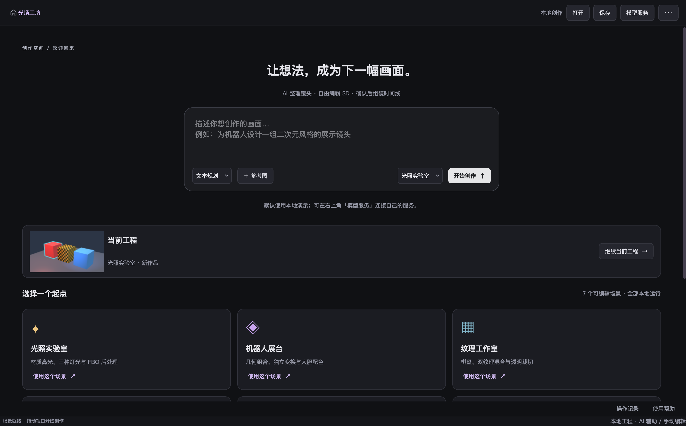
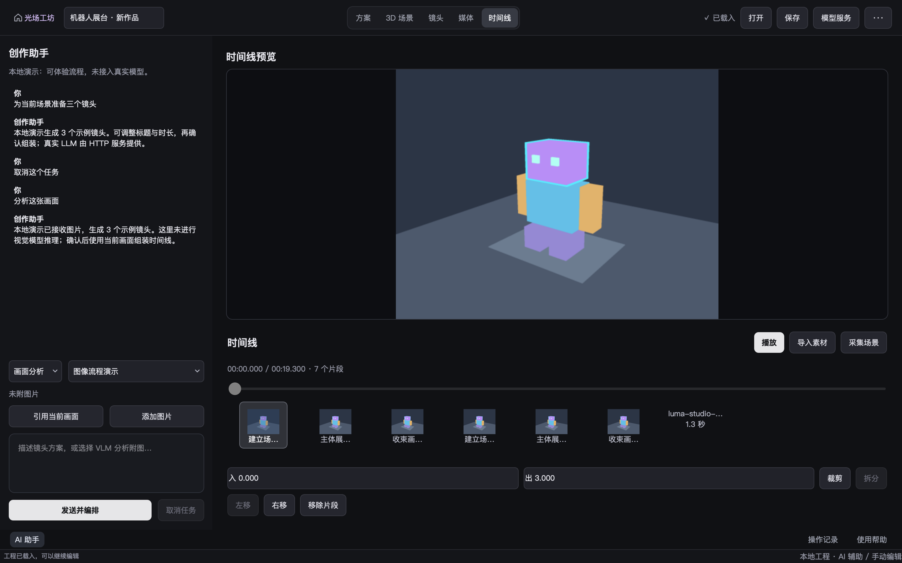
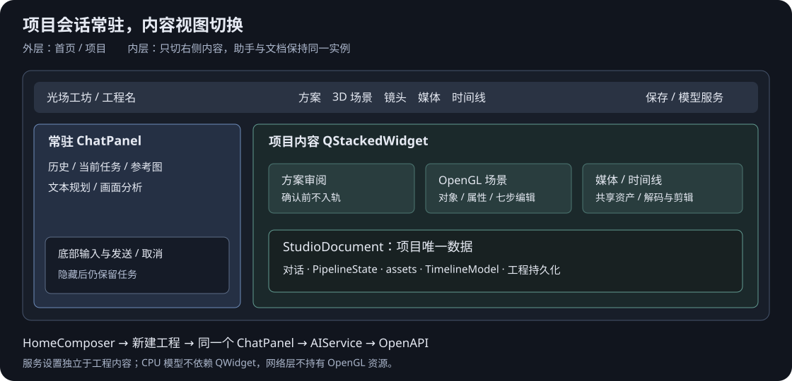
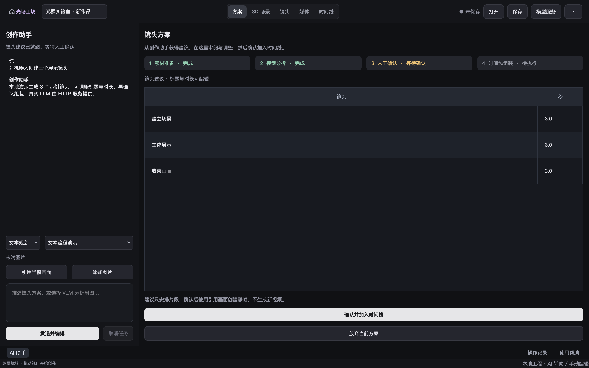
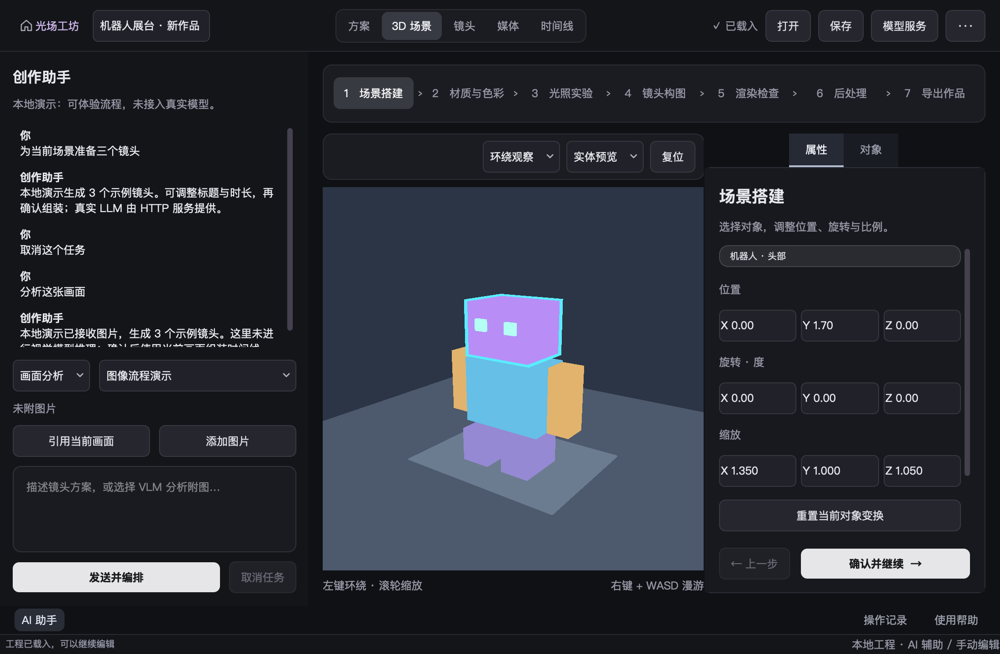
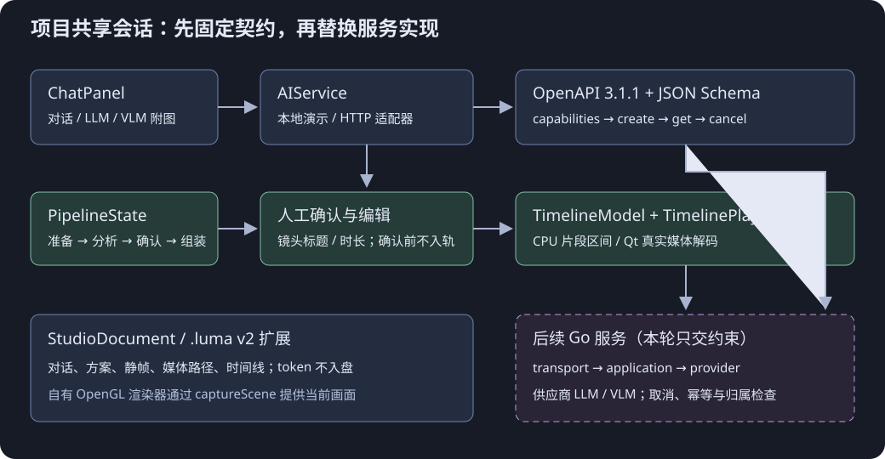
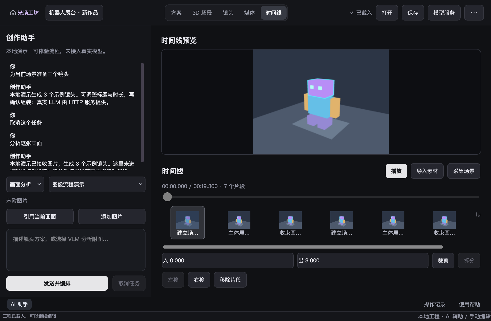

+++
date = '2026-10-24T21:00:00+08:00'
draft = false
title = 'OpenGL 项目实战（六）：用 OpenAPI 接通对话、人工 Pipeline 与视频时间线'
description = '在同一款 Qt/OpenGL 创作软件中加入对话、VLM 附图、人工确认和真实视频时间线。通过 OpenAPI 3.1.1、可替换 AIService、CPU 剪辑模型、Go 后端约束与真实窗口测试，建立后续接入模型服务的完整链路。'
toc = true
tags = ['OpenGL', 'Qt', 'OpenAPI', 'Pipeline', 'Go', '视频时间线']
keywords = ['Qt AI 对话', 'OpenAPI 契约优先', 'Qt 视频时间线', 'Go LLM VLM 接入', '人工确认 Pipeline', 'OpenGL 创作软件']
[[params.faqItems]]
question = '没有实现 Go 后端，对话页面是否能使用？'
answer = '默认本地演示执行器可以完整体验对话、取消、镜头确认和入轨，且明确标注未调用真实模型。HTTP 适配器已经实现，后续 Go 服务遵守四个 OpenAPI 接口即可替换演示执行器。'
[[params.faqItems]]
question = 'OpenAPI 和 OpenAI API 是同一个东西吗？'
answer = '不是。这里的 OpenAPI 描述本软件的业务 HTTP 协议；Go provider 才负责适配 OpenAI 或其他供应商，Qt 不直接持有供应商密钥。'
[[params.faqItems]]
question = '时间线现在能导出完整视频吗？'
answer = '本轮支持本地视频解码播放、定位、裁剪、拆分、重排与工程保存。尚未实现多轨合成、转场和视频编码导出；现有 PNG 导出仍属于 OpenGL 画面输出。'
[[params.faqItems]]
question = '以后换后端需要重写界面吗？'
answer = '只要服务继续遵守同一份 OpenAPI，ChatPanel 通过 AIService 工作，Pipeline 与 TimelineModel 不需要了解具体模型供应商。新增业务能力应先改规范和回归，再扩展实现。'
+++



**先把模型服务的输入、输出、取消和版本规则固定下来，再把 Go 接进来。** 这是本次扩展最重要的判断。对一个仍在持续学习 OpenGL 的项目，先完成可运行的业务闭环，比提前堆入模型 SDK、数据库和通用调度框架更容易验证，也更方便复用。

光场工坊现在把整个项目组织成 AI 辅助创作界面：首页输入想法或附图，项目左侧保留同一个助手，右侧切换方案、3D 场景、镜头、媒体和时间线。默认本地演示不调用真实模型；右上角“模型服务”连接 HTTP 后，客户端按同一份 OpenAPI 请求后端。Go 目前交付实现约束。

## 先走完一条创作链路

安装匹配的 Qt6 Widgets、OpenGLWidgets、Network 和 Multimedia 后，在工作区根目录运行：

```sh
cmake -S opengl_visual_workbench/native -B opengl_visual_workbench/native/build \
  -DCMAKE_PREFIX_PATH=/opt/homebrew -DLUMA_WITH_QT=ON -DCMAKE_BUILD_TYPE=Debug
cmake --build opengl_visual_workbench/native/build -j4
opengl_visual_workbench/native/build/bin/luma_qt_workbench
```

在首页输入“为当前场景准备三个镜头”，选择起始场景，再点“开始创作”。也可以用模板进入项目，从常驻助手输入后点“发送并编排”。分析结束会停在“人工确认”：可以改标题和时长，确认后才用引用的 OpenGL 画面创建静帧片段。它并没有生成新的视频内容，镜头建议与媒体生成是两项不同的业务。

在助手中选择“画面分析”，引用当前画面或添加 PNG/JPEG 后再发送，可以体验带图请求。真实模型的图像理解需要后端；演示执行器只验证附件并返回固定示例，不声称识别了图中内容。

“导入素材”支持本地图片和视频。导入视频后，选择片段并播放，可以拖动播放头，用源入点、出点裁剪，在播放头拆分，再左右移动或移除。保存 `.luma` 会保留对话、方案、静帧和时间线；外部视频继续引用原路径，移动文件后需要恢复该路径。

## AI 创作布局应当围绕同一项目会话

AI 创作工具需要让对话伴随编辑过程。把助手关在独立页面里，用户每次修改场景都要离开会话；这次实际查看 [Pixo 首页](https://pixo.video/zh/539-04a9405c/dashboard) 和项目视图后，采用常驻对话与右侧内容栈来组织本项目。





这里有两层 QStackedWidget：外层只切首页和项目，内层只切项目内容。ChatPanel 在内层栈外面，所以切换媒体、镜头或场景不会重建它。方案就绪时导航到审阅表格；确认组装成功后进入时间线，整个过程使用同一份 StudioDocument。



3D 场景也留在这个项目容器内。对象列表和属性页共用右侧标签面板，避免再增加一列；七步手工编辑仍由原有 Controller 驱动。首页只产生输入意图，不再维护另一套 HTTP 客户端。设置窗口是模型服务的唯一入口，连接状态会同时显示在设置窗口和助手中。



给工程清空内容时，服务连接应当保留。真实 HTTP 回归发现，新建工程曾调用 ChatPanel::reset 清空连接，首页提交随即失败。现在空闲连接独立于项目文档，HTTP 输入可以从首页进入同一条提交链；未连接时则保留输入和参考图，等待连接后发送。不要用“本地演示能跑”推断 HTTP 入口也能跑。

## 模块的复用入口在哪里



| 模块 | 主要类与函数 | 负责的边界 |
| --- | --- | --- |
| CPU 模型 | TimelineModel::add/trim/split/move/remove/locate | 片段顺序、时间区间与原子校验，不依赖 Qt/OpenGL |
| 编排状态 | PipelineState::start/prepared/analyzed/approve/assembled/cancel/restore | 四节点依赖、人工确认、取消与恢复 |
| 服务接口 | AIService::capabilities/start/cancel | 本地演示和 HTTP 的共同入口 |
| HTTP 协议 | ApiContract::operation/validate、HttpAIService | 从规范读路径、校验 DTO、轮询与取消协调 |
| 本地文档 | StudioDocument::toJson/fromJson/requestMessages | 对话、资产索引、Unicode 上下文和版本化 JSON |
| Qt 视图 | HomeComposer、ChatPanel、PipelinePanel、TimelinePanel、StudioAssetsPanel | 首页意图、常驻对话、右侧内容，不管理 GL 资源 |
| 工作区组合 | StudioWorkspace、WorkbenchShell、WorkbenchStudio | 持有项目会话、组合视图、人工组装，复用工程保存与脏状态 |
| 媒体播放 | TimelinePlayer | QMediaPlayer 解码、QVideoSink 取帧、全局时间映射 |

布局组合的实际代码从 [WorkbenchShell](../../native/src/qt/WorkbenchShell.cpp)、[HomeComposer](../../native/src/qt/HomeComposer.cpp)、[StudioWorkspace](../../native/src/qt/StudioWorkspace.cpp) 阅读；模型设置位于 [ChatSettings](../../native/src/qt/ChatSettings.cpp)，共享资产视图位于 [StudioAssetsPanel](../../native/src/qt/StudioAssetsPanel.cpp)。它们各自只承担一个界面职责。

完整声明从 [studio 头文件目录](../../native/include/luma/studio) 和 [Qt 模块目录](../../native/include/luma/qt) 阅读。新文件遵守现有行数约束，窗口只增加组合点，没有把 HTTP 与剪辑算法塞入主窗口。

原有 OpenGL 绘制链路仍由自己的 Renderer 和资源包装完成。项目容器通过 `captureScene` 回调取得 `QOpenGLWidget::grabFramebuffer()` 的图像；网络层不接触 GL handle。模型返回的只是受限镜头建议，当前也不会自动修改场景对象。以后做自动摆灯、材质修改时，应新增有校验的业务命令，再由宿主调用现有 Controller。

## OpenAPI 必须真的约束客户端

本项目的业务契约是 [api/openapi.json](../../api/openapi.json)。采用 OpenAPI 3.1.1，DTO 拆在 `api/schemas/`，分发时要连同外部引用一起保留。JSON 是规范允许的表达格式；本轮固定一个明确版本，便于校验和生成工具兼容性验证。[OpenAPI 3.1.1 规范](https://spec.openapis.org/oas/v3.1.1.html)

| operationId | 方法与路径 | 成功结果 |
| --- | --- | --- |
| getCapabilities | GET /v1/capabilities | 200，可用模型及 llm/vlm 能力 |
| createRun | POST /v1/runs | 202，任务完整快照 |
| getRun | GET /v1/runs/{run_id} | 200，最新完整快照 |
| cancelRun | POST /v1/runs/{run_id}/cancel | 200，取消结果；冲突使用 409 |

创建任务携带 UUID `Idempotency-Key`，取消携带 `expected_revision`。错误使用 `application/problem+json`，正文 status 必须与 HTTP 状态码一致。每次快照变化增加 revision，相同 revision 必须对应相同内容。客户端按 operationId 查实际 method/path，同时校验请求和响应；测试还用标准 Python 校验器验证同一份规范及 Qt 导出的 DTO。

不要把它误认为供应商的 OpenAI API。Qt 只认识本软件的模型 ID、消息、附件与 Run。供应商 SDK、模型别名、工具调用和厂商错误由将来的 Go provider 归一化。这样替换模型不会迫使 Qt 对话页同时兼容多套供应商协议。

`ApiContract` 是受控校验器，只实现当前 schema 实际使用的关键字，并拒绝不认识的关键字。它不是完整通用 JSON Schema 引擎。扩展 schema 时，应同时补它的能力或改用完整实现，并继续通过标准校验器验收。

```sh
python3 -m venv /private/tmp/luma-contract-venv
/private/tmp/luma-contract-venv/bin/pip install \
  -r opengl_visual_workbench/api/requirements-validation.txt
opengl_visual_workbench/native/build/bin/luma_studio_contract_tests \
  /private/tmp/luma-studio-client-dtos.json
LUMA_CLIENT_FIXTURES=/private/tmp/luma-studio-client-dtos.json \
  /private/tmp/luma-contract-venv/bin/python opengl_visual_workbench/tests/test_api_contract.py
```

## 人工确认是有状态的业务节点

流程为“素材准备 → 模型分析 → 人工确认 → 时间线组装”。分析成功不会直接入轨，`analyzed()` 只让 review 进入 Waiting。只有 `approve()` 才允许组装，后续 `assembled()` 才成为完成。取消后的迟到结果无法跨过这些前置条件。

恢复工程时，不能为了让界面看起来合理而猜测节点状态。代码验证状态组合是否真实可达；已取消和已完成保持原样，正在执行的节点恢复为“失败 / 已中断”，等待人工审核的方案仍可继续确认。因为本轮没有服务端恢复执行协议，不能把磁盘上的 Running 当成仍有后台任务在运行。

```cpp
// SOURCE: native/src/studio/PipelineState.cpp
#include <luma/studio/PipelineState.hpp>
#include <stdexcept>
namespace luma {
bool PipelineState::active() const {
    for (auto state : nodes_)
        if (state == PipelineNodeState::Running || state == PipelineNodeState::Waiting) return true;
    return false;
}
void PipelineState::start() {
    if (active()) throw std::logic_error("已有编排正在执行");
    reset(); nodes_[0] = PipelineNodeState::Running;
}
void PipelineState::advance(int from, int to, PipelineNodeState expected, PipelineNodeState next) {
    if (nodes_[from] != expected || nodes_[to] != PipelineNodeState::Pending)
        throw std::logic_error("编排节点的前置条件未满足");
    nodes_[from] = PipelineNodeState::Done;
    nodes_[to] = next;
}
void PipelineState::prepared() { advance(0, 1, PipelineNodeState::Running, PipelineNodeState::Running); }
void PipelineState::analyzed() { advance(1, 2, PipelineNodeState::Running, PipelineNodeState::Waiting); }
void PipelineState::approve() { advance(2, 3, PipelineNodeState::Waiting, PipelineNodeState::Running); }
void PipelineState::assembled() {
    if (nodes_[3] != PipelineNodeState::Running) throw std::logic_error("请先确认镜头方案");
    nodes_[3] = PipelineNodeState::Done;
}
void PipelineState::fail() {
    for (auto& state : nodes_)
        if (state == PipelineNodeState::Running || state == PipelineNodeState::Waiting)
            state = PipelineNodeState::Failed;
}
void PipelineState::cancel() {
    for (auto& state : nodes_)
        if (state != PipelineNodeState::Done) state = PipelineNodeState::Cancelled;
}
void PipelineState::reset() { nodes_.fill(PipelineNodeState::Pending); }
void PipelineState::restore(const std::array<PipelineNodeState, 4>& states) {
    PipelineState phase;
    bool reachable = false;
    for (int i = 0; i < 6; ++i) {
        auto failed = phase; failed.fail();
        auto cancelled = phase; cancelled.cancel();
        reachable |= states == phase.nodes_ || states == failed.nodes_ || states == cancelled.nodes_;
        if (i == 0) phase.start();
        else if (i == 1) phase.prepared();
        else if (i == 2) phase.analyzed();
        else if (i == 3) phase.approve();
        else if (i == 4) phase.assembled();
    }
    if (!reachable) throw std::invalid_argument("编排状态不符合节点执行顺序");
    nodes_ = states;
    for (auto& state : nodes_)
        if (state == PipelineNodeState::Running) state = PipelineNodeState::Failed;
}
} // namespace luma
```

本次测试先暴露了一个实际错误：在人工确认阶段取消后保存，再读取工程，原先会变成模型分析失败。测试同时发现“不可能的节点组合”也能被读入。修复后用可达状态校验恢复，保留终态，而不是只检查末尾一个字段。

## 取消和超时不能只让按钮停止转圈

客户端基于 Qt 异步网络请求接收回复，不阻塞窗口线程。[QNetworkAccessManager 文档](https://doc.qt.io/qt-6/qnetworkaccessmanager.html)

单请求限时 15 秒，整个运行默认三分钟。总超时时如果已有 GET 在途，客户端先标记取消意图，等它返回后取得最新 revision 再发 POST cancel，协调终态后报告超时。若直接先清掉 active 标志，迟到 GET 就无法继续发出取消，后端推理可能继续消耗资源。这是本次独立审查发现并已补上回归的一处问题。

409 冲突时重新获取快照，最多重试三次。若取回已成功或失败的终态，就保留该结果，不把完成竞态强行改成 cancelled。网络无法到达服务时，客户端无法保证远端已停止；Go application 仍必须实现自身的截止时间与 provider context 取消。完整代码见 [HttpAIService.cpp](../../native/src/studio/HttpAIService.cpp)。

## 时间线的时间与视频源时间不是同一个值

每个片段保存 `[in_ms, out_ms)`。假设时间线第一段播放源视频 0–1000 ms，第二段播放同一视频 1100–2000 ms，那么时间线的 1000 ms 应跳到源视频的 1100 ms。仅比较 asset ID 会漏掉这次切换；用“偏差超过 250 ms 才 seek”也会放过这个 100 ms 的缺口。

TimelinePlayer 因此同时跟踪片段 ID 和素材 ID。切换片段就强制映射源位置，播放中的一般漂移才使用阈值调整。媒体格式与解码能力取决于平台的 Qt Multimedia 后端；测试使用本机生成的 H264 MOV，并验证真实解码帧，而不只看播放头数字。[QMediaPlayer 文档](https://doc.qt.io/qt-6/qmediaplayer.html)

```cpp
// SOURCE: native/src/studio/TimelineModel.cpp
#include <luma/studio/TimelineModel.hpp>
#include <algorithm>
#include <stdexcept>
namespace luma {
std::int64_t TimelineModel::duration() const {
    std::int64_t sum = 0;
    for (const auto& clip : clips_) sum += clip.duration();
    return sum;
}
void TimelineModel::validate(const TimelineClip& clip) const {
    if (clip.id.empty() || clip.assetId.empty() || clip.title.empty() ||
        clip.title.size() > 480 || clip.inMs < 0 || clip.outMs > 3600000 || clip.duration() < 100)
        throw std::invalid_argument("片段须有名称，时长至少 0.1 秒且源范围不超过一小时");
}
void TimelineModel::add(TimelineClip clip) {
    validate(clip);
    if (clips_.size() >= 100 || duration() + clip.duration() > 3600000)
        throw std::invalid_argument("时间线最多 100 个片段，总时长不超过一小时");
    for (const auto& previous : clips_)
        if (previous.id == clip.id) throw std::invalid_argument("片段 ID 重复");
    clips_.push_back(std::move(clip));
}
void TimelineModel::trim(std::size_t index, std::int64_t in, std::int64_t out,
                         std::int64_t sourceDuration) {
    auto candidate = clips_.at(index);
    candidate.inMs = in; candidate.outMs = out;
    validate(candidate);
    if (out > sourceDuration || duration() - clips_[index].duration() + candidate.duration() > 3600000)
        throw std::invalid_argument("裁剪超出素材或时间线时长");
    clips_[index] = std::move(candidate);
}
void TimelineModel::split(std::size_t index, std::int64_t localMs, std::string newId) {
    const auto original = clips_.at(index);
    if (localMs < 100 || localMs > original.duration() - 100 || clips_.size() >= 100)
        throw std::invalid_argument("拆分点两侧须至少保留 0.1 秒");
    for (const auto& clip : clips_)
        if (clip.id == newId) throw std::invalid_argument("片段 ID 重复");
    auto right = original;
    right.id = std::move(newId); right.inMs += localMs;
    validate(right);
    clips_.insert(clips_.begin() + index + 1, right);
    clips_[index].outMs = right.inMs;
}
void TimelineModel::move(std::size_t from, std::size_t to) {
    auto clip = clips_.at(from);
    clips_.at(to); // Validate both before mutation.
    clips_.erase(clips_.begin() + from);
    clips_.insert(clips_.begin() + to, std::move(clip));
}
void TimelineModel::remove(std::size_t index) {
    clips_.at(index);
    clips_.erase(clips_.begin() + index);
}
TimelinePosition TimelineModel::locate(std::int64_t globalMs) const {
    if (clips_.empty()) throw std::logic_error("时间线为空");
    auto remaining = std::clamp<std::int64_t>(globalMs, 0, duration() - 1);
    for (std::size_t i = 0; i < clips_.size(); ++i) {
        if (remaining < clips_[i].duration()) return {i, clips_[i].inMs + remaining};
        remaining -= clips_[i].duration();
    }
    throw std::logic_error("时间线定位失败");
}
} // namespace luma
```

TimelineModel 可以直接放进其他 C++ 程序：拆分保持总时长，非法裁剪不改变旧数据，最终边界定位到最后一个有效源时刻。当前单轨上限 100 段、总时长一小时、每段至少 100 ms。它不负责解码、控件、音频同步或文件 IO；Qt 播放器负责这些宿主能力中的播放部分。

## 用真实运行结果检查封装



这次运行了 11 项 CTest，以及独立的真实 Qt 编排回归。项目窗口回归共 47 项，覆盖常驻助手、首页文本/附图/HTTP 提交、素材联动和窄窗口，还包括取消后无迟到入轨、VLM 附图、真实视频解码帧变化、100 ms 源区间跳切、裁剪拆分、重排后移除正确片段，以及工程恢复。原有 Qt 工作台和完整交互回归另行运行；日志与命令见 [整体布局验收记录](../../docs/implementation/2026-10-24-ai-project-layout.md)。

视频验证还遇到一个测试层面的陷阱：当前 macOS Qt 6.12 的 AVFoundation 输出使用原生显示回调，仅在循环中调用 processEvents 会让播放头前进而收不到帧。独立最小播放器可正常解码；将测试等待改为 QEventLoop 后，实际像素变化通过。这里保留真实解码断言，没有把播放头计时当作替代验收。

还有两个容易藏在“按钮能点”背后的错误：移动片段后若按行号恢复选中项，下一次删除可能删错片段；按 Unicode 字符验证输入后再用 UTF-16 `left(4000)` 截断，会把合法 emoji 提示词截短。现在选中项按稳定片段 ID 保留，上下文按 Unicode 码点裁切。这些回归比复刻一份实现细节更能证明边界有效。

macOS 上可生成不依赖外部素材的视频测试文件：

```sh
swift -module-cache-path /private/tmp/luma-swift-cache \
  opengl_visual_workbench/tools/make-video-fixture.swift /private/tmp/luma-studio-fixture.mov
opengl_visual_workbench/native/build/bin/luma_studio_ui_tests /private/tmp/luma-studio-fixture.mov
```

## Go 接入时从哪里开始

先阅读 [Go 后端约束](../../docs/backend-go-contract.md)，实现四个业务接口、账号归属、幂等记录、版本原子比较、累计文本快照和 provider 取消。然后在 Qt 右上角“模型服务”中选择 HTTP 模式，输入根地址与本应用的 bearer token，连接读取能力列表，再发送 LLM 或 VLM 请求。token 只在当前会话中存在，不写进工程。

暂时不用添加工程同步、文件上传或视频生成接口。当前本地资产路径只属于本机，不能让远端模型服务直接读取；需要上传时先补 OpenAPI、资产 ID 和测试。视频编码、多轨、转场、音画同步与恢复远端运行都还需要各自的设计和实现。下一阶段学习模型、阴影与 PBR 时，继续扩展原有渲染模块，编排工作区通过清楚的业务接口接入这些新增能力。

## FAQ

### 后续换 Qt 的 OpenGL 资源包装需要重做编排吗？

编排只通过画面采集回调取得 QImage，不使用 shader 或纹理 handle。资源包装仍在原有 IResourceFactory 边界替换；渲染算法本身继续由自己的 Renderer 维护。

### 本地演示和真实 HTTP 为什么都保留？

本地执行器用来开发、演示和验证人工流程；HTTP 执行器用来连接真实服务。两者遵循同一业务 DTO，但本地成功不能作为模型推理成功的证据。

### 可以把 AI 建议变成任意脚本执行吗？

当前输出只有标题和时长。后续自动操作应映射到白名单业务命令，经过候选状态校验和必要人工确认，再由持有上下文的线程提交。不要把模型文本直接当成本地可执行代码。
