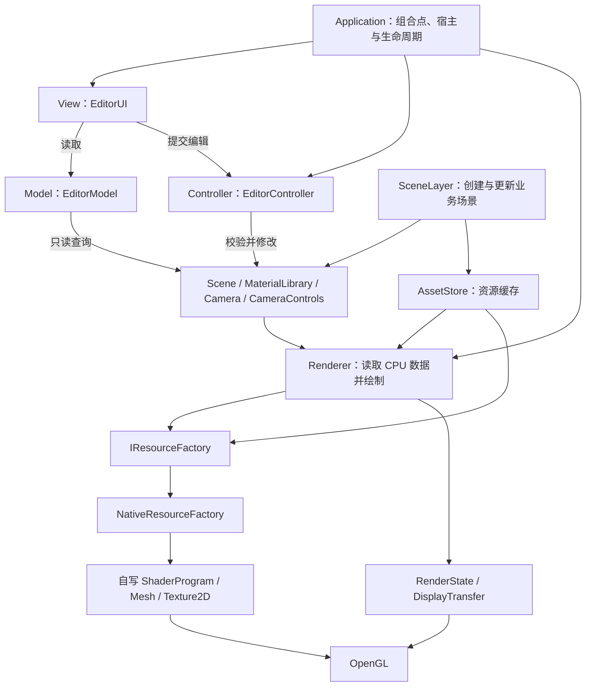
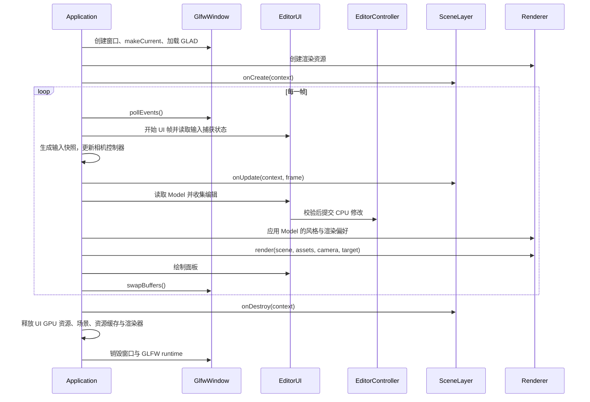

# 光场工坊：C++ / OpenGL 模块设计

状态：第一、二阶段与 MVC 复用边界实现说明，2026-10-24。第二阶段新增 LightRig、LightingSettings、LightingPipeline、PostProcessTarget 与 PostProcessPipeline，详细新增边界见 [开发边界](development-boundaries.md) 和 [第五篇文章](../articles/05-stage-two-lighting/index.zh.md)。原生工程已实现，参见 [构建与操作](../native/README.md) 和 [实际验证](../native/tests/verification.md)。[HTML 产品原型](../index.html) 展示未来多风格视觉目标。本文中的后续模块会明确标记。

## 1. 从使用场景确定封装

这个项目最终是一款多风格 3D 场景工作台：摆放物体、编辑材质、切换画风、调整灯光、导出画面。第一版用已经学完的第一阶段知识完成基础场景，后续每学一个阶段就增加真实功能。

封装的验收标准是：**增加一个场景时，主要写“放什么物体、用什么材质、怎么运动”，窗口初始化、缓冲上传和资源释放由公共模块完成。** 每个封装内部保留对应 OpenGL 调用和知识点说明，方便向下阅读。

当前同时提供 GLFW / Dear ImGui 学习宿主和 Qt6 中文桌面宿主。两者都复用 CPU MVC、场景、资源工厂与 Renderer；Qt 已接管窗口 / 面板，但 QtResourceFactory 仍是后续可选扩展。

借鉴 Qt 的生命周期组织方式。Qt 提供 `initializeGL / resizeGL / paintGL`，并管理调用时的当前上下文；本项目采用自己的 `Application + SceneLayer`，适配 GLFW 运行循环。这里借鉴使用体验，首版不引入 Qt 依赖。[Qt 官方生命周期说明](https://doc.qt.io/qt-6/qopenglwidget.html)

### 方案取舍

| 方案 | 使用体验 | 代价 | 本项目决定 |
| --- | --- | --- | --- |
| 几个工具函数 | 小例子容易开始 | 状态、生命周期和所有权仍散落在场景中 | 用于纯数学和 CPU 几何生成 |
| 对象封装 + 薄场景层 | 通过对象和成员函数组织工作流 | 需要明确资源和场景的边界 | 采用 |
| 通用游戏引擎框架 | 可以覆盖大量未知需求 | ECS、反射、插件和多 API 适配增加学习负担 | 有实际需求时逐项引入 |

## 2. MVC 与渲染基础设施



MVC 约束编辑业务的职责，Renderer 是渲染服务。`EditorModel` 借用 Scene、MaterialLibrary、Camera、CameraControls，保存选择和渲染偏好；View 只读这些内容，写操作交给 `EditorController`。控制器不引用 OpenGL、GLFW、Qt 或 Dear ImGui，无窗口程序与当前面板使用同一套操作。

源码目录和构建目标分工一致：纯 CPU 数据与控制器进入 `luma_cpu`；`gfx` 包含资源契约与自写实现，不链接 GLFW；`core` 承担 GLFW 宿主。`scene` 下的 AssetStore 持有 GPU 资源，CPU MaterialLibrary 单独构建。`render` 负责绘制算法，`app` 组合实例和生命周期。这里的箭头表示调用或数据流，不能把所有箭头理解为继承关系。

### 宿主层：Application、GlfwWindow、Input

- `GlfwWindow` 管 GLFW 窗口、当前上下文、像素尺寸和交换缓冲；全程序只有一个 GLFW runtime 所有者。
- `Application` 是 app 层的组合入口，保证初始化和退出顺序，计算时间，驱动输入、场景更新和渲染。
- `InputRouter`（`core/Input.hpp`）把 GLFW 事件转成 `InputSnapshot`。相机和场景代码不包含 `GLFWwindow*`。
- `SceneLayer` 是用户扩展点：`onCreate()`、`onUpdate()`，需要时实现 `onDestroy()`。

GLAD 2 入口在上下文成为 current 之后加载。首版固定单窗口、主线程渲染；所有 GPU 创建、上传和删除都发生在该线程。这个限制与 GLFW 关于当前上下文的要求一致。[GLFW 上下文指南](https://www.glfw.org/docs/latest/context_guide.html)

### GPU 资源层：ShaderProgram、Mesh、Texture2D

| 类 / 类型 | 封装什么 | 主要接口 | 明确不负责的事 |
| --- | --- | --- | --- |
| `ShaderProgram` | 编译、链接、program、uniform location 缓存 | `fromFiles()`、`use()`、`set()` | 决定物体材质或光照算法 |
| `MeshData` | CPU 顶点与索引 | 普通值类型 | 调用 OpenGL |
| `PrimitiveFactory` | 立方体、平面等 CPU 几何 | `cube()`、`plane()` | 分配 GPU 缓冲 |
| `Mesh` | VAO、VBO、EBO、顶点布局与 draw | `upload()`、`draw()` | 计算 MVP 或选择 shader |
| `ImageData` | 解码后的像素、尺寸与通道 | 普通值类型 | 创建纹理 |
| `Texture2D` | 纹理上传、采样、mipmap、纹理单元绑定 | `fromFile()`、`bind()` | 决定使用哪个 sampler uniform |
| `RenderState` | 深度、模板、混合、剔除和写入掩码 | `apply()` | 自动猜测上一个 pass 留下了什么 |
| `RenderTarget` | FBO、附件、尺寸与完整性检查 | 已由 PostProcessTarget 实现 `resize()`、`bindForScene()` | 管理操作系统窗口 |

GPU 资源采用 RAII，禁止复制，允许 `noexcept` 移动。移动后源对象 handle 归零，移动赋值先释放自身旧资源；空对象析构不调用删除。构造 / 工厂失败要释放已经创建的部分资源。

资源按 `AssetStore → IMesh / ITexture → 原生适配对象 → GPU 包装对象` 单向持有；Renderer / DisplayTransfer 通过 IShader 持有程序。`NativeResourceFactory` 创建这些适配对象，并在内部委托现有自写类。工厂显式注入，场景与渲染调用方无需知道实际包装类型。场景拿到 `MeshId / TextureId / MaterialId`，不会复制 GPU handle。首版资源缓存随应用存活，退出时统一释放；场景切换清空实体，已加载的基础资源可复用。首版不提供运行中的资源卸载 API。

### 场景与渲染层：Scene、Material、Camera、Renderer

- `Scene`：对象名称、实体 ID、变换、网格和材质引用；首版用简单容器，支持创建、查询和清空。
- `Transform`：位置、四元数旋转、缩放；计算 `T * R * S`。角度输入明确使用角度或弧度，矩阵内部统一 GLM。
- `MaterialLibrary`：CPU 材质数据与强类型 ID 仓库，不要求窗口或 GPU；AssetStore 的材质便利函数转发到它。
- `MaterialDesc`：CPU 材质参数。第一版为 Unlit 颜色 / 纹理、透明模式和双面属性；已增加 specularColor、shininess、specularTexture；金属度和粗糙度留给 PBR。
- `Camera`：观察与投影数据，不读取键盘或鼠标。
- `CameraControls`：组织 Orbit 和 Fly 控制方式，接收 `InputSnapshot`，修改 `Camera`。
- `Renderer`：读取场景，生成绘制队列，应用 pass 状态，向指定输出目标绘制。
- `StyleKind`：当前由 Renderer 选择 Basic 与 Wireframe，ShadingModel 已独立选择 Unlit / BlinnPhong；Toon、PBR、Neon 仍待后续。
- `EditorModel`：只读编辑视图、选中实体与渲染偏好；借用的 CPU 数据必须比模型活得更久。
- `EditorController`：校验和提交变换、材质、选择、相机与视图操作；无 UI、窗口或 GPU 依赖。
- `EditorUI`：对象列表和参数面板，读 Model，向 Controller 提交编辑；控件回调不持有可写场景或 Renderer。

桌面首版编辑面板使用 Dear ImGui 的 GLFW + OpenGL3 后端，集中放在 `editor`；它已有这套组合的官方接入示例。面板已提供对象、材质、变换、风格和状态实验控制。[Dear ImGui 接入指南](https://github.com/ocornut/imgui/wiki/Getting-Started)

## 3. 调用者应该写什么

下面片段展示真实接口的调用方式，省去 include。完整可编译版本见 [reusable_scene.cpp](../native/examples/reusable_scene.cpp)，构建生成 `luma_reuse_example`。详细类型约定见 [接口契约](api-contract.md)。

```cpp
class CubeStudio final : public luma::SceneLayer {
public:
    void onCreate(luma::SceneContext& ctx) override {
        const auto cube = ctx.assets.primitive(luma::Primitive::Cube);
        const auto lavender = ctx.assets.createMaterial(
            luma::MaterialDesc::unlit({0.55f, 0.35f, 0.80f, 1.0f}));
        cube_ = ctx.scene.create("展示立方体", cube, lavender);
        ctx.camera.lookAt({4.f, 3.f, 6.f}, {0.f, 0.f, 0.f});
        ctx.controls.setMode(luma::CameraMode::Orbit);
    }

    void onUpdate(luma::SceneContext& ctx,
                  const luma::FrameInfo& frame) override {
        ctx.scene.transform(cube_).setRotation(glm::angleAxis(
            static_cast<float>(frame.elapsedSeconds) * 0.4f,
            glm::vec3{0.f, 1.f, 0.f}));
    }

private:
    luma::EntityId cube_{};
};

int main() {
    luma::Application app{"光场工坊", 1280, 800};
    return app.run(std::make_unique<CubeStudio>());
}
```

这里颜色值定义为线性 RGB，生产界面的十六进制颜色由 UI 转换后再写入材质。公共模块负责相机输入、窗口尺寸、渲染和清理，场景只保存实体 ID 和自己的业务状态。

## 4. 一帧和整个应用的生命周期



关键约定：

1. 每帧处理输入后更新相机；鼠标正在操作面板或键盘正在输入时，相机不消费相应输入。失焦时清除按键和拖拽状态。ImGui 捕获标志的接入依据其官方指南。
2. 投影 aspect 和 `glViewport` 使用 framebuffer 像素尺寸。尺寸为零时暂停绘制与尺寸相关资源重建，但仍处理事件。GLFW 明确区分窗口坐标和像素尺寸。[Framebuffer size](https://www.glfw.org/docs/latest/window_guide.html#window_fbsize)
3. GPU 资源在有有效 current context 时创建和销毁。初始化中途失败也保持这一顺序；错误最终由 `Application` 报告，返回非零状态。
4. `onCreate()` 成功后，退出时恰好调用一次 `onDestroy()`；其异常会记录并继续清理。创建失败时不调用这个完成回调，依靠已构造对象的 RAII 回收。场景类不直接拥有 GPU 包装对象，析构函数不依赖上下文。
5. 限制异常恢复后的模拟时间步长，避免切回应用时物体突然跳动；统计墙钟时间和实际更新使用的 delta 分开记录。

## 5. 资源、材质与状态的具体规则

### 资源共享，实例参数可独立

相同 `MeshId` 可以给一百个物体使用。相同 `MaterialId` 表示主动共享材质，修改会影响所有引用者；属性面板提供“创建独立材质”，通过控制器的独立材质操作复制 CPU 材质数据。默认新建对象使用独立材质，防止改一个物体导致全部变色。

资源缓存 key 包含规范化资产路径及影响纹理结果的选项：色彩空间、Y 翻转、环绕、过滤和 mipmap。色彩贴图与法线 / 粗糙度等数据贴图使用不同色彩空间标记。图片解码翻转采用每次加载的局部处理，避免全局 stb 翻转开关影响其他加载任务。

首版 ID 使用独立的强类型、单调递增编号，0 为无效；同一应用生命周期内不复用编号。查询失效 ID 返回明确错误；实体删除或场景清空后，旧 ID 不得指向新对象。动态卸载和编号复用真的需要时再引入代际 handle。

### RenderState 在每个 pass 开始时完整应用

状态配置包含：depth test、depth func、depth write、stencil test / func / op / mask、blend enable / equation / factors、cull mode、front face、color mask、polygon mode、scissor 和 viewport。首版逐 pass 设置，便于观察和调试，暂不做隐式状态缓存。

清屏前恢复需要清除的附件写入掩码，并处理 scissor 范围。透明物体放在不透明之后，常规 Alpha 混合从远到近、开启深度测试并关闭深度写入；中心点排序对相交透明几何存在限制，文章要展示此边界。模板选中轮廓与画风描边分成不同功能。

桌面线框使用 `glPolygonMode`，pass 结束后下一 pass 显式恢复填充状态。现有 WebGL 原型通过边索引画线；不把它误写成同一 API 的直接复用。

### 统一管理输出色彩

材质颜色和 shader 内部运算保持在线性空间。颜色贴图标记为 sRGB、数据贴图为线性；最终输出只做一次编码。宿主提供目标 framebuffer 的实际色彩编码能力，能硬件编码时使用 `GL_FRAMEBUFFER_SRGB`，否则先在内部线性附件完成混合，最后显示阶段手动编码。这个 `DisplayTransfer` 附件服务正确输出，不是尚待学习的后期滤镜接口。第二阶段引入线性中间纹理时不提前编码。

## 6. 先用当前接口，后续按业务增加能力

两种复用已有实际入口：[reusable_scene.cpp](../native/examples/reusable_scene.cpp) 通过 SceneLayer 创建运行中的场景；[controller_example.cpp](../native/examples/controller_example.cpp) 无窗口调用 Model / Controller 操作 CPU 参数。后者不链接窗口或 GL 库，直接展示选择、变换与共享材质编辑。

Qt 当前已替换 View / 宿主并继续使用 NativeResourceFactory；需要 Qt 的资源包装时，再实现同一资源契约，并在组合点切换工厂。Qt 包装不是自写类的同名替身，矩阵类型转换、资源释放时机、纹理选项与错误语义仍由适配器实现。`RenderState / DisplayTransfer` 继续是 OpenGL 算法，这套资源契约不表示已能切换到其他图形 API。

Qt 宿主需要在 current context 回调中加载函数、创建与销毁 GPU 资源，并传入 widget 的实际 FBO、像素尺寸和编码；不能在 Renderer 内写死 FBO 0。当前 Qt UI、输入桥、FBO 宿主和关闭清理已实现并由 luma_qt_tests 验收；QtResourceFactory 仍未实现。

编排扩展已加入 AIService、人工 PipelineState 和 TimelineModel。HTTP 按 [OpenAPI](../api/openapi.json) 创建、读取及取消任务；默认本地演示不调用模型。结果经人工确认后组装静帧时间线，不直接执行场景命令。Go 与供应商推理仍是后续实现，见 [Go 约束](backend-go-contract.md)。GPU 渲染与画面采集仍由持有上下文的线程执行。

### 各学习阶段增加什么

| 学习进展 | 增加的能力 | 主要扩展位置 | 场景业务代码变化 |
| --- | --- | --- | --- |
| 已完成的第一阶段 | 纯色 / 纹理场景、MVP、相机、深度 / 模板 / 混合 / 剔除、线框 | 核心资源、Renderer（Basic / Wireframe）、Scene、CameraControls | 创建物体和交互 |
| 第二阶段 | Phong、方向 / 点 / 聚光灯、FBO 滤镜 | Light、MaterialDesc、PhongPipeline、RenderTarget、PostProcess | 增加灯和材质参数 |
| 第三阶段 | 模型、天空盒、实例化、阴影、法线贴图 | ModelImporter、MeshData、Cubemap、ShadowPass、InstanceBatch | 用模型替换基础几何 |
| 第四阶段 | HDR / Bloom、PBR、粒子、骨骼动画 | PbrPipeline、BloomPass、ParticleSystem、Animator | 配置画风与动画 |
| 综合软件阶段 | 工程保存、撤销重做、资源浏览、导出 | ProjectIO、EditorCommand、AssetBrowser、ExportService | 形成完整创作流程 |

Toon 可在掌握基础光照后实现；Neon 随 FBO / Bloom 加入；“写实”逐步从 Phong 演进到 PBR。HTML 原型的视觉目标包含后续阶段，首版 C++ 不会提前假装具备这些算法。

Compute Shader 是 OpenGL 4.3 的核心能力；曲面细分对应 4.0。高级模块必须检查实际版本、扩展和函数入口，基础 3.3 管线持续可用。Compute 不列为当前 Mac 学习路径的必需条件，粒子可先采用 CPU 更新；真正实现 GPU 粒子时再选择 Transform Feedback 或具备相应能力的环境。[Khronos Compute Shader](https://wikis.khronos.org/opengl/Compute_Dispatch)、[Tessellation Evaluation Shader](https://wikis.khronos.org/opengl/Tess_Evaluation_Shader)

## 7. 目录与构建边界

`native/` 已创建并可独立构建。保留 HTML 入口作为最终产品的效果参考。

```text
opengl_visual_workbench/
├── index.html                    现有产品原型
├── workbench.js                  现有 WebGL 源码
├── docs/
│   ├── architecture.md           实现说明
│   ├── api-contract.md           类、函数与错误约定
│   └── milestones.md             实现顺序与验收标准
├── articles/
│   ├── README.md                 完整正文、HTML 阅读版与后续安排
│   ├── index.html                三篇完整中文博客阅读版
│   └── 01…03/                    中文 Markdown 正文
└── native/                       已实现的 C++17 工程
    ├── CMakeLists.txt
    ├── include/luma/
    │   ├── app/                  Application、SceneLayer、SceneContext
    │   ├── core/                 GLFW runtime、窗口、输入
    │   ├── gfx/                  资源契约、原生工厂、RenderState
    │   ├── scene/                Scene、Transform、Camera、MaterialLibrary、AssetStore
    │   ├── render/               Renderer、风格、Pass
    │   └── editor/               EditorModel、EditorController、EditorUI
    ├── src/                      与 include 对应的实现
    ├── examples/                 独立复用场景；学习例子使用 --example
    ├── scenes/                   Robot、Texture studio、State lab 预设与学习入口
    ├── assets/shaders/           GLSL 源文件
    └── tests/                    CPU 行为测试与真实 GL 冒烟测试
```

实际 CMake 目标包括 `luma_cpu`（纯 CPU 行为）、`luma_gfx`、`luma_core`、`luma_scene`、`luma_render`、`luma_app` 与 `luma_workbench`。`luma_app` 组合 app、editor 和具体场景；Dear ImGui 单独构建，依赖不进入场景接口。`luma_reuse_example` 使用同一应用模块；`luma_controller_example` 只使用 CPU 模型和操作。CPU CTest 不创建窗口，两个 GL 集成测试显式运行。依赖版本与源码来源见 [原生说明](../native/README.md)。

## 8. 如何证明封装好用

验收不以类数量或模式数量计分，而看以下结果：

- 新场景不出现 GLFW 初始化、`glGen* / glDelete*` 或重复 shader 编译代码。
- 一个缓存 Mesh 被多个实体复用，独立变换不会互相影响；材质共享行为明确。
- 修改图片加载策略只改 `Texture2D / AssetStore`，修改相机输入只改控制器和输入路由。
- 切换场景、窗口缩放、最小化恢复、输入失焦、程序退出都有明确验证记录。
- 每个模块有“解决什么 → 怎么调用 → 内部 GL 链路 → 出错如何定位”的文档。
- 无窗口示例能调用与 UI 相同的控制器；资源替身可注入，验证缓存、失败清理和所有权。
- 文章中的可运行示例引用真实源文件和验证记录；设计代码始终标注为设计代码。

首批文章与项目的对应关系见 [文章规划](../articles/README.md)，版本验收见 [里程碑](milestones.md)。


## AI 创作界面的项目容器

`WorkbenchWindow → shellPages` 只切换首页和 `StudioWorkspace`。项目根容器左侧只有一个 ChatPanel，右侧 `pages` 承载 3D 场景、镜头、媒体、时间线、方案。顶栏切换只改变右侧内容；隐藏助手只改变可见性，不创建新服务或清空会话。

HomeComposer 通过意图回调复用新建工程动作和 ChatPanel::beginPrompt。StudioWorkspace 的 onReviewReady/onAssembled 分别导航到方案与时间线；模型返回受限建议，人工确认后才提交候选文档。StudioAssetsPanel 和 TimelinePanel 读取同一份资产。模型设置属于应用会话，工程重置不清除空闲服务连接。借用 StudioDocument 的控件先析构，文档后析构。

完整界面决策及回归见 [AI 整体布局验收](implementation/2026-10-24-ai-project-layout.md)。
