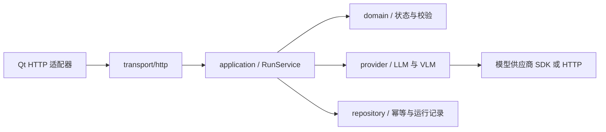

# 后续 Go 后端的实现约束

本轮不实现 Go HTTP 服务、数据库或模型 SDK。已经实现的是 Qt 客户端、本地流程演示、真实 HTTP 适配器、pipeline 与时间线。后续 Go 服务应实现 [OpenAPI 3.1.1 契约](../api/openapi.json)，不能另起一套路径、字段或状态。

## 唯一依据与校验

`api/openapi.json` 是 HTTP 路由、方法、状态码和鉴权的依据；`api/schemas/` 是 DTO 的依据。JSON 是 OpenAPI 支持的文档格式，可直接导入支持 3.1 的 Swagger、Redoc 或 API 调试工具。外部 `$ref` 必须与主文档一并分发。

规范采用 [OpenAPI 3.1.1](https://spec.openapis.org/oas/v3.1.1.html) 与 JSON Schema 2020-12。选用生成器之前，先验证它支持 3.1、外部 `$ref`、`if/then` 和 `additionalProperties:false`；不能静默降级到 3.0 后丢掉 VLM 图片条件。请求/响应正反例见 [examples.json](../api/examples.json) 与 [规范测试](../tests/test_api_contract.py)。

Qt 的 `ApiContract` 从嵌入的同一份文档按 operationId 查方法和路径，验证请求、响应与本地编排 DTO。它只实现本契约实际使用的受控关键字，遇到未知关键字拒绝校验；不是完整通用 JSON Schema 引擎。规范本身另外使用标准校验器验收。

## 模块依赖



transport 只处理鉴权、限额、JSON、状态码和问题响应；application 负责幂等创建、执行、取消及修订号；domain 不引入 HTTP 框架或模型 SDK；provider 不直接访问工程数据库或 GPU。

Go provider 接口可以采用下面的形态。`RunRequest`、`RunSnapshot` 和 `ModelCapability` 的字段以 OpenAPI 生成为准，示意不提供第二份 DTO 定义：

```go
type ModelProvider interface {
    Capabilities(ctx context.Context) ([]ModelCapability, error)
    Execute(ctx context.Context, request RunRequest,
        publish func(RunSnapshot) error) error
}
```

供应商的文本增量、工具调用、图片编码和错误需要在 provider 内归一化。发布给客户端的 message 始终是累计文本；shots 只能是受限的镜头标题与时长。模型不能返回客户端要执行的 C++、GL、Shell、Python 或任意函数名。

## 四个接口必须满足的行为

| operationId | HTTP | 结果 |
| --- | --- | --- |
| getCapabilities | GET /v1/capabilities | 200；当前账号可用的 model id、中文 label、llm/vlm 能力与 200–10000 ms 轮询间隔 |
| createRun | POST /v1/runs | 202；立即返回 queued/running 快照，不等待推理完成 |
| getRun | GET /v1/runs/{run_id} | 200；完整快照，客户端替换文本和进度 |
| cancelRun | POST /v1/runs/{run_id}/cancel | 200；完成取消；修订冲突或已完成/失败返回 409 |

所有接口使用 bearer 身份。运行记录须验证账号归属，不能仅凭 UUID 查询其他用户的记录。HTTP 客户端的 token 仅留在会话中，不写进 `.luma`、日志或请求错误文本。项目内的本地视频路径不是服务可读取的资产地址，不发送给模型服务。

### 幂等与运行状态

`Idempotency-Key` 为 UUID，按账号与 createRun 作用域保存 24 小时。使用原子唯一约束解决同时创建；相同键且相同规范化 body 返回原任务快照，不重复计费或调用模型；键相同、body 不同返回 409。

```text
queued → running → succeeded
   └──────┴─────→ failed
   └──────┴─────→ cancelled
```

每次快照内容变化都增加 revision；相同 revision 必须代表相同快照。终态不可回到运行中。取消使用 expected_revision 原子比较更新，同时取消 provider 的 context；迟到的 token 或结果不能把 cancelled 改成 succeeded。

若取消冲突，客户端重新读取快照并最多重试三次；若已成为成功/失败终态，保留该终态。Go 实现需要将 provider context 与运行记录关联，不能仅标记数据库却让模型无限继续。断线重连通过 getRun 获取累计快照，无须重放文本增量。本轮没有 SSE/WebSocket 接口。

### 请求与输出边界

- JSON 请求体不超过 6 MiB；最多 40 条上下文消息，每条 1–4000 字符，图片最多 2 张。
- VLM 必须有图；图片仅 PNG/JPEG 的 base64，服务端实际解码并检查大小与尺寸。前端默认缩到 1280 像素并压缩 JPEG。
- model_id 必须来自能力列表，并匹配所选 capability；不可把无视觉能力的模型当成 VLM 使用。
- 镜头建议最多 12 个，标题 1–120 字符，时长 100–60000 ms。时间线跨字段不变量由领域模型校验。
- HTTP 单请求超时不代表 provider 已取消。运行总超时、取消和 terminal 写入需要 application 统一处理；客户端三分钟后进入取消协调，等待在途请求结束（单请求最多 15 秒）后发送取消，再反馈超时。网络不可达时不能保证远端取消，后端必须实现自己的截止时间。
- 供应商密钥只放在 Go 服务配置中，Qt 的 bearer 是本应用服务令牌，不是供应商密钥。

错误使用 `application/problem+json`，字段严格对应 common.Problem：type、title、status、detail、request_id。建议区分 400 JSON 错误、401 身份错误、403 权限错误、404 不存在、409 状态/幂等冲突、413 超限、422 DTO/能力不匹配、429 限流和 502/503 上游错误；不得返回 HTTP 200 包裹失败。

## 本地数据与执行边界

StudioDocument、Pipeline 与 Timeline 也有 schema，但本轮仅用于客户端持久化与验证，没有假设已经存在后端工程同步接口。`.luma` v2 的 studio 扩展保存对话、镜头方案、资产索引、内嵌静帧与时间线。视频以本地路径引用，不复制原文件。工程上限 16 MiB，媒体缺失时在播放/恢复中反馈。

GPU 帧采集和时间线组装由 Qt 在主线程执行；模型分析完成后先进入人工确认。当前建议使用引用图片创建静帧片段，视频来自用户本地导入，不包含视频生成或编码导出。后续增加上传、工程同步或视频渲染时，先补充 OpenAPI 和测试，再实现 Go handler 与客户端适配。

## 接入验收

1. 运行 OpenAPI 与示例校验，拒绝未知字段、VLM 空图片和错误类型。
2. Go 服务通过同一组 create/get/cancel 用例，包括幂等重放、revision 冲突、迟到结果及供应商失败。
3. Qt 切到 HTTP 模式，填服务地址与应用令牌，连接读取模型后实际发送 LLM/VLM；本地演示模式不作为模型推理验收。
4. 验证保存工程不会包含 token、供应商密钥或网络请求附件的隐式上传配置。
