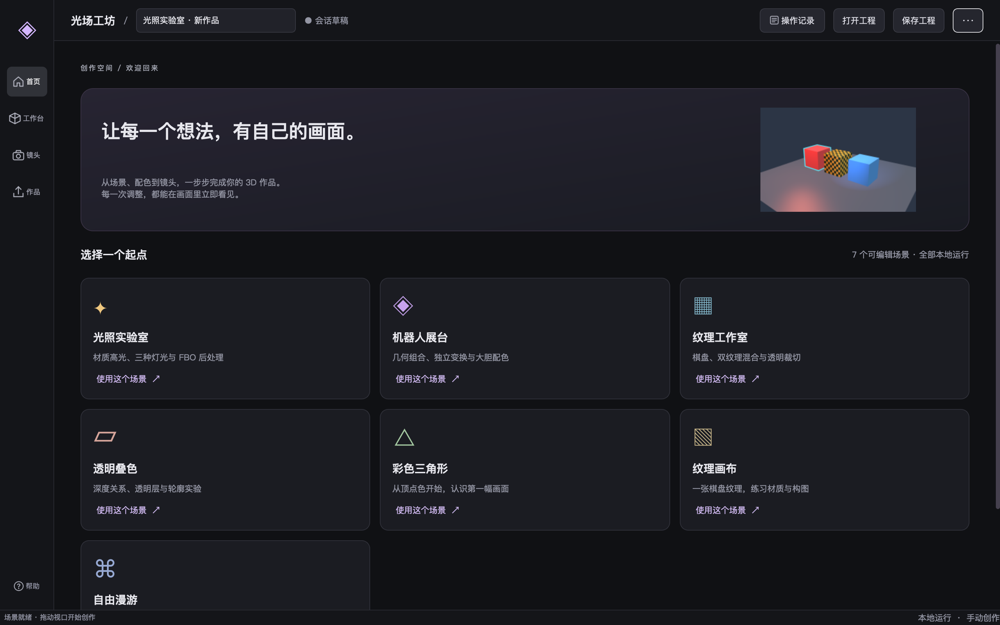
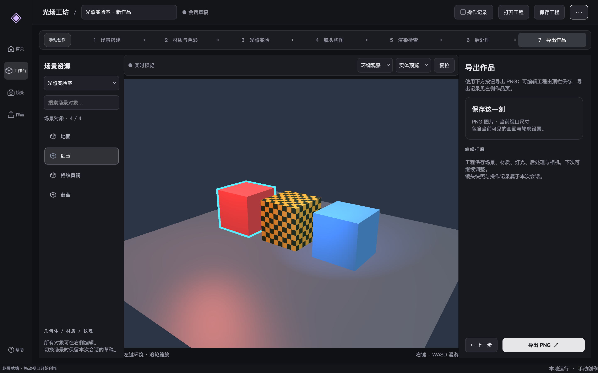
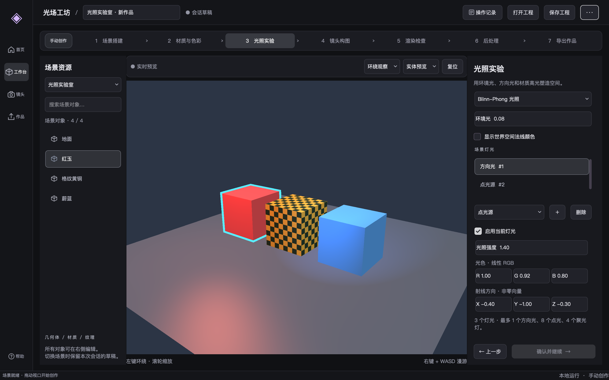
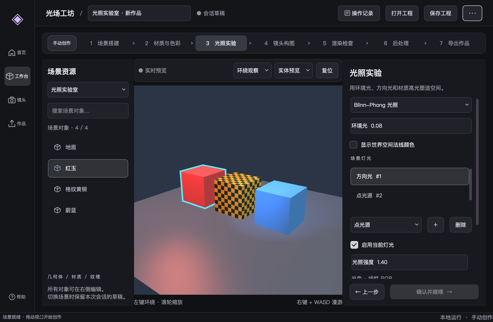
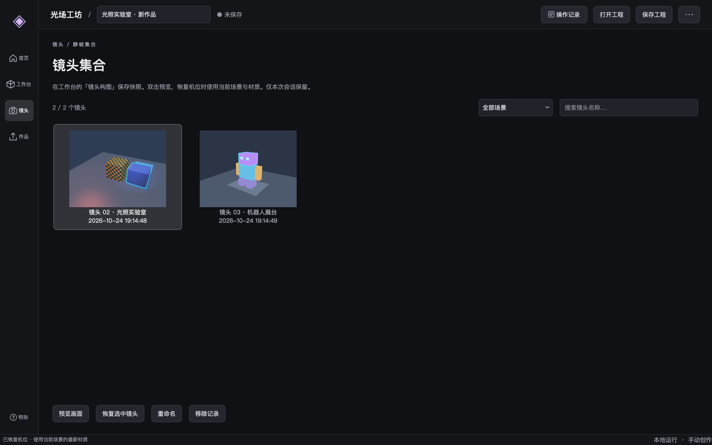
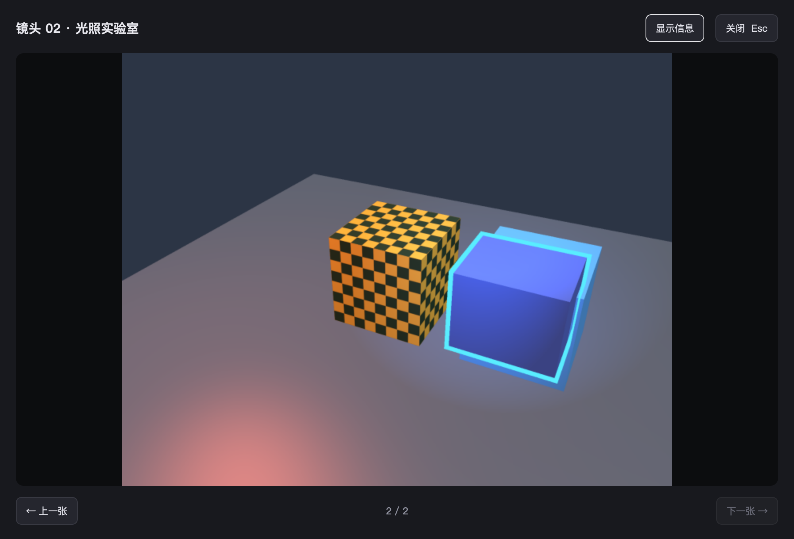
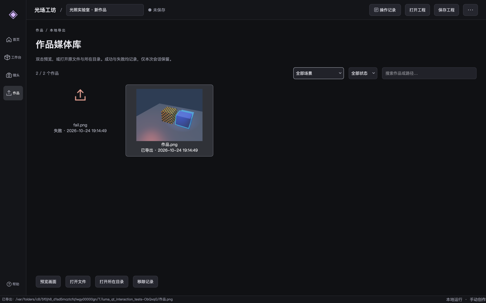

# Qt 工作台交互逐项审计

检查对象：`native/build/bin/luma_qt_workbench`，当前 Qt 主程序。参考：用户提供的 [Pixo 媒体页](https://pixo.video/zh/539-04a9405c/projects/01a14299-2568-7fc1-9212-f221a8d02472?view=media)，2026-10-24 在用户已登录浏览器中实际查看。没有修改参考工程内容。

检查前的结论：旧版本已有主要按钮回调，但不能称为完整交互验收，更不能称为深入交互严格复刻 Pixo。下面列出本轮补全后的行为、证据和保留的差异。

后续入口去重已完成，下面的控件清单与截图为精简后的版本。此前 135 项交互检查中，删除了加号和顶栏导出跳转两项已废弃入口的检查；保留功能通过原入口继续验证，当前共 133 项。

## 控件清单

| 范围 | 已接通的操作 | 边界与反馈 | 验证位置 |
| --- | --- | --- | --- |
| 侧栏 | 首页、工作台、镜头、作品、帮助 | 页面导航唯一可见入口；当前页选中，帮助为中文 | qt_control_checks.cpp |
| 首页 | 7 张模板卡、当前画面概览 | 模板真正创建新工程；替换前处理未保存修改 | qt_control_checks.cpp、qt_tests.cpp |
| 顶栏 | 作品命名、操作记录、打开、保存、项目菜单 | 操作抽屉开关与关闭按钮同步；打开/保存不在页面和菜单重复 | qt_project_interactions.cpp、qt_control_checks.cpp |
| 项目菜单 | 新建当前场景、另存为 | 新建恢复默认场景；另存为独立对话框 | qt_project_interactions.cpp |
| 七步流程 | 任意阶段导航、上一步、确认并继续、导出 | 前序未确认时禁用确认；可自由编辑，临时导出仍可用 | qt_tests.cpp、workflow_tests.cpp |
| 场景 | 8 个预设、搜索、对象选择、XYZ/TRS、重置变换 | 搜索显示可见/总数；取消选择清空 Controller 选中；空场景禁用对象动作 | qt_control_checks.cpp |
| 材质 | 颜色选择器、RGBA、高光 RGB/光泽、双纹理混合、透明模式、双面、独立材质 | 取消颜色不修改；sRGB 转线性；仅编辑目标字段；无对象禁用 | qt_tests.cpp、qt_interaction_tests.cpp、qt_control_checks.cpp |
| 灯光 | 着色模型、环境光、法线显示、三类灯光增删、启用/颜色/强度/位置/方向/衰减/锥角 | 达到对应容量禁用添加；取消选择禁用删除/参数；非法参数恢复模型值 | qt_tests.cpp、qt_control_checks.cpp、lighting_tests.cpp |
| 相机 | 环绕/第一人称、实体/线框、复位、4 个机位、快照、鼠标/滚轮/WASD | 构图阶段创建快照，侧栏进入集合；复位取真实预设默认 | qt_tests.cpp、qt_interaction_tests.cpp |
| 渲染检查 | 深度、剔除、混合、轮廓、4 个背景色 | 背景显示当前选中；开关修改真实 Renderer 配置 | qt_control_checks.cpp、gl_tests.cpp |
| 后处理 | 启用、5 种选项、强度、模糊半径 | 关闭或 None 时强度禁用；半径仅在启用模糊时可用；单字段编辑 | qt_tests.cpp、qt_interaction_tests.cpp、lighting_gl_tests.cpp |
| 镜头媒体库 | 搜索、场景筛选、计数、双击/按钮预览、前后切换、详情开关、恢复、重命名、移除、右键菜单 | 无选择禁用动作；搜索无结果单独反馈；空名拒绝；移除须确认；跨预设恢复正确机位 | qt_media_checks.cpp |
| 作品媒体库 | 搜索、场景/成功失败筛选、计数、预览、打开文件、打开目录、移除、右键菜单 | 失败记录不能打开/预览；原文件缺失给出错误；移除记录保留磁盘文件 | qt_media_checks.cpp |
| 存档 | `.luma` 保存、另存为、打开、关闭保护 | 原子提交、v1/v2、非法文档不破坏场景；保存取消不继续替换；后缀在覆盖确认前确定 | qt_tests.cpp、qt_project_interactions.cpp |
| 导出 | PNG 选择路径、真实保存、成功/失败记录 | 视口隐藏时也可导出；缺目录明确失败；无扩展名按 PNG 确认覆盖 | qt_media_checks.cpp、qt_project_interactions.cpp |
| 通用样式 | 悬停、按下、选中、禁用、键盘焦点、菜单、复选勾与下拉箭头 | 中性深色、浅色主动作；语义对象名不再导致主按钮样式丢失 | WorkbenchTheme.cpp、QtUiHelpers.hpp、实际截图 |

表中 Qt 测试位于 `native/tests/`。CPU 校验和 GPU 测试用于验证相应底层行为，不代表逐个执行系统原生文件选择器；新增弹窗回归仅在测试应用中关闭原生对话框，以便真实输入文件名、选择和取消。

## 本轮实际修正的问题

1. 光照场景点击复位得到通用 `(5,3.3,7)`，与真正初始 `(6,3.8,8)` 不一致。QtViewport 在构建预设后记录默认 Camera，复位通过 Controller 应用。
2. 修改光泽度、X 或后处理开关，会将其他表单中的四位精度值重写成两位。改为从模型复制候选，只写 field/component；回归使用 `.075`、`.1234` 等真实数据。
3. 已有路径仍反复弹保存位置，场景草稿还丢失路径和确认状态。现在区分保存/另存为，Draft 保留 document/path/workflow/dirty。
4. 打开工程没有未保存保护。现在打开、新建、关闭共用中文的保存/放弃/取消规则。
5. 输入无扩展名时在对话框关闭后才加后缀，可能绕过最终文件的覆盖确认。现在先设置 defaultSuffix，确认的是最终路径，显式错误后缀会拒绝。
6. Ctrl 取消选中卡片/灯光后 currentItem 仍存在，动作可能操作无高亮的记录。现在同时检查实际 selection，并监听 itemSelectionChanged。
7. 灯光达到上限、空场景、未选中快照等入口仍可点。对应动作改为禁用并说明原因。
8. 镜头/作品只有薄列表，缺预览、筛选和无结果反馈。拆出可复用 MediaGallery 与 MediaPreviewDialog。
9. 原文件被外部删除后打开没有明确反馈；现在报错并建议重新导出。
10. 对象搜索在重建后显示总数，容易误以为对象丢失；现在统一计算可见/总数。
11. 语义 objectName 覆盖了 primary 等样式名。主题改用 variant 属性，保留测试/无障碍对象名；补充勾选、焦点、禁用和菜单状态。

## 与 Pixo 的对照

| Pixo 实测行为 | 本项目的处理 | 对齐程度 |
| --- | --- | --- |
| 深色底、紧凑导航、浅色当前动作 | 中性深色主题、浅色主按钮、明确选中状态 | 视觉语言适配 |
| 媒体卡片、数量、类别筛选 | 镜头/作品卡片、可见/总数、场景和成功失败筛选 | 按本地业务适配 |
| 左侧镜头/资产分组并跳转 | 原生场景下拉筛选，避免挤占较小桌面窗口 | 保留布局差异 |
| 图片预览、上一张/下一张、计数、信息栏开关 | MediaPreviewDialog，左右键、Esc、边界禁用、完整像素画面 | 主要操作对齐 |
| 卡片悬停下载/预览 | 双击预览、选择后的动作区和右键菜单 | 使用桌面操作方式，未做相同悬浮按钮 |
| 项目菜单的设置、记忆、智能体入口 | 菜单保留新建当前场景、另存为；打开/保存走顶栏，帮助走侧栏 | 按当前业务替换并去重 |
| AI 对话区、视频/音频、时间线、发布/分享/积分 | 当前没有这些业务，不设置无效按钮 | 尚未实现，按后续阶段安排 |

因此这版是**参考 Pixo 的交互方式并适配 3D 的 Qt 软件**，不是该网站全部页面、像素、动画和响应逻辑的严格复刻。不能用本报告证明全站复刻完成。

Pixo 本次点击“图片”筛选时返回 0 项，但“全部”中可见图片。这是本次参考页实测现象，本项目的场景/状态筛选按自己的真实记录执行，不复刻这一现象。

## 重复入口清理

共删除 11 个按钮、4 个菜单项，连同其构建代码和信号连接一起删除：

| 删除的位置 | 重复行为 | 保留的入口 |
| --- | --- | --- |
| 侧栏加号 | 与首页完全相同的 `showPage(0)` | 侧栏首页 |
| 首页继续创作、打开本地工程 | 与工作台导航、顶栏打开相同 | 侧栏工作台、顶栏打开 |
| 镜头页保存当前镜头 | 在视口已隐藏时再次拍摄，且与构图阶段快照相同 | 工作台镜头构图的保存快照 |
| 镜头页返回工作台、作品页继续创作 | 重复工作台导航 | 侧栏工作台 |
| 构图阶段查看全部镜头 | 重复镜头页导航 | 侧栏镜头 |
| 导出阶段内部导出、保存、查看记录 | 分别重复底部导出、顶栏保存、作品页导航 | 导出阶段底部唯一按钮、顶栏保存、侧栏作品 |
| 顶栏导出设置 | 重复流程条的导出阶段导航 | 流程条第七阶段 |
| 菜单从模板新建、打开、保存、使用说明 | 重复侧栏和顶栏 | 侧栏首页/帮助，顶栏打开/保存 |

菜单只保留新建当前场景工程与另存为，都是独立业务。颜色选择器与精确数值、快捷键与右键菜单仍有不同使用方式，予以保留。

同时删除没人读取的 `shots_`、`exports_` 别名与 `exportCount_`，以及相关多余 include、空动作布局和未来课程提示。没有通过隐藏控件、兼容空壳或另一套回调保留废弃设计；导出按钮的动态提示和无障碍名称也随当前阶段更新。规则已加入[开发边界](../development-boundaries.md)。

## 模块边界

`MediaGallery` 只依赖 Qt：MediaEntry、筛选、选择、上下文菜单及记录动作。通过 onRestore/onRename/onRemove 回调连接镜头业务，不接触 OpenGL。

`MediaPreviewDialog` 只负责图像、元信息、当前索引与键盘导航。`WorkbenchMediaActions` 负责实际截图、相机恢复与 PNG；`WorkbenchProjectActions` 负责文件对话框、脏状态保护和项目菜单。编辑仍走 `View → EditorController → EditorModel`。

快照、草稿、任务和作品记录仍仅本次会话保留。没有加入数据库、后台调度、AI SDK 或任意外部资产导入。文件行数仍由 [开发边界脚本](../../tools/check-native-boundaries.py) 强制检查。

## 复现命令

在工作区根目录执行：

```sh
cmake --build opengl_visual_workbench/native/build -j4
ctest --test-dir opengl_visual_workbench/native/build --output-on-failure
opengl_visual_workbench/native/build/bin/luma_qt_tests
opengl_visual_workbench/native/build/bin/luma_qt_interaction_tests
opengl_visual_workbench/native/build/bin/luma_lighting_gl_tests --hidden
python3 opengl_visual_workbench/tools/check-native-boundaries.py
```

## 实际验收结果

2026-10-24，Apple M2 Pro / OpenGL 4.1 Metal：

- 全量 CMake 构建：成功，无新增编译警告。
- CTest：8/8 通过。
- 原 Qt 回归：通过（含真实 WASD、MVP/FBO 像素、工程读写、坏文档、共享材质和导出）。
- 去重后交互回归：133 checks, 0 interaction failures（原有两项已删除入口检查一并删除）。
- GL 光照回归：通过（shader、法线、三类灯光、衰减与后处理）。
- 文件边界：131 个手写原生文件全部符合上限。
- 中文离线阅读器：4/4 测试通过，5 章 HTML 已重新生成；修正了代码块内 C++ lambda 被误识别为 Markdown 链接的问题。
- 独立静态审查：修正选择状态、覆盖确认和计数问题后，无剩余阻断项。

“打开文件/目录”的回归检查 Qt 实际分发的 file URL，测试期间不打开其他应用；系统关联软件如何展示文件属于操作系统行为。原 Qt 测试首次因桌面窗口焦点未激活失败，恢复焦点后整套通过。新增回归早期的弹窗崩溃来自测试将错误弹窗当作预览读取，已修正并全套通过；未将失败运行计作通过。

Qt 在本机仍输出已有的 macOS container layer 和一次 sampler 诊断，像素验证与实际导出通过。QtSvg 插件未安装，因此勾选和下拉图标使用内嵌 PNG，不要求额外依赖。

### 实际截图














